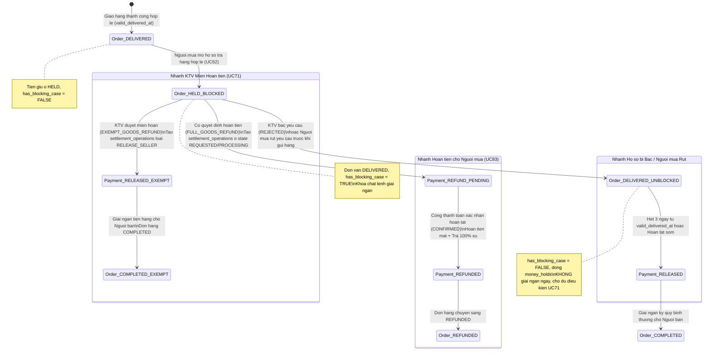

# Kế hoạch Triển khai Tính năng Trả hàng & Xử lý Tranh chấp Nhiều Vòng (Multi-Round Return & Dispute Workflow)

> [!NOTE]
> Tài liệu di chuyển từ nhánh PR #17 (`tasks/complaint_plan.md`) vào `docs/architecture/` theo `docs/PROJECT_STRUCTURE.md` (Đợt 1 — `TASK-0119`).
> Khi tích hợp lên `main`, toàn bộ chuỗi Flyway của nhánh PR #17 đã được đánh số lại **V37–V51 -> V41–V55** để hòa hợp với **V37–V40** của `main` (`chat_moderation` & `dispute_arbitration_and_reviews`), đồng thời giữ vận hành song song **Dual-Track** (`LEGACY_V14` + `UC83`).

> **Căn cứ tài liệu**: Báo cáo đồ án tốt nghiệp (`Báo_cáo_đồ_án.docx`: UC22, UC26, UC27, UC33, UC40, UC52, UC62, UC63, UC71, UC75, UC83).  
> **Tệp trích xuất văn bản**: `tasks/bao_cao_extracted.txt` (9.426 dòng trích xuất nguyên văn từ `Báo_cáo_đồ_án.docx`).  
> **Kiến trúc dữ liệu hiện có**: PostgreSQL schema `og_compat` & `public` (V18, V19, V22: `cases`, `case_rounds`, `case_decisions`, `case_evidence`, `case_events`, `money_holds`, `settlement_operations`, `shipments`).

---

## 0. Các Quyết định Đã Chốt (Core Decisions)

- **D1**: Trả hàng sau giao CHỈ xảy ra thông qua yêu cầu khiếu nại trả hàng (UC62). Kiểm duyệt viên (KTV) là người phân xử và quyết định cuối cùng.
- **D2**: Người bán KHÔNG chỉ "được biết" thụ động mà có **3 vai trò chủ động**:
  * **(a) Vòng 1**: Có 2 lựa chọn: `[Chấp thuận trả]` hoặc `[Không đồng ý, chuyển KTV]`. KTV thấy hồ sơ ngay khi `OPEN` và có toàn quyền duyệt cho trả dù Người bán không đồng ý (UC62 7b). KTV không phải đợi Người bán từ chối mới thấy hồ sơ.
  * **(b) Theo dõi hàng trả**: Khi Người mua gửi hàng trả, Người bán có một màn hình **"Hàng trả"** hiển thị mã vận đơn và tiến trình giao hàng chiều về (`shipments.leg = 'RETURN'`) giống phía Người mua (UC33).
  * **(c) Vòng 2**: Khi hàng về, Người bán kiểm tra hàng thực tế và có **2 lựa chọn rõ ràng**:
    - `[Hàng đúng, đồng ý hoàn tiền]` -> Kích hoạt lệnh hoàn tiền ngay cho Người mua.
    - `[Hàng có vấn đề, gửi đề nghị xét lại]` kèm bằng chứng (tối đa 5 ảnh, 2 video <= 60 giây) đề nghị KTV miễn hoàn tiền.
    Hạn phản hồi: **2 ngày** kể từ khi nhận lại hàng. Nếu Người bán không chọn gì trong hạn, hệ thống tự động hoàn tiền 100% (UC83).
- **D3**: "Nhận lại hàng" KHÔNG đồng nghĩa với "đồng ý hoàn tiền" (BR-UC33-02). Nhận lại chỉ ghi nhận mốc `valid_returned_at` và mở thời hạn 2 ngày phản hồi. Ghi nhận nhận lại đến từ: Sự kiện vận đơn giao thành công (mô phỏng GHN), hoặc OTP / hai bên xác nhận (nếu trả trực tiếp), tuyệt đối không phụ thuộc vào một nút bấm cảm tính của Người bán.
- **D4**: Phản hồi "khiếu nại" của Người bán ở Vòng 2 là **ĐỀ NGHỊ XÉT LẠI**, không phải quyết định. Người bán **KHÔNG ĐƯỢC TỰ QUYẾT TỪ CHỐI HOÀN TIỀN** (BR-UC63-02, BR-UC33-03); chỉ KTV mới có thẩm quyền ra quyết định miễn hoàn. Khi có đề nghị hợp lệ, hệ thống tiếp tục giữ tiền.
- **D5**: Mở rộng câu chữ báo cáo đồ án: Cụm từ *"hư hỏng nghiêm trọng"* được mở rộng thành:
  > *"hàng trả hư hỏng nghiêm trọng HOẶC không đúng với hàng đã giao (tráo hàng, sai hàng, thiếu hàng)"*.
  Phải sửa đồng bộ toàn bộ các Use Case liên quan trong báo cáo (xem bảng chi tiết tại Mục 7).
- **D6**: Đơn hàng **GIỮ TRẠNG THÁI `DELIVERED`**. Tuyệt đối **KHÔNG dùng `STATUS_DISPUTED` làm trạng thái đơn hàng**; trạng thái có tranh chấp được suy ra từ cờ quan hệ hồ sơ (`has_blocking_case = true` qua hàm DB `og_order_has_blocking_case`).
- **D7 (Quyết định Schema Cases cho Task 2.2)**: Task 2.2 sử dụng **schema `cases` hiện tại** (V19/V22: `case_type`, `order_id`, `created_by`, `description`, `state`, `command_key`) và **KHÔNG** tạo migration schema mới (V37).
  * *Căn cứ & Lý do kỹ thuật*: `CaseEntity` và `CaseRepository` đã được ánh xạ chuẩn xác với view `og_compat.cases` và vượt qua kiểm thử `ddl-auto=validate` trên PostgreSQL thật (`CaseEntitiesPostgresTest`).
  * *Cơ chế mã hóa lý do trả hàng*: Mã lý do chuẩn (`ReturnReasonCode`: `CHANGE_MIND`, `NOT_AS_DESCRIBED`, `DAMAGED_OR_DEFECTIVE`) được đóng gói và phân tích qua `ReturnReasonCode.format(code, explanation)` và `ReturnReasonCode.parse(description)` lưu trong cột `description`. Cách làm này đảm bảo 100% toàn vẹn dữ liệu, không làm lệch trigger DB hiện hành (`og_guard_return_case`), và tránh rủi ro vỡ `ddl-auto=validate`.

---

## 1. Phạm vi Triển khai (Scope Boundaries)

### 1.1. Trong Phạm vi (In-Scope - Thực hiện trong giai đoạn này)
1. **UC62 (Yêu cầu trả hàng)**: Người mua gửi yêu cầu trả hàng với đầy đủ 6 điều kiện, 3 lý do chuẩn hóa, upload bằng chứng (tối đa 5 ảnh, 2 video <= 60s), tự động kích hoạt `money_holds`. Rút yêu cầu trước khi gửi hàng trả (7c).
2. **UC27 & UC71 (Tách Hoàn tất sớm khỏi Xác nhận nhận hàng)**:
   - Nút "Đã nhận hàng" chỉ ghi nhận xác nhận nhận hàng của Người mua (`received_at`), không đóng quyền trả hàng và không giải ngân ngay.
   - Nút "Hoàn tất sớm" (`earlyCompleteOrder`): yêu cầu đồng thuận cảnh báo từ bỏ quyền trả hàng (`warningConsent`), gọi `og_early_complete_order`, chặn khi có hồ sơ tranh chấp đang mở.
3. **Vòng 1 (RETURN_APPROVAL - Xét duyệt trả hàng)**:
   - Người bán chọn: `[Chấp thuận trả]` (`APPROVE_RETURN`) hoặc `[Không đồng ý, chuyển KTV]` (`SELLER_DECLINED`).
   - KTV thấy hồ sơ ngay khi `OPEN`, có quyền duyệt `APPROVE_RETURN` hoặc bác `REJECT_RETURN` (kèm lý do).
   - KTV bác yêu cầu -> chuyển `REJECTED`, **không giải ngân ngay** mà chờ đủ điều kiện UC71 (hết 3 ngày từ `valid_delivered_at` hoặc Hoàn tất sớm).
   - Quy tắc đua quyết định Vòng 1: Ghi trước thắng, ghi sau bị từ chối; hạn 48h của Người bán là SLA hành vi, không chặn KTV.
4. **UC33 (Vận chuyển hàng trả)**:
   - Quản lý vận đơn chiều về (`shipments.leg = 'RETURN'`).
   - Hạn gửi hàng trả: 3 ngày hoặc 3 lần lấy hàng thất bại. Lỗi ĐVVC mô phỏng không tự quy kết lỗi Người mua.
   - Ghi nhận `valid_returned_at` từ webhook vận đơn hoặc xác nhận bàn giao trực tiếp hai bên (`og_consume_handover_otp` / `og_confirm_direct_handover`), mở hạn 2 ngày cho Người bán.
5. **Vòng 2 (POST_RETURN_RESOLUTION - Giải quyết sau nhận lại hàng)**:
   - Người bán có 2 lựa chọn: `[Hàng đúng, đồng ý hoàn tiền]` (endpoint `agree-refund`) hoặc `[Hàng có vấn đề, gửi đề nghị xét lại]` (`submitDamageExemptionRequest` hỗ trợ hàng hỏng hoặc tráo hàng/sai hàng).
   - Bộ đếm ngược 2 ngày phản hồi của Người bán (`seller_response_due_at`).
   - KTV phân xử Vòng 2: `FULL_GOODS_REFUND` (hoàn tiền Người mua) hoặc `EXEMPT_GOODS_REFUND` (miễn hoàn tiền, giải ngân Người bán).
6. **Hệ thống Worker Tự động**:
   - Worker 1: Quá hạn 2 ngày Người bán im lặng -> tự động `SYSTEM_TIMEOUT` + `FULL_GOODS_REFUND` (UC83).
   - Worker 2: Quá hạn 3 ngày từ `valid_delivered_at` -> tự động giải ngân cho đơn `DELIVERED` đủ điều kiện (kể cả đơn `return_allowed = false`).
7. **UC83 & UC22 (Hạch toán hoàn tiền)**:
   - Hoàn tiền hàng thực trả sau voucher và xu phân bổ cho hàng.
   - Trả lại 100% xu đã dùng trong đơn (kể cả xu dùng cho ship). Không hoàn phí ship tiền mặt, không hoàn phí đăng tin, không cấp lại voucher.
   - Xử lý đơn 0 đồng (Ví dụ UC83-07): không tạo giao dịch hoàn tiền 0đ.
   - Nhánh `EXEMPT_GOODS_REFUND`: không hoàn tiền hàng, không trả xu theo trường hợp hoàn thông thường; giải ngân Người bán theo BR-UC71-01/05.
   - Phân biệt quyết định hoàn và đã hoàn xong (`REFUND_PENDING` -> `CONFIRMED` qua `settlement_operations`).
8. **KTV Workbench & Admin Monitoring**:
   - Màn hình KTV Workbench: hàng đợi hồ sơ `OPEN` và `REVIEWING`, đối chiếu bằng chứng hai bên, cảnh báo SLA 48h tính từ khi hồ sơ đủ nội dung (`complete_submission_at`).
   - Màn hình/Endpoint Admin theo dõi hồ sơ `ESCALATED` quá hạn 48h KTV.

### 1.2. Hoãn sang Giai đoạn Sau (Out-of-Scope / Deferred Post-MVP)
1. **Thông báo Đẩy Thời gian thực (UC40, UC48, UC52 - Push Notifications / WebSockets)**:
   - *Lý do hoãn*: Việc thiết lập hạ tầng WebSocket / FCM push cần cấu hình máy chủ riêng. Trong phạm vi đồ án, toàn bộ sự kiện thông báo được ghi nhận đầy đủ vào cơ sở dữ liệu (`case_events` và bảng thông báo hệ thống); đồng thời giao diện Frontend hiển thị trạng thái hồ sơ tức thời trong màn hình chi tiết đơn hàng của Người mua và Người bán.
2. **Khiếu nại Lỗi Hệ thống / Thu tiền (UC64, UC76)**:
   - *Lý do hoãn*: UC64 và UC76 xử lý các tranh chấp kỹ thuật ngoài luồng trả hàng (lỗi trừ tiền ví, lỗi hệ thống). Luồng này được tách riêng, không nằm trong quy trình trả hàng của đơn mua.
3. **Tích hợp Bưu tá Thực tế (GHN Real Postman Integration)**:
   - *Lý do hoãn*: Chiều trả hàng sử dụng cơ chế mô phỏng sự kiện vận chuyển GHN (webhook simulation) theo đúng đặc tả UC33 và UC83 của đồ án.

---

## 2. Sơ đồ Chuyển Trạng thái (Hai Sơ đồ Mermaid Độc lập)

### 2.1. Sơ đồ 1: Vòng đời Trạng thái Hồ sơ Trả hàng (`cases.state` & `case_rounds`)

```mermaid
stateDiagram-v2
    [*] --> OPEN: Nguoi mua tao ho so tra hang (UC62)\n[Kiem tra du 6 dieu kien]

    state "VONG 1: RETURN_APPROVAL (Xet duyet tra hang)" as Round1 {
        OPEN --> RETURN_APPROVED: Nguoi ban chap thuan (APPROVE_RETURN)\nhoac KTV chu dong duyet
        OPEN --> REVIEWING: Nguoi ban tu choi (SELLER_DECLINED)
        REVIEWING --> RETURN_APPROVED: KTV duyet cho tra (APPROVE_RETURN)
        REVIEWING --> REJECTED: KTV bac yeu cau (REJECT_RETURN + ly do)
        OPEN --> REJECTED: KTV bac yeu cau ngay tu OPEN
    }

    state "VAN CHUYEN HANG TRA (UC33)" as ReturnShipping {
        RETURN_APPROVED --> RETURNING: Nguoi mua gui hang (Van don leg=RETURN)
        RETURNING --> POST_RETURN: Nguoi ban nhan lai hang hop le\n(valid_returned_at, mo han 2 ngay)
        RETURN_APPROVED --> CLOSED_EXPIRED: Qua 3 ngay hoac 3 lan lay that bai do loi Nguoi mua
    }

    state "VONG 2: POST_RETURN_RESOLUTION (Giai quyet sau khi nhan lai hang)" as Round2 {
        POST_RETURN --> CLOSED_REFUND: Nguoi ban dong y hoan tien (agree-refund)\nhoac Qua han 2 ngay tu dong hoan (SYSTEM_TIMEOUT)
        POST_RETURN --> POST_RETURN_OPEN: Nguoi ban nop de nghi xet lai\n(VALID_DAMAGE_REQUEST + <=5 anh, <=2 video)
        note right of POST_RETURN_OPEN: Nhan mo ta tien trinh nghiep vu;\nDB va Entity thuc te giu cases.state = POST_RETURN,\ncase_rounds.state = OPEN (khong dung state REVIEWING_R2)
        POST_RETURN_OPEN --> CLOSED_REFUND: KTV bac de nghi khong hoan\n(FULL_GOODS_REFUND cho Nguoi mua)
        POST_RETURN_OPEN --> CLOSED_EXEMPT: KTV chap thuan mien hoan\n(EXEMPT_GOODS_REFUND cho Nguoi ban)
    }

    REJECTED --> [*]: Dong ho so (Giai phong money_holds, cho giai ngan UC71)
    CLOSED_EXPIRED --> [*]: Dong ho so do loi Nguoi mua khong gui hang
    CLOSED_REFUND --> [*]: Dong ho so (Hoan tien Nguoi mua theo UC83)
    CLOSED_EXEMPT --> [*]: Dong ho so (Giai ngan tien hang cho Nguoi ban)
```



### 2.2. Sơ đồ 2: Trạng thái Tiền & Đơn hàng (`orders.status` & `settlement_operations`)



---

## 3. Quy tắc Tài chính, Hoàn tiền & Giải ngân (UC83, UC71, UC22)

### 3.1. Công thức Hoàn tiền Thực tế cho Người mua (UC83)
Theo quy tắc `BR-UC22-04`, xu tích lũy và voucher giảm giá trừ vào cả tiền hàng và phí vận chuyển:
- **Tiền mặt hoàn trả cho Người mua**:
  ```text
  Tiền mặt hoàn = Tiền hàng thực trả sau voucher và xu (phần phân bổ cho tiền hàng)
  CashRefund = subtotal - voucher_discount_amount_for_goods - points_discount_amount_for_goods
  ```
- **Quy tắc hoàn chi tiết**:
  1. **Tiền mặt**: Hoàn đúng bằng khoản tiền hàng thực trả sau giảm trừ.
  2. **Phí vận chuyển chiều mua**: **KHÔNG HOÀN** phần phí vận chuyển chiều mua đã trả bằng tiền mặt (BR-UC83-05).
  3. **Phí đăng tin**: **KHÔNG HOÀN** phí đăng tin (BR-UC83-05, BR-UC17-09).
  4. **Xu tích lũy**: **TRẢ LẠI 100% SỐ XU ĐÃ DÙNG** trong đơn hàng (kể cả phần xu đã dùng cho phí vận chuyển) theo BR-UC22-03 và BR-UC83-01.
  5. **Voucher khuyến mãi**: **KHÔNG CẤP LẠI VOUCHER** đã dùng (BR-UC22-03, BR-UC83-01).

### 3.2. Nhánh KTV Duyệt Miễn Hoàn tiền (`EXEMPT_GOODS_REFUND` - UC83 4d, BR-UC22-03)
Khi KTV chấp thuận không hoàn vì hàng trả hư hỏng nghiêm trọng hoặc không đúng hàng đã giao đủ căn cứ:
- **Đối với Người mua**: **KHÔNG hoàn tiền hàng**, **KHÔNG trả lại xu** theo trường hợp hoàn thông thường (UC83 4d, BR-UC22-03).
- **Đối với Người bán**: Giải ngân tiền hàng theo quy định `BR-UC71-01/05`:
  ```text
  Số giải ngân Người bán = Tiền hàng thực trả (sau voucher và xu) + Phần Sàn tài trợ voucher/xu cho hàng
  ```
  *(Lưu ý: Bỏ hoàn toàn khoản "Trừ phí sàn bán" vì báo cáo không quy định phí hoa hồng sàn. Không bao gồm phí vận chuyển và không bao gồm phí đăng tin; phí đăng tin Người bán đã thanh toán riêng từ trước).*

### 3.3. Kiểm thử Trường hợp Điển hình UC83-07 (Đơn hàng 0 đồng)
- **Kịch bản**: Đơn hàng có:
  * Tiền hàng (`subtotal`) = 100.000 VNĐ.
  * Phí vận chuyển (`shipping_fee`) = 10.000 VNĐ.
  * Voucher giảm giá = 10.000 VNĐ.
  * Sử dụng xu tích lũy = 100.000 xu (tương đương 100.000 VNĐ).
  * **Tổng tiền mặt Người mua thanh toán = 0 VNĐ**.
- **Kết quả xử lý khi hoàn tiền (UC83 5a)**:
  * Tiền mặt hoàn trả: **0 VNĐ** -> **TUYỆT ĐỐI KHÔNG TẠO GIAO DỊCH HOÀN TIỀN 0 ĐỒNG** sang cổng thanh toán / ngân hàng.
  * Hoàn trả xu: **Cộng trả lại đúng 100.000 xu** vào ví xu của Người mua.
  * Voucher: **Không cấp lại voucher 10.000 VNĐ**.

### 3.4. Phân biệt "Quyết định Hoàn tiền" và "Đã Hoàn xong" (BR-UC83-04)
- **Tách biệt trạng thái**:
  * Khi có quyết định hoàn tiền (Người bán đồng ý hoặc KTV phán quyết): Trạng thái thanh toán chuyển sang **`REFUND_PENDING`**.
  * Chỉ khi dịch vụ thanh toán / ngân hàng xác nhận giao dịch thành công, trạng thái mới chuyển sang **`REFUNDED`**.
- **Xử lý sự cố dịch vụ và hoàn từng phần (UC83 6a, 6b)**:
  * Kết quả hoàn chưa rõ hoặc lỗi dịch vụ: hiển thị "còn chờ", không báo đã hoàn, không chuyển lại ngay (tránh chuyển kép).
  * Tiền hoặc xu chỉ hoàn thành một phần: hiển thị rõ phần đã xong và phần cần tiếp tục.
- **Xác minh Bảng `settlement_operations`**:
  * Đã xác minh: Bảng `settlement_operations` **ĐÃ TỒN TẠI** trong Flyway migration `V18__payment_intents_and_component_settlement.sql` (dòng 242) và view `og_compat.settlement_operations` trong `V22__consolidate_database_to_48_tables.sql` (dòng 2826) với các trường: `operation_id` (UUID), `component_id`, `operation_type` (`REFUND_BUYER`, `RELEASE_SELLER`), `amount`, `cause_type` (`RETURN`, `EXEMPTION`, `COMPLETION`), `case_decision_id`, `state` (`REQUESTED`, `PROCESSING`, `CONFIRMED`, `FAILED`), `command_key`.

### 3.5. Chống Trùng lặp & Thứ tự Khóa Tài nguyên (BR-UC83-03)
- Tuyệt đối không vừa hoàn tiền vừa giải ngân cùng một khoản hai lần (BR-UC83-03).
- Mọi thao tác xử lý tiền và worker phải đảm bảo Idempotent thông qua `command_key` duy nhất.
- **Giao thức khóa tài nguyên chống Deadlock**: Tham chiếu chi tiết tại **Mục 3.0.1 (Unified Locking Protocol)**. Không sử dụng thứ tự cũ `Order → Payment → Case`. Thứ tự khóa tài chính con `orders → order_fund_components → settlement_operations` (đã dùng ở Task 2.1b) cần được đối chiếu toàn diện với Java Gateway Lock trong Task 3.0.1, không mặc định tương thích.

---

## 4. Quy tắc Hạn chờ, Worker & SLA

### 4.1. Đủ 6 Điều kiện Mở Yêu cầu Trả hàng (UC62, BR-UC62-02) & Tầng Kiểm tra

Hệ thống kiểm tra nghiêm ngặt cả **6 điều kiện nghiệp vụ** (kèm các ràng buộc kỹ thuật DB) trước khi cho phép tạo hồ sơ:

| STT | Điều kiện Nghiệp vụ (UC62, BR-UC62-02) | Tầng Kiểm tra | Căn cứ Kỹ thuật & Thân hàm Trigger DB |
| :---: | :--- | :--- | :--- |
| **1** | Đơn hàng `status == 'DELIVERED'` và có mốc `valid_delivered_at IS NOT NULL` | **Cả hai tầng**:<br>- `status == DELIVERED`: Application Service<br>- `valid_delivered_at IS NOT NULL`: DB Trigger | DB Trigger `og_guard_return_case` kiểm tra trực tiếp: `IF o.valid_delivered_at IS NULL THEN RAISE EXCEPTION 'Order has no current right to request return'`. Application Service kiểm tra `status == DELIVERED` trước khi khởi tạo case. |
| **2** | Đơn hàng cho phép trả hàng (`return_allowed == true`) | **DB Trigger & Service** | DB Trigger `og_guard_return_case` kiểm tra: `IF NOT o.return_allowed THEN RAISE EXCEPTION 'Order has no current right to request return'`. Ghi nhận cờ `return_allowed` lúc đặt hàng. |
| **3** | Trong thời hạn 3 ngày kể từ lúc giao hàng (`now() <= valid_delivered_at + 3 ngày`) | **DB Trigger & Service** | DB Trigger `og_guard_return_case` kiểm tra: `IF NEW.created_at > o.valid_delivered_at + INTERVAL '3 days' THEN RAISE EXCEPTION 'Order has no current right to request return'`. Xem/mở form nháp không kéo dài thời hạn 3 ngày. |
| **4** | Người mua chưa bấm Hoàn tất sớm (`early_completed_at IS NULL`) | **DB Trigger & Service** | DB Trigger `og_guard_return_case` kiểm tra: `IF o.early_completed_at IS NOT NULL THEN RAISE EXCEPTION 'Order has no current right to request return'`. |
| **5** | Tiền ký quỹ chưa giải ngân cuối cùng (`PaymentEntity.status != 'RELEASED'`) | **Application Service** | Application Service kiểm tra trạng thái thanh toán trước khi mở case. Cấp DB bảo vệ tài chính thông qua trigger `og_return_case_money_holds` tự động đóng băng các khoản `GOODS_CASH` / `PLATFORM_GOODS_SUBSIDY`. |
| **6** | Không có hồ sơ trả hàng/khiếu nại nào đang hoạt động cho đơn này | **Application Service & DB Unique Index** | Application Service gọi `og_order_has_blocking_case(order_id)`. Cấp DB bảo vệ qua index duy nhất `uq_return_case_active` trên `(order_id) WHERE state NOT IN ('CLOSED', 'REJECTED')`. |
| *Ràng buộc DB* | Đơn hàng phải thuộc mô hình `workflow_model = 'UC83'` | **DB Trigger** | DB Trigger `og_guard_return_case` kiểm tra: `IF o.workflow_model <> 'UC83' THEN RAISE EXCEPTION 'Order has no current right to request return'`. Đơn `LEGACY_V14` bị từ chối. |
| *Ràng buộc DB* | Người tạo hồ sơ phải chính là Người mua (`NEW.created_by = o.buyer_id`) | **DB Trigger & Service** | DB Trigger `og_guard_return_case` kiểm tra: `IF NEW.created_by <> o.buyer_id THEN RAISE EXCEPTION 'Order has no current right to request return'`. |
| *Ràng buộc DB* | Trạng thái khởi tạo của hồ sơ mới phải là `OPEN` | **DB Trigger** | DB Trigger `og_guard_return_case` kiểm tra: `IF NEW.state <> 'OPEN' THEN RAISE EXCEPTION 'New case starts open'`. |

### 4.2. Hạn Gửi Hàng Trả & Thu gom (UC33 3e)
- Khi hồ sơ ở trạng thái `RETURN_APPROVED`:
  * Thời hạn gửi hàng: **3 ngày** kể từ thời điểm chấp thuận HOẶC **3 lần bưu tá lấy hàng thất bại**, mốc nào đến trước thì dừng thu gom (UC33 3e).
  * Mô phỏng bưu tá GHN: Lần lấy đầu tiên dự kiến trong 24 giờ (`pickup_expected_at = approved_at + 24 hours`), nếu thất bại thì hẹn lại trong cửa sổ 3 ngày (`pickup_deadline = approved_at + 3 days`).
  * Xử lý thất bại (3d, 3e): Lỗi ĐVVC mô phỏng không tự quy kết lỗi Người mua. Nếu có phản đối, lỗi vận chuyển hoặc chưa rõ nguyên nhân -> chuyển KTV và tiếp tục giữ tiền; nếu có căn cứ rõ ràng do lỗi Người mua không giao hàng -> đóng hồ sơ (`CLOSED_EXPIRED`).

### 4.3. Cơ chế Ghi nhận "Nhận lại Hàng" Chống kẹt Hồ sơ (D3 & UC33)
- `valid_returned_at` được ghi nhận từ:
  1. *Đơn hàng qua đơn vị vận chuyển*: Webhook / sự kiện giao hàng thành công của vận đơn chiều trả (`shipments.leg = 'RETURN'`).
  2. *Giao dịch bàn giao trực tiếp*: Người mua và Người bán cùng xác nhận qua OTP / mã bàn giao 2 bên (`og_consume_handover_otp` / `og_confirm_direct_handover`).
- **Cơ chế chống kẹt hồ sơ**:
  * Người bán KHÔNG có nút tự bấm "đã nhận lại" tùy tiện.
  * Nếu hai bên im lặng hoặc Người bán cố tình không xác nhận: Tận dụng cơ chế `direct_handover_attention` có sẵn trong V19 (sau 14 ngày hoặc khi có biên bản bất đồng `FAILED`) -> Tự động chuyển hồ sơ sang KTV kiểm tra đối soát, không để hồ sơ bị kẹt vô hạn.

### 4.4. Hệ thống Worker Tự động Định kỳ
1. **Worker 1: Quá hạn 2 ngày phản hồi của Người bán (`reconcileOverdueReturnResponses`)**:
   - Chạy định kỳ quét các hồ sơ `cases.state = 'POST_RETURN'`.
   - Nếu `now() > seller_response_due_at` mà Người bán KHÔNG gửi đề nghị xét lại hợp lệ -> Hệ thống tự động tạo quyết định quá hạn: `actor_type = 'SYSTEM_TIMEOUT'`, `outcome = 'FULL_GOODS_REFUND'` theo UC83.
2. **Worker 2: Tự động Giải ngân sau 3 ngày (`reconcileOverdueDeliveries` - UC71)**:
   - Chạy định kỳ quét các đơn hàng có `status = 'DELIVERED'`, `now() > valid_delivered_at + 3 ngày`.
   - Kiểm tra điều kiện: `has_blocking_case == false` và tiền chưa giải ngân.
   - Nếu thỏa mãn -> Tự động giải ngân cho Người bán.
   - *Lưu ý*: Áp dụng cho cả đơn hàng có cờ `return_allowed = false` (vẫn phải chờ hết 3 ngày hoặc Hoàn tất sớm mới giải ngân).

### 4.5. KTV Bác Yêu cầu Trả (`REJECTED`) KHÔNG Giải ngân Ngay
- Khi KTV bác yêu cầu trả của Người mua (`outcome = 'REJECT_RETURN'`):
  * Hồ sơ chuyển sang `REJECTED`, lệnh giữ tiền `money_holds` được đóng (`closed_at = now()`).
  * **TUYỆT ĐỐI KHÔNG GIẢI NGÂN TIỀN NGAY LẬP TỨC**.
  * Đơn hàng quay về trạng thái `DELIVERED` không có hồ sơ cản trở (`has_blocking_case = false`), và chỉ được giải ngân khi thỏa mãn quy tắc UC71: Đủ 3 ngày kể từ `valid_delivered_at` HOẶC Người mua bấm Hoàn tất sớm.

### 4.6. Mốc SLA 48h của KTV & Admin Escalation
- Thời hạn SLA 48 giờ của KTV được tính thống nhất từ thời điểm **HỒ SƠ ĐỦ NỘI DUNG** (`complete_submission_at + 48 hours` theo `BR-UC62-03`), không tính từ thời điểm Người bán từ chối.
- Khi quá hạn 48 giờ: Hệ thống ghi nhận sự kiện `ESCALATED` vào `case_events` và hiển thị trên màn hình giám sát của Quản trị viên (Admin). **Tuyệt đối KHÔNG tự động duyệt hay tự động hoàn tiền khi KTV quá hạn**.

---

## 5. Tách "Đã nhận hàng" khỏi "Hoàn tất sớm" & Tái sử dụng Database Functions (UC26, UC27, UC71)

### 5.1. Định nghĩa Nút "Đã nhận hàng" vs "Hoàn tất sớm" (UC27 & UC71)

- **Nút "Đã nhận hàng" (`confirmReceived` - UC27)**:
  * Endpoint mới: `POST /api/v1/commerce/orders/{orderId}/confirm-received`.
  * Ghi nhận mốc thời gian: `orders.received_at = now()`.
  * Ánh xạ vào `OrderEntity` như trường ghi thường: `@Column(name = "received_at")`, có getter và setter.
  * **Tính chất Idempotent**: Gọi lần 2 (nếu đã có `received_at`) thì không ghi đè lại thời điểm ban đầu, trả về thành công 200 idempotent.
  * **Chốt chặn an toàn**: KHÔNG thay đổi trạng thái giải ngân (vẫn giữ nguyên `HELD`), KHÔNG đóng quyền trả hàng của Người mua, KHÔNG gán lại `valid_delivered_at`.
  * Backend KHÔNG bắt buộc `received_at` phải có trước khi gọi `earlyCompleteOrder` (stored procedure DB không kiểm tra cột này).
- **Nút "Hoàn tất sớm" (`earlyCompleteOrder` - UC27, UC71)**:
  * Endpoint mới: `POST /api/v1/commerce/orders/{orderId}/early-complete`.
  * Client gửi cờ boolean: `warningConsent: boolean` (DTO: `EarlyCompleteRequest(Boolean warningConsent, String commandKey)`). Hằng số phiên bản cảnh báo `EARLY_COMPLETION_WARNING_VERSION = "v1.0"` được quản lý tập trung ở phía server.
  * Hiển thị popup cảnh báo: *"Xác nhận hoàn tất sớm sẽ đóng vĩnh viễn quyền gửi yêu cầu trả hàng mới của bạn và đơn hàng sẽ được chuyển sang tiến trình giải ngân cho Người bán"*.
  * Kiểm tra guard: Không có hồ sơ trả hàng nào đang mở (`og_order_has_blocking_case(orderId) == false`).
  * Gọi trực tiếp hàm stored procedure `og_early_complete_order(orderId, buyerId, warningVersion, commandKey)`. Hàm này **CHỈ ghi nhận mốc `early_completed_at` và tạo sự kiện `EARLY_COMPLETION_ACCEPTED`, KHÔNG trực tiếp đổi trạng thái giải ngân và KHÔNG chuyển đơn sang COMPLETED** (UC71 3a).
  * **Lưu ý Stale Entity (Bộ nhớ Hibernate)**: Do thuộc tính `OrderEntity.earlyCompletedAt` được cấu hình `updatable = false`, câu lệnh UPDATE của `og_early_complete_order` diễn ra trực tiếp dưới DB qua JDBC. Mọi logic đọc lại `early_completed_at` trên `order` trong cùng transaction bắt buộc phải gọi `entityManager.refresh(order)` hoặc đọc qua truy vấn DB mới để tránh đọc dữ liệu cũ trong Java cache.
- **Chiến lược Endpoint `POST /complete` cũ**:
  * Giữ nguyên hỗ trợ cho đơn `LEGACY_V14` để bảo toàn tương thích ngược cho frontend hiện hữu và các integration test cũ.
  * Với đơn `UC83`, nếu gọi vào `/complete`, hệ thống lập tức ném lỗi nghiệp vụ rõ ràng (HTTP 400 Bad Request): *"Đơn hàng thuộc mô hình UC83, vui lòng sử dụng chức năng Xác nhận nhận hàng (/confirm-received) hoặc Hoàn tất sớm (/early-complete)"*.
- **Tách biệt Phạm vi Task 2.1 và Task 2.1b**:
  * **Task 2.1 (UC27)**: Thuần túy mốc thời gian: `confirmReceived` (ghi nhận `received_at`, idempotent, map vào `OrderEntity` như trường ghi thường), `earlyCompleteOrder` (gọi `og_early_complete_order`, consent v1.0, tạo `order_events`), xử lý endpoint cũ `/complete`. **TUYỆT ĐỐI KHÔNG GIẢI NGÂN UC83 TRONG TASK 2.1**. Đơn sau `earlyCompleteOrder` vẫn giữ nguyên trạng thái `DELIVERED`, tiền ký quỹ vẫn giữ nguyên.
  * **Task 2.1b (`disburseSellerFunds` - UC71 3a, BR-UC71-04)**: Tiến trình hạch toán giải ngân riêng biệt.
    - Kiểm tra đủ 3 điều kiện BR-UC71-04:
      1. Đơn hàng đã giao thành công hợp lệ (`valid_delivered_at` có giá trị);
      2. Hết hạn 3 ngày kể từ `valid_delivered_at` HOẶC Người mua đã xác nhận hoàn tất sớm (`early_completed_at` có giá trị);
      3. Không có hồ sơ ngăn chặn (`og_order_has_blocking_case(orderId) == false`) và không còn lệnh giữ tiền (`money_holds`) nào chưa đóng.
    - Với đơn `LEGACY_V14`: gọi `payment.markReleased(now)` và chuyển `orders.status = 'COMPLETED'`.
    - Với đơn `UC83`: Bảng `payments` là bảng aggregate của V14 (`COMMENT ON TABLE payments IS 'V14 legacy aggregate. UC83 intents/components/operations are canonical; do not double-write money.'`). Giải ngân cho Người bán ở UC83 **KHÔNG dùng `payment.markReleased`**, mà bắt buộc tạo bản ghi trong `settlement_operations` (`operation_type = 'RELEASE_SELLER'`, `cause_type = 'COMPLETION'`) tác động lên `order_fund_components`.
    - **Thứ tự khóa tài nguyên (Lock Order Invariant)**: `orders` (1) -> `order_fund_components` (2) -> `settlement_operations` (3) (theo DB trigger `og_guard_settlement_operation` tại V18 dòng 269-270).
    - **Các câu hỏi thiết kế chi tiết (Đã tra cứu và xác minh 100% mã nguồn V18/V22)**:
      a. *Ai/cái gì chuyển `settlement_operations` từ `REQUESTED` sang `CONFIRMED`, và `provider`/`provider_operation_id` lấy từ đâu?*
         - DB không có worker ngầm tự chuyển state. Service Java (hoặc worker scheduler) khởi tạo INSERT bản ghi với `state = 'REQUESTED'` (bắt buộc theo V18 dòng 271), sau đó Service (hoặc Worker mô phỏng) thực hiện UPDATE sang `state = 'CONFIRMED'`.
         - Khi UPDATE sang `CONFIRMED`, CHECK constraint (V18 dòng 258, V22 dòng 9284) bắt buộc phải có `confirmed_at`, `provider`, `provider_operation_id`.
         - Trong môi trường đồ án (mô phỏng cổng thanh toán), `provider = 'INTERNAL_SIMULATED'` và `provider_operation_id = 'SIM-RELEASE-' + operation_id` (hoặc UUID) đảm bảo tính duy nhất theo `UNIQUE(provider, provider_operation_id)` (V18 dòng 257).
      b. *`amount` lấy từ đâu và trigger nào cập nhật `released_amount`?*
         - `amount` lấy từ số dư khả dụng của từng component: `c.confirmed_amount - c.released_amount - c.refunded_amount - c.reserved_amount` (thông thường khi hoàn tất đơn đủ điều kiện thì `amount = c.confirmed_amount`).
         - Trigger cập nhật `released_amount`: DB Trigger `trg_settlement_operation_guard` (hàm `og_guard_settlement_operation` tại V18 dòng 316-320) khi UPDATE sang `CONFIRMED` sẽ tự động trừ `reserved_amount` và cộng `released_amount = released_amount + NEW.amount` vào `order_fund_components`. Java cấm tự update trực tiếp bảng này vì sẽ bị trigger `og_guard_fund_component` chặn do `pg_trigger_depth() < 2` (V18 dòng 340-341).
      c. *Có cần hai operation cho `GOODS_CASH` và `PLATFORM_GOODS_SUBSIDY` không, và quy tắc `command_key`?*
         - **CÓ, BẮT BUỘC 2 OPERATION RIÊNG**: Khóa ngoại `component_id UUID NOT NULL REFERENCES order_fund_components(component_id)` (V18 dòng 243-244) là trường đơn. Hai component `GOODS_CASH` và `PLATFORM_GOODS_SUBSIDY` có 2 UUID khác nhau nên phải tạo 2 bản ghi `settlement_operations` riêng biệt (nếu đơn có trợ giá sàn).
         - Quy tắc `command_key` ổn định để idempotent: `"DISBURSE:SELLER:" + orderId + ":" + componentType + ":COMPLETION"` (đảm bảo thỏa mãn `command_key VARCHAR(150) NOT NULL UNIQUE` tại V18 dòng 256).
      d. *Khi tất cả component đã `RELEASED` thì trigger/hàm nào đóng đơn sang `COMPLETED`, hay service phải làm?*
         - **SERVICE PHẢI LÀM**: Trong toàn bộ schema DB (V18, V19, V21, V22), không có bất kỳ trigger nào tự động cập nhật `orders.status = 'COMPLETED'`. Sau khi giải ngân các components qua `settlement_operations` hoàn tất, chính Service phải thực hiện `order.markCompleted(now)` và `orderRepository.save(order)`.

### 5.2. Chữ ký Hàm & Trích đoạn Migration Tái sử dụng Database (Đã kiểm tra 100% file thật)

Dưới đây là kết quả kiểm tra đối chiếu trực tiếp từng dòng mã nguồn trong `V19__fulfillment_and_multi_round_cases.sql` và `V22__consolidate_database_to_48_tables.sql`:

1. **`og_early_complete_order`**:
   - *Chữ ký hàm*: `public.og_early_complete_order(p_order bigint, p_buyer bigint, p_warning text, p_command text) RETURNS boolean`
   - *Vị trí*:
     * `V19__fulfillment_and_multi_round_cases.sql`: Dòng 504 – 520.
     * `V22__consolidate_database_to_48_tables.sql`: Dòng 3604 – 3625 (và lệnh DROP tại dòng 287).
   - *Trạng thái*: **ĐÃ XÁC MINH 100%**.
   - *Trích đoạn V22*:
     ```sql
     CREATE OR REPLACE FUNCTION public.og_early_complete_order(p_order bigint, p_buyer bigint, p_warning text, p_command text)
      RETURNS boolean LANGUAGE plpgsql SET search_path TO 'public', '$user', 'public' AS $function$
     DECLARE o og_compat.orders;
     BEGIN
         SELECT * INTO STRICT o FROM og_compat.orders WHERE order_id=p_order FOR UPDATE;
         IF EXISTS(SELECT 1 FROM og_compat.order_events WHERE command_key=p_command AND order_id=p_order AND actor_id=p_buyer
             AND event_type='EARLY_COMPLETION_ACCEPTED') THEN RETURN TRUE; END IF;
         IF o.workflow_model<>'UC83' OR o.buyer_id<>p_buyer OR o.valid_delivered_at IS NULL
             OR NULLIF(btrim(p_warning),'') IS NULL OR o.status<>'DELIVERED' OR og_order_has_blocking_case(p_order)
             OR EXISTS(SELECT 1 FROM og_compat.money_holds h JOIN og_compat.order_fund_components c USING(component_id)
                 WHERE c.order_id=p_order AND h.closed_at IS NULL) THEN
             RAISE EXCEPTION 'Early completion needs Buyer warning consent and no blockers' USING ERRCODE='23514'; END IF;
         UPDATE og_compat.orders SET early_completed_at=clock_timestamp(),early_completion_warning_version=p_warning WHERE order_id=p_order;
         INSERT INTO og_compat.order_events(event_id,order_id,actor_id,event_type,metadata,command_key)
             VALUES(gen_random_uuid(),p_order,p_buyer,'EARLY_COMPLETION_ACCEPTED',jsonb_build_object('warning_version',p_warning),p_command);
         RETURN TRUE;
     END;
     $function$;
     ```

2. **`og_order_has_blocking_case`**:
   - *Chữ ký hàm*: `public.og_order_has_blocking_case(p_order bigint) RETURNS boolean`
   - *Vị trí*:
     * `V19__fulfillment_and_multi_round_cases.sql`: Dòng 246 – 249.
     * `V22__consolidate_database_to_48_tables.sql`: Dòng 4206 – 4214 (và lệnh DROP tại dòng 343; sử dụng tại dòng 3615, 4544, 7079).
   - *Trạng thái*: **ĐÃ XÁC MINH 100%**.
   - *Trích đoạn V22*:
     ```sql
     CREATE OR REPLACE FUNCTION public.og_order_has_blocking_case(p_order bigint)
      RETURNS boolean LANGUAGE sql STABLE SET search_path TO 'public', '$user', 'public' AS $function$
         SELECT EXISTS(SELECT 1 FROM og_compat.cases WHERE order_id=p_order AND state NOT IN ('CLOSED','REJECTED'))
     $function$;
     ```

3. **`og_case_settlement_allowed`**:
   - *Chữ ký hàm*: `public.og_case_settlement_allowed(p_decision bigint, p_order bigint, p_cause text) RETURNS boolean`
   - *Vị trí*:
     * `V19__fulfillment_and_multi_round_cases.sql`: Dòng 238 – 245.
     * `V22__consolidate_database_to_48_tables.sql`: Dòng 4099 – 4111 (và lệnh DROP tại dòng 333; sử dụng tại dòng 4552, 4561, 4570).
   - *Trạng thái*: **ĐÃ XÁC MINH 100%**.
   - *Trích đoạn V22*:
     ```sql
     CREATE OR REPLACE FUNCTION public.og_case_settlement_allowed(p_decision bigint, p_order bigint, p_cause text)
      RETURNS boolean LANGUAGE sql STABLE SET search_path TO 'public', '$user', 'public' AS $function$
         SELECT EXISTS(SELECT 1 FROM og_compat.case_decisions d JOIN og_compat.case_rounds r USING(round_id) JOIN og_compat.cases c USING(case_id)
             WHERE d.decision_id=p_decision AND c.order_id=p_order AND c.case_type='RETURN'
               AND c.valid_returned_at IS NOT NULL AND d.is_final
               AND ((p_cause='RETURN' AND d.outcome='FULL_GOODS_REFUND')
                 OR (p_cause='EXEMPTION' AND d.outcome='EXEMPT_GOODS_REFUND')))
     $function$;
     ```

4. **`og_guard_return_case`**:
   - *Chữ ký hàm*: `public.og_guard_return_case() RETURNS trigger`
   - *Vị trí*:
     * `V19__fulfillment_and_multi_round_cases.sql`: Dòng 32 – 49 (kèm trigger `trg_return_case_guard` tại dòng 49).
     * `V22__consolidate_database_to_48_tables.sql`: Dòng 3232 – 3252 (lệnh DROP tại dòng 259; trong kiến trúc trigger gộp của V22, được bọc trong `og70_row_cases_og_guard_return_case` tại dòng 4894 và kích hoạt tại dòng 7703).
   - *Trạng thái*: **ĐÃ XÁC MINH 100%**.
   - *Trích đoạn V22*:
     ```sql
     CREATE OR REPLACE FUNCTION public.og_guard_return_case()
      RETURNS trigger LANGUAGE plpgsql SET search_path TO 'public', '$user', 'public' AS $function$
     DECLARE o og_compat.orders;
     BEGIN
         IF NEW.state<>'OPEN' THEN RAISE EXCEPTION 'New case starts open' USING ERRCODE='23514'; END IF;
         IF NEW.case_type='RETURN' AND TG_OP='INSERT' THEN
             SELECT * INTO STRICT o FROM og_compat.orders WHERE order_id=NEW.order_id FOR UPDATE;
             NEW.created_at:=clock_timestamp();
             IF o.workflow_model<>'UC83' OR NEW.created_by<>o.buyer_id OR NOT o.return_allowed
                 OR o.valid_delivered_at IS NULL OR o.early_completed_at IS NOT NULL
                 OR NEW.created_at>o.valid_delivered_at+INTERVAL '3 days' THEN
                 RAISE EXCEPTION 'Order has no current right to request return' USING ERRCODE='23514';
             END IF;
         END IF;
         RETURN NEW;
     END;
     $function$;
     ```

5. **`og_return_case_money_holds`**:
   - *Chữ ký hàm*: `public.og_return_case_money_holds() RETURNS trigger`
   - *Vị trí*:
     * `V19__fulfillment_and_multi_round_cases.sql`: Dòng 251 – 265 (kèm trigger `trg_return_case_holds` tại dòng 264).
     * `V22__consolidate_database_to_48_tables.sql`: Dòng 4226 – 4238 (lệnh DROP tại dòng 347; trong trigger gộp V22 bọc trong `og70_row_cases_og_return_case_money_holds` dòng 4919, kích hoạt tại dòng 7708).
   - *Trạng thái*: **ĐÃ XÁC MINH 100%**.
   - *Trích đoạn V22*:
     ```sql
     CREATE OR REPLACE FUNCTION public.og_return_case_money_holds()
      RETURNS trigger LANGUAGE plpgsql SET search_path TO 'public', '$user', 'public' AS $function$
     BEGIN
         IF NEW.case_type='RETURN' THEN
             INSERT INTO og_compat.money_holds(hold_id,component_id,source_key,reason,case_id)
                 SELECT gen_random_uuid(),f.component_id,'RETURN_CASE:'||NEW.case_id,'Return case pending',NEW.case_id
                 FROM og_compat.order_fund_components f WHERE f.order_id=NEW.order_id
                     AND f.component_type IN ('GOODS_CASH','PLATFORM_GOODS_SUBSIDY')
                     AND NOT EXISTS(SELECT 1 FROM og_compat.money_holds h WHERE h.component_id=f.component_id AND h.source_key='RETURN_CASE:'||NEW.case_id);
         END IF;
         RETURN NEW;
     END;
     $function$;
     ```

6. **`og_close_case_holds`**:
   - *Chữ ký hàm*: `public.og_close_case_holds() RETURNS trigger`
   - *Vị trí*:
     * `V19__fulfillment_and_multi_round_cases.sql`: Dòng 437 – 447 (kèm trigger `trg_case_close_holds` tại dòng 446).
     * `V22__consolidate_database_to_48_tables.sql`: Dòng 3135 – 3147 (lệnh DROP tại dòng 249; trong trigger gộp V22 bọc trong `og70_row_case_decisions_og_close_case_holds` dòng 5702, kích hoạt tại dòng 7903).
   - *Trạng thái*: **ĐÃ XÁC MINH 100%**.
   - *Trích đoạn V22*:
     ```sql
     CREATE OR REPLACE FUNCTION public.og_close_case_holds()
      RETURNS trigger LANGUAGE plpgsql SET search_path TO 'public', '$user', 'public' AS $function$
     BEGIN
         UPDATE og_compat.money_holds SET closed_at=clock_timestamp() WHERE case_id=(SELECT r.case_id FROM og_compat.case_rounds r
             WHERE r.round_id=NEW.round_id) AND closed_at IS NULL AND EXISTS(SELECT 1 FROM og_compat.cases c
             WHERE c.case_id=og_compat.money_holds.case_id AND c.state IN ('CLOSED','REJECTED'));
         RETURN NEW;
     END;
     $function$;
     ```

7. **`settlement_operations`**:
   - *Vị trí*:
     * `V18__payment_intents_and_component_settlement.sql`: Dòng 242 – 258 (tạo bảng gốc `CREATE TABLE settlement_operations`).
     * `V19__fulfillment_and_multi_round_cases.sql`: Dòng 236 (thêm FK `fk_settlement_case_decision`).
     * `V22__consolidate_database_to_48_tables.sql`: Dòng 1525 – 1541 (tạo bảng gộp `public.settlement_operations`), Dòng 2826 (tạo view `og_compat.settlement_operations`).
   - *Trạng thái*: **ĐÃ XÁC MINH 100%**.

8. **`direct_handover_attention`**:
   - *Vị trí*:
     * `V19__fulfillment_and_multi_round_cases.sql`: Dòng 522 – 529.
     * `V22__consolidate_database_to_48_tables.sql`: Dòng 2846 (tạo view `og_compat.direct_handover_attention`), Dòng 14666 – 14681 (view `public.direct_handover_attention`).
   - *Trạng thái*: **ĐÃ XÁC MINH 100%**.

---

## 6. Danh mục Lý do Trả hàng & Quản lý Bằng chứng (BR-UC62-05, BR-UC62-07)

### 6.1. Danh mục 3 Lý do Chuẩn hóa & Lưu trữ Cơ sở Dữ liệu
- **3 Lý do Chuẩn theo Báo cáo Đồ án (BR-UC62-05)**:
  1. `CHANGE_MIND`: Đổi ý khi chưa mở và còn nguyên (chỉ áp dụng khi đơn có `return_allowed = true`).
  2. `NOT_AS_DESCRIBED`: Hàng sai mô tả (sai mẫu mã, thiếu phụ kiện, nghi vấn hàng giả).
  3. `DAMAGED_OR_DEFECTIVE`: Hàng hỏng, không dùng được.
- *Bỏ `DELIVERY_ISSUE`*: Thuộc giao hàng thất bại (UC26/UC82), không thuộc quy trình trả hàng.
- *Kết quả kiểm tra DB V19/V22*: Bảng `cases` không có cột enum `case_reason` riêng mà dùng cột `description TEXT NOT NULL`.
- *Đề xuất lưu trữ sạch*: Lưu mã chuẩn hóa có tiền tố vào trường `description`:
  Ví dụ: `[CHANGE_MIND] Người mua đổi ý, bao bì còn nguyên seal`, `[NOT_AS_DESCRIBED] Sản phẩm giao sai màu sắc`, `[DAMAGED_OR_DEFECTIVE] Màn hình bị nứt vỡ`. Khi đọc dữ liệu, hệ thống dễ dàng bóc tách cả `reason_code` lẫn văn bản mô tả của người dùng mà không cần sửa migration database.

### 6.2. Giới hạn Bằng chứng & Tính Riêng tư (BR-UC62-07)
- **Giới hạn**: Tối đa **5 ảnh** (<= 5MB/ảnh), tối đa **2 video** (<= 50MB/video, thời lượng mỗi video <= **60 giây**). Validate chặt chẽ ở cả Frontend Modal và Backend Service.
- **Bảo mật & Lưu trữ**:
  * Bằng chứng lưu trữ riêng tư, chỉ Người mua, Người bán trong đơn và KTV/Admin được phân quyền truy cập.
  * Bằng chứng lưu theo cơ chế **Append-only**: Lưu `submission_no` tăng dần và `submitted_at`. Bổ sung bằng chứng ở vòng sau tuyệt đối không ghi đè hoặc xóa bằng chứng đã gửi trước đó.

### 6.3. Các Thao tác Nghiệp vụ Bổ trợ
- **Người mua bổ sung bằng chứng (UC62 7a, UC75 4a)**: Khi KTV yêu cầu bổ sung thông tin (`POST .../request-evidence`), Người mua được mở lại quyền nộp thêm ảnh/video với `submission_no` tăng dần.
- **Người mua rút yêu cầu trả hàng (UC62 7c)**:
  * Người mua **CHỈ ĐƯỢC RÚT TRƯỚC KHI GỬI HÀNG TRẢ** (`state IN ('OPEN', 'REVIEWING', 'RETURN_APPROVED')` và chưa tạo vận đơn / chưa lấy hàng).
  * Nếu hàng đang trả hoặc đã trả về Người bán thì không được rút; hồ sơ tiếp tục xử lý theo UC33 và UC75.
  * Khi rút yêu cầu: Hồ sơ chuyển sang `CLOSED`, **đóng lệnh giữ tiền (`money_holds.closed_at = now()`); việc giải ngân vẫn phải tuân theo điều kiện của UC71** (chờ hết 3 ngày từ `valid_delivered_at` hoặc Người mua bấm Hoàn tất sớm).
- **Quy định bên chịu phí vận chuyển từng chiều (BR-UC62-04)**:
  * Chiều mua: Người mua đã thanh toán khi đặt đơn (không hoàn lại).
  * Chiều trả hàng: Nếu trả do lỗi Người bán (hư hỏng, sai mô tả) -> Người bán/Sàn chịu phí chiều trả; nếu trả do Đổi ý -> Người mua tự chi trả phí chiều trả.

### 6.4. Bảng Ánh xạ Sự kiện Nghiệp vụ -> `event_type` DB (Ràng buộc `case_events_event_type_check`)
- Ràng buộc CHECK trong DB (`V22` dòng 8696-8697 / `V19` dòng 202-203) chỉ cho phép **chính xác 8 giá trị** cho cột `event_type`:
  `SUBMITTED`, `SUPPLEMENTED`, `VALID_DAMAGE_REQUEST`, `ESCALATED`, `ASSIGNED`, `COMPENSATION`, `DEADLINE_EXTENSION`, `CLEANUP`.
- Mọi thông tin nghiệp vụ chi tiết hơn được lưu trong trường `reason` (TEXT NOT NULL, btrim <> '') và `metadata` (JSONB NOT NULL, jsonb_typeof='object').

| Sự kiện nghiệp vụ thực tế | `event_type` trong DB | Ghi chú trong `reason` | Nội dung `metadata` (JSON Object) |
| :--- | :--- | :--- | :--- |
| Nộp yêu cầu trả hàng / khiếu nại ban đầu | `SUBMITTED` | Mô tả lý do nộp hồ sơ (tiền tố `[CODE]`) | `{"action": "RETURN_REQUESTED", "subtotal": 300000, "client_ip": "..."}` |
| Bổ sung bằng chứng / thông tin phản hồi | `SUPPLEMENTED` | Diễn giải bằng chứng bổ sung | `{"submission_no": 2, "evidence_count": 3, "role": "BUYER"}` |
| Người bán đề nghị miễn trừ hư hỏng | `VALID_DAMAGE_REQUEST` | Lý do yêu cầu miễn trừ thiệt hại hàng trả | `{"damage_claim": true, "round_id": 2, "claim_type": "DAMAGED"}` |
| Chuyển hồ sơ lên Admin (KTV -> Admin) | `ESCALATED` | Lý do chuyển tiếp cấp thẩm quyền | `{"escalated_by": 1002, "target": "ADMIN", "priority": "HIGH"}` |
| Phân công chuyên viên KTV thụ lý | `ASSIGNED` | Quyết định điều phối phân công hồ sơ | `{"assignee_id": 1002, "assigned_by": 1001, "queue": "DEFAULT"}` |
| Bồi thường sự cố / hỗ trợ thiện chí | `COMPENSATION` | Lý do chi trả bồi hoàn cho đương sự | `{"compensation_amount": 50000, "source": "PLATFORM", "target_user_id": 2001}` |
| Gia hạn thời hạn phản hồi/xử lý | `DEADLINE_EXTENSION` | Căn cứ và lý do gia hạn thời hạn | `{"extended_hours": 24, "target_user_id": 3001, "new_due_at": "..."}` |
| Dọn dẹp dữ liệu media hết hạn | `CLEANUP` | Báo cáo tác vụ bảo trì / dọn dẹp hệ thống | `{"cleaned_keys_count": 5, "batch_id": "BATCH_01"}` |

---

## 7. Đề xuất Sửa Báo cáo Đồ án (Theo Quyết định D5) - Bảng Đối chiếu Nguyên văn

> **Nguyên tắc**: Cột "Câu cũ" được chép **NGUYÊN VĂN 100%** từ file `Báo_cáo_đồ_án.docx` (đối chiếu trực tiếp với `tasks/bao_cao_extracted.txt`), không diễn đạt lại. Cột "Câu mới" mở rộng cụm từ *"hư hỏng nghiêm trọng"* thành *"hàng trả hư hỏng nghiêm trọng hoặc không đúng với hàng đã giao (tráo hàng, sai hàng, thiếu hàng)"* với số lượng chữ thay đổi ít nhất có thể.

| Vị trí trong Báo cáo | Dòng trích xuất | Câu cũ (nguyên văn trong docx) | Câu mới đề xuất thay thế |
| :--- | :---: | :--- | :--- |
| **Bảng 1.6 YCKN Thương mại - Mục 17 (Giữ và giải phóng tiền)** | 412 | `Giữ tiền theo từng đơn và hồ sơ đang xét; trả đủ điều kiện hoàn 100% tiền hàng thực trả, miễn hoàn chỉ khi KTV duyệt vì hư hỏng đủ mức. Không phân chia tỷ lệ trung gian, không xử lý trùng; phí đăng tin Người bán trả riêng.` | `Giữ tiền theo từng đơn và hồ sơ đang xét; trả đủ điều kiện hoàn 100% tiền hàng thực trả, miễn hoàn chỉ khi KTV duyệt vì hàng trả hư hỏng nghiêm trọng hoặc không đúng với hàng đã giao (tráo hàng, sai hàng, thiếu hàng) đủ căn cứ. Không phân chia tỷ lệ trung gian, không xử lý trùng; phí đăng tin Người bán trả riêng.` |
| **Bảng 1.8 YCKN Quản trị an ninh - Mục 1 (Tạo khiếu nại)** | 470 | `Phân biệt yêu cầu trả UC62 của đơn cho trả, đề nghị miễn hoàn vì hư hỏng UC63 sau nhận lại và lỗi hệ thống/tiền UC64; hai vòng trả thuộc cùng hồ sơ.` | `Phân biệt yêu cầu trả UC62 của đơn cho trả, đề nghị miễn hoàn vì hư hỏng nghiêm trọng hoặc không đúng với hàng đã giao UC63 sau nhận lại và lỗi hệ thống/tiền UC64; hai vòng trả thuộc cùng hồ sơ.` |
| **Bảng 1.8 YCKN Quản trị an ninh - Mục 5 (Xử lý giao dịch theo quyết định tranh chấp)** | 482 | `Người bán hoặc KTV chấp thuận trả; chỉ KTV duyệt miễn hoàn sau Người bán nhận hàng trả. Hoàn 100% tiền hàng thực trả khi đủ điều kiện; hỏng không đủ mức vẫn hoàn 100%. Tiền thực hiện qua sandbox.` | `Người bán hoặc KTV chấp thuận trả; chỉ KTV duyệt miễn hoàn sau Người bán nhận hàng trả. Hoàn 100% tiền hàng thực trả khi đủ điều kiện; không đủ căn cứ hư hỏng nghiêm trọng hoặc sai khác hàng vẫn hoàn 100%. Tiền thực hiện qua sandbox.` |
| **Bảng 1.8 YCKN Quản trị an ninh - Mục 10 (Phản đối hoàn tiền sau nhận lại)** | 497 | `Người bán gửi bằng chứng hư hỏng trong hạn phản hồi sau nhận trả để xin miễn hoàn. KTV duyệt; mức hỏng/bằng chứng không đủ thì hoàn 100% tiền hàng, không áp tỷ lệ trung gian.` | `Người bán gửi bằng chứng hàng trả hư hỏng nghiêm trọng hoặc không đúng với hàng đã giao trong hạn phản hồi sau nhận trả để xin miễn hoàn. KTV duyệt; không đủ căn cứ thì hoàn 100% tiền hàng, không áp tỷ lệ trung gian.` |
| **Bảng 1.8 YCKN Quản trị an ninh - Mục 11 (Hoàn tiền)** | 500 | `Hủy hoặc trả hợp lệ hoàn tiền thực trả được phép và trả toàn bộ xu đã dùng của đơn; voucher không cấp lại. Khi trả, phí giao chiều mua đã trả bằng tiền không được hoàn, xu dùng cho phí giao vẫn trả lại. Chỉ KTV được cho không hoàn vì hư hỏng nghiêm trọng theo UC75 và UC83.` | `Hủy hoặc trả hợp lệ hoàn tiền thực trả được phép và trả toàn bộ xu đã dùng của đơn; voucher không cấp lại. Khi trả, phí giao chiều mua đã trả bằng tiền không được hoàn, xu dùng cho phí giao vẫn trả lại. Chỉ KTV được cho không hoàn vì hàng trả hư hỏng nghiêm trọng hoặc không đúng với hàng đã giao (tráo hàng, sai hàng, thiếu hàng) theo UC75 và UC83.` |
| **Mục 1.4.5: Phạm vi mô phỏng của quy trình giao dịch** | 891 | `Người bán hoặc KTV chấp thuận trả; hàng về Người bán. Chỉ KTV duyệt miễn hoàn do hư hỏng nghiêm trọng đủ căn cứ; mức hỏng không đủ thì hoàn 100% tiền hàng.` | `Người bán hoặc KTV chấp thuận trả; hàng về Người bán. Chỉ KTV duyệt miễn hoàn do hàng trả hư hỏng nghiêm trọng hoặc không đúng với hàng đã giao (tráo hàng, sai hàng, thiếu hàng) đủ căn cứ; không đủ căn cứ thì hoàn 100% tiền hàng.` |
| **Bảng 2.1 Bảng danh sách Use Case - UC33** | 1108 | `Hai bên theo dõi hàng trả sau chấp thuận của Người bán hoặc KTV. Hàng về Người bán; nhận lại mở hạn phản hồi 2 ngày, đồng ý/hết hạn chuyển hoàn hoặc bằng chứng hư hỏng chuyển KTV xét miễn hoàn.` | `Hai bên theo dõi hàng trả sau chấp thuận của Người bán hoặc KTV. Hàng về Người bán; nhận lại mở hạn phản hồi 2 ngày, đồng ý/hết hạn chuyển hoàn hoặc bằng chứng hàng trả hư hỏng nghiêm trọng hoặc không đúng với hàng đã giao chuyển KTV xét miễn hoàn.` |
| **Bảng 2.1 Bảng danh sách Use Case - UC63** | 1260 | `Người bán nhận hàng trả, gửi bằng chứng hư hỏng để đề nghị KTV cho phép không hoàn tiền hàng. Người bán không tự miễn hoàn; mức hỏng hoặc bằng chứng không đủ thì vẫn hoàn 100% tiền hàng thực trả.` | `Người bán nhận hàng trả, gửi bằng chứng hàng trả hư hỏng nghiêm trọng hoặc không đúng với hàng đã giao (tráo hàng, sai hàng, thiếu hàng) để đề nghị KTV cho phép không hoàn tiền hàng. Người bán không tự miễn hoàn; không đủ căn cứ thì vẫn hoàn 100% tiền hàng thực trả.` |
| **Bảng 2.1 Bảng danh sách Use Case - UC75** | 1321 | `KTV xét yêu cầu trả trước gửi và đề nghị miễn hoàn vì hư hỏng sau Người bán nhận lại, dựa trên bằng chứng hai bên trong cùng hồ sơ. Trả đủ điều kiện hoàn 100% tiền hàng; chỉ miễn hoàn khi KTV duyệt.` | `KTV xét yêu cầu trả trước gửi và đề nghị miễn hoàn vì hàng trả hư hỏng nghiêm trọng hoặc không đúng với hàng đã giao sau Người bán nhận lại, dựa trên bằng chứng hai bên trong cùng hồ sơ. Trả đủ điều kiện hoàn 100% tiền hàng; chỉ miễn hoàn khi KTV duyệt.` |
| **Bảng đặc tả UC17 (Quản lý tin đăng)** | - | `KHÔNG TÌM THẤY (UC17 không có câu nào quy định về miễn hoàn/hư hỏng hàng trả. BR-UC17-09 tại dòng 2053 chỉ nêu: "giảm giá hoặc hủy, trả đơn không hoàn phí đăng" - tức phí đăng tin không hoàn lại khi đơn bị trả).` | `Giữ nguyên docx (không sửa).` |
| **Bảng 3.32 Đặc tả UC22 - BR-UC22-03** | 2240 | `BR-UC22-03: Hủy đơn hoặc hoàn tiền hợp lệ được trả lại toàn bộ xu đã dùng của đơn, voucher đã dùng không được cấp lại. Nếu KTV chấp thuận không hoàn vì hàng trả bị hư hỏng nghiêm trọng, không trả xu theo trường hợp hoàn thông thường.` | `BR-UC22-03: Hủy đơn hoặc hoàn tiền hợp lệ được trả lại toàn bộ xu đã dùng của đơn, voucher đã dùng không được cấp lại. Nếu KTV chấp thuận không hoàn vì hàng trả bị hư hỏng nghiêm trọng hoặc không đúng với hàng đã giao (tráo hàng, sai hàng, thiếu hàng), không trả xu theo trường hợp hoàn thông thường.` |
| **Bảng 3.44 Đặc tả UC33 - Mô tả** | 2645 | `Hai bên theo dõi hàng trả sau chấp thuận của Người bán hoặc KTV. Hàng về Người bán; nhận lại mở hạn phản hồi 2 ngày, đồng ý/hết hạn chuyển hoàn hoặc bằng chứng hư hỏng chuyển KTV xét miễn hoàn.` | `Hai bên theo dõi hàng trả sau chấp thuận của Người bán hoặc KTV. Hàng về Người bán; nhận lại mở hạn phản hồi 2 ngày, đồng ý/hết hạn chuyển hoàn hoặc bằng chứng hàng trả hư hỏng nghiêm trọng hoặc không đúng với hàng đã giao chuyển KTV xét miễn hoàn.` |
| **Bảng 3.70 Đặc tả UC62 - BR-UC62-06** | 3677 | `BR-UC62-06: Chấp thuận trả chưa phải hoàn xong. Sau nhận trả và hết bước phản hồi hoặc xét lại, hoàn theo UC83; chỉ KTV có thể cho không hoàn do hư hỏng nghiêm trọng đủ căn cứ.` | `BR-UC62-06: Chấp thuận trả chưa phải hoàn xong. Sau nhận trả và hết bước phản hồi hoặc xét lại, hoàn theo UC83; chỉ KTV có thể cho không hoàn do hàng trả hư hỏng nghiêm trọng hoặc không đúng với hàng đã giao (tráo hàng, sai hàng, thiếu hàng) đủ căn cứ.` |
| **Bảng 3.71 Đặc tả UC63 - Mô tả** | 3690 | `Người bán nhận hàng trả, gửi bằng chứng hư hỏng để đề nghị KTV cho phép không hoàn tiền hàng. Người bán không tự miễn hoàn; mức hỏng hoặc bằng chứng không đủ thì vẫn hoàn 100% tiền hàng thực trả.` | `Người bán nhận hàng trả, gửi bằng chứng hàng trả hư hỏng nghiêm trọng hoặc không đúng với hàng đã giao (tráo hàng, sai hàng, thiếu hàng) để đề nghị KTV cho phép không hoàn tiền hàng. Người bán không tự miễn hoàn; không đủ căn cứ thì vẫn hoàn 100% tiền hàng thực trả.` |
| **Bảng 3.71 Đặc tả UC63 - Post-conditions** | 3696 | `Đề nghị được gửi cho KTV cùng hồ sơ trả; chưa tự quyết không hoàn tiền.` | `Đề nghị được gửi cho KTV cùng hồ sơ trả; chưa tự quyết không hoàn tiền.` |
| **Bảng 3.71 Đặc tả UC63 - Main flow bước 4** | 3701 | `Người bán mô tả hư hỏng nghiêm trọng, gửi ảnh hoặc video đối chiếu và đề nghị không hoàn tiền hàng.` | `Người bán mô tả hàng trả hư hỏng nghiêm trọng hoặc không đúng với hàng đã giao (tráo hàng, sai hàng, thiếu hàng), gửi ảnh hoặc video đối chiếu và đề nghị không hoàn tiền hàng.` |
| **Bảng 3.71 Đặc tả UC63 - BR-UC63-02** | 3714 | `BR-UC63-02: Người bán chỉ đề nghị; KTV quyết định có cho không hoàn hay không. Không đủ căn cứ thì hoàn toàn bộ khoản được phép theo UC83, không chia tỷ lệ theo mức hỏng.` | `BR-UC63-02: Người bán chỉ đề nghị; KTV quyết định có cho không hoàn hay không. Không đủ căn cứ thì hoàn toàn bộ khoản được phép theo UC83, không chia tỷ lệ theo mức độ hư hại hoặc sai lệch.` |
| **Bảng 3.71 Đặc tả UC63 - BR-UC63-05** | 3717 | `BR-UC63-05: KTV so sánh tình trạng trước giao, lý do đã cho trả và hàng nhận lại. Chỉ hư hỏng nghiêm trọng đủ căn cứ mới được xem xét không hoàn.` | `BR-UC63-05: KTV so sánh tình trạng trước giao, lý do đã cho trả và hàng nhận lại. Chỉ hàng trả hư hỏng nghiêm trọng hoặc không đúng với hàng đã giao (tráo hàng, sai hàng, thiếu hàng) đủ căn cứ mới được xem xét không hoàn.` |
| **Bảng 3.75 Đặc tả UC71 - Alternative flow 3b** | 4011 | `3b. KTV chấp thuận không hoàn do hư hỏng nghiêm trọng: xét phần Người bán theo quyết định cuối.` | `3b. KTV chấp thuận không hoàn do hàng trả hư hỏng nghiêm trọng hoặc không đúng với hàng đã giao: xét phần Người bán theo quyết định cuối.` |
| **Bảng 3.78 Đặc tả UC75 - Mô tả** | 4154 | `KTV xét yêu cầu trả trước gửi và đề nghị miễn hoàn vì hư hỏng sau Người bán nhận lại, dựa trên bằng chứng hai bên trong cùng hồ sơ. Trả đủ điều kiện hoàn 100% tiền hàng; chỉ miễn hoàn khi KTV duyệt.` | `KTV xét yêu cầu trả trước gửi và đề nghị miễn hoàn vì hàng trả hư hỏng nghiêm trọng hoặc không đúng với hàng đã giao sau Người bán nhận lại, dựa trên bằng chứng hai bên trong cùng hồ sơ. Trả đủ điều kiện hoàn 100% tiền hàng; chỉ miễn hoàn khi KTV duyệt.` |
| **Bảng 3.78 Đặc tả UC75 - Main flow bước 2** | 4166 | `KTV chọn cho trả hoặc bác yêu cầu ở giai đoạn đầu; sau nhận hàng trả, chọn chấp thuận hoặc bác đề nghị không hoàn của Người bán.` | `KTV chọn cho trả hoặc bác yêu cầu ở giai đoạn đầu; sau nhận hàng trả, chọn chấp thuận hoặc bác đề nghị không hoàn (do hư hỏng nghiêm trọng hoặc sai khác hàng) của Người bán.` |
| **Bảng 3.78 Đặc tả UC75 - Alternative flow 5b** | 4172 | `5b. Xét lại xác nhận vấn đề Người mua nêu hoặc không đủ căn cứ hư hỏng nghiêm trọng: hoàn theo UC83.` | `5b. Xét lại xác nhận vấn đề Người mua nêu hoặc không đủ căn cứ hư hỏng nghiêm trọng hay không đúng hàng đã giao: hoàn theo UC83.` |
| **Bảng 3.78 Đặc tả UC75 - Alternative flow 5c** | 4173 | `5c. KTV chấp thuận không hoàn vì hư hỏng nghiêm trọng đủ căn cứ: nêu lý do và xét khoản Người bán theo UC71.` | `5c. KTV chấp thuận không hoàn vì hàng trả hư hỏng nghiêm trọng hoặc không đúng với hàng đã giao đủ căn cứ: nêu lý do và xét khoản Người bán theo UC71.` |
| **Bảng 3.78 Đặc tả UC75 - BR-UC75-01** | 4181 | `BR-UC75-01: Người bán hoặc KTV chấp thuận trước trả; chỉ KTV quyết không hoàn sau nhận trả. Lượt đầu xử lý trong 48 giờ từ hồ sơ đủ nội dung; quá hạn báo Admin theo dõi, không tự đổi kết quả.` | `BR-UC75-01: Người bán hoặc KTV chấp thuận trước trả; chỉ KTV quyết không hoàn sau nhận trả (khi hàng trả hư hỏng nghiêm trọng hoặc không đúng hàng đã giao). Lượt đầu xử lý trong 48 giờ từ hồ sơ đủ nội dung; quá hạn báo Admin theo dõi, không tự đổi kết quả.` |
| **Bảng 3.78 Đặc tả UC75 - BR-UC75-03** | 4183 | `BR-UC75-03: Trả hợp lệ hoàn toàn bộ tiền hàng thực trả và trả xu theo UC83; chỉ KTV có thể chấp thuận không hoàn vì hư hỏng nghiêm trọng. Không chia tỷ lệ tiền theo mức hỏng.` | `BR-UC75-03: Trả hợp lệ hoàn toàn bộ tiền hàng thực trả và trả xu theo UC83; chỉ KTV có thể chấp thuận không hoàn vì hàng trả hư hỏng nghiêm trọng hoặc không đúng với hàng đã giao (tráo hàng, sai hàng, thiếu hàng). Không chia tỷ lệ tiền theo mức hỏng.` |
| **Bảng 3.78 Đặc tả UC75 - BR-UC75-05** | 4185 | `BR-UC75-05: KTV phải đối chiếu bằng chứng hai bên và nêu lý do; không đủ căn cứ nghiêm trọng thì không chấp thuận đề nghị không hoàn.` | `BR-UC75-05: KTV phải đối chiếu bằng chứng hai bên và nêu lý do; không đủ căn cứ hư hỏng nghiêm trọng hoặc không đúng hàng đã giao thì không chấp thuận đề nghị không hoàn.` |
| **Bảng 3.86 Đặc tả UC83 - Alternative flow 4d** | 4496 | `4d. KTV chấp thuận không hoàn vì hư hỏng nghiêm trọng đủ căn cứ: không hoàn tiền hàng hoặc trả xu theo trường hợp hoàn thông thường; phần Người bán xét theo UC71.` | `4d. KTV chấp thuận không hoàn vì hàng trả hư hỏng nghiêm trọng hoặc không đúng với hàng đã giao đủ căn cứ: không hoàn tiền hàng hoặc trả xu theo trường hợp hoàn thông thường; phần Người bán xét theo UC71.` |
| **Bảng 3.86 Đặc tả UC83 - BR-UC83-02** | 4505 | `BR-UC83-02: Trả sau nhận cần quyền trả lúc đặt, được Người bán hoặc KTV chấp thuận, hàng về Người bán và hoàn tất phản hồi hoặc xét lại. Chỉ KTV có thể quyết không hoàn vì hư hỏng nghiêm trọng đủ căn cứ; không chia tỷ lệ hoàn theo mức hỏng.` | `BR-UC83-02: Trả sau nhận cần quyền trả lúc đặt, được Người bán hoặc KTV chấp thuận, hàng về Người bán và hoàn tất phản hồi hoặc xét lại. Chỉ KTV có thể quyết không hoàn vì hàng trả hư hỏng nghiêm trọng hoặc không đúng với hàng đã giao (tráo hàng, sai hàng, thiếu hàng) đủ căn cứ; không chia tỷ lệ hoàn theo mức hỏng.` |
| **Từ điển dữ liệu (Chương 4) - Bảng case_rounds** | 8512 | `Thời điểm nhận đề nghị hư hỏng hợp lệ.` *(Mô tả cột `valid_damage_request_at`)* | `Thời điểm nhận đề nghị xem xét lại (hư hỏng nghiêm trọng / không đúng hàng đã giao) hợp lệ.` |

---

## 8. Các Giả định Ngoài Báo cáo (Assumptions Matrix)

Các quy tắc sau đây là thiết kế chi tiết kỹ thuật bổ trợ cho những điểm báo cáo chưa nêu cụ thể số liệu, đảm bảo hệ thống vận hành nhất quán và không có lỗ hổng kẹt quy trình:

| STT | Giả định Đề xuất | Giá trị / Quy tắc Kỹ thuật | Lý do và Căn cứ Kỹ thuật |
| :---: | :--- | :--- | :--- |
| **1** | **Thời hạn Người bán phản hồi ở Vòng 1 & Quy tắc Đua lệnh** | **48 giờ (2 ngày)** kể từ khi hồ sơ mở đủ nội dung.<br>**Nguyên tắc Đua lệnh**: `first-write-wins` **CHỈ** áp dụng cho các quyết định cuối cùng (`APPROVE_RETURN`, `REJECT_RETURN`). Thao tác `SELLER_DECLINED` của Người bán **KHÔNG** khóa KTV (UC62 7b). | Báo cáo quy định hạn 2 ngày ở Vòng 2 và SLA 48h cho KTV, nhưng chưa nêu số ngày Người bán phải chọn ở Vòng 1. Thiết lập 48h để Người bán có đủ thời gian phản hồi. KTV thấy hồ sơ ngay khi `OPEN` và có thể duyệt/bác bất kỳ lúc nào. Nếu Người bán bấm `[Không đồng ý, chuyển KTV]`, hồ sơ chuyển sang `REVIEWING` để KTV ưu tiên phân xử, hoàn toàn không cản trở quyền quyết định của KTV. Khi có hai quyết định cuối cùng xảy ra đồng thời (ví dụ Người bán bấm chấp thuận trong khi KTV bấm bác), quyết định nào ghi vào DB trước sẽ thắng (`command_key` idempotent), quyết định sau bị từ chối. |
| **2** | **SLA của KTV ở Vòng 2** `[PENDING USER APPROVAL - BD-4]` | **48 giờ** kể từ khi nhận đủ đề nghị của Người bán (`valid_damage_request_at`) hoặc từ `complete_submission_at`. Cần User chốt mốc tính theo BD-4. | Quy tắc `BR-UC75-01` ghi *"lượt đầu trong 48 giờ"*. Lượt phân xử Vòng 2 cũng liên quan trực tiếp đến số tiền đang bị đóng băng của hai bên, nên áp dụng chuẩn cam kết 48 giờ đồng bộ. Quá hạn 48 giờ tự động phát sinh sự kiện `ESCALATED` lên Admin theo dõi (có endpoint và màn hình Admin chuyên biệt). |
| **3** | **Quy tắc Phân bổ Voucher và Xu giữa Tiền hàng và Phí vận chuyển (BR-UC22-04)** | **Voucher giảm trừ theo loại trước, Xu giảm trừ sau; Xu trừ vào Tiền hàng trước rồi mới đến Phí vận chuyển**.<br><br>*(a) Quyết định phạm vi*: Giữ nguyên phạm vi, **KHÔNG triển khai checkout dùng xu lúc này**. Ghi nhận UC22 *"Dùng xu ở checkout"* là phụ thuộc chưa triển khai (đơn hàng tạo mới giữ `points_discount_amount = 0`).<br>*(b) Ràng buộc bắt buộc*: Khi triển khai checkout dùng xu, bắt buộc phải trừ xu theo đúng quy tắc: `points_on_goods = min(points_discount_amount, max(0, subtotal - voucher_discount_amount))`, phần dư mới trừ vào phí giao hàng (`points_on_shipping = points_discount_amount - points_on_goods`).<br>*(c) Phạm vi kiểm thử*: Các test case hoàn tiền có xu (như TC-24, hoàn 100% xu đã dùng) sử dụng **đơn hàng giả lập (mock/fixture order)** có sẵn `points_discount_amount > 0` và `order_fund_components` để kiểm chứng. | Báo cáo `BR-UC22-04` quy định: *"voucher trước, xu sau, trừ vào tiền hàng và phí vận chuyển"*. Việc trừ thẳng vào Tiền hàng trước bảo đảm xác định chính xác và minh bạch khoản hoàn tiền mặt tối đa cho Người mua theo đúng giá trị hàng hóa thực trả (`subtotal - voucher_discount_amount - points_on_goods`). Xu hoàn 100% về ví xu (`points_discount_amount`), phí ship tiền mặt không hoàn, voucher không cấp lại. Phạm vi đã được người dùng chốt chính thức. |
| **4** | **Thời hạn 14 ngày của cơ chế `direct_handover_attention`** | **14 ngày** kể từ thời điểm khởi tạo bàn giao trực tiếp (`initiated_at + 14 days`). | Đây là cơ chế có sẵn trong view database `direct_handover_attention` (V19 line 528). Khi hai bên giao nhận trực tiếp nhưng im lặng quá 14 ngày không xác nhận thành công, hệ thống tự động gắn cờ `SILENT_14_DAYS` để chuyển KTV kiểm tra xử lý, tránh kẹt đơn vĩnh viễn. |
| **5** | **Điều kiện áp dụng lý do `CHANGE_MIND` (Đổi ý)** | Đơn hàng phải có `return_allowed = true` và hàng chưa mở seal/còn nguyên vẹn. | Bỏ cờ phát sinh `allow_change_mind` ở cấp sản phẩm để bám sát báo cáo; quyền đổi ý được bảo vệ mặc định cho mọi đơn hàng có cam kết `return_allowed = true` tại thời điểm đặt hàng. |

---

## 9. Danh mục Kiểm thử Mở rộng (Test Matrix Chi tiết - 37 Kịch bản)

| Mã Test | Kịch bản & Điều kiện Kiểm thử | Kết quả Mong đợi |
| :--- | :--- | :--- |
| **TC-01** | Người ngoài hoặc Người bán cố tình gọi API tạo yêu cầu trả hàng thay Người mua | Ném lỗi `403 Forbidden`, từ chối tạo case. |
| **TC-02** | Người mua gửi yêu cầu trả khi đơn chưa `DELIVERED` (ví dụ `SHIPPED`, `CONFIRMED`) | Ném lỗi `400 Bad Request`, từ chối tạo case. |
| **TC-03** | Người mua gửi yêu cầu trả cho đơn hàng có `return_allowed = false` | Ném lỗi từ chối ngay lập tức do đơn không cho phép trả hàng. |
| **TC-04** | Người mua gửi yêu cầu trả sau 3 ngày kể từ `valid_delivered_at` | Ném lỗi quá hạn 3 ngày quyền yêu cầu trả hàng. |
| **TC-05** | Người mua đã bấm "Hoàn tất sớm" trước đó, sau đó gửi yêu cầu trả | Ném lỗi quyền trả hàng đã bị đóng bởi Hoàn tất sớm. |
| **TC-06** | Mở yêu cầu trả khi đã có một hồ sơ khác đang `OPEN` hoặc `REVIEWING` trên cùng đơn | Chặn tạo case trùng lặp (`uq_return_case_active`). |
| **TC-07** | Upload video dài > 60 giây hoặc gửi > 5 ảnh bằng chứng | Chặn ngay tại validation DTO / service. |
| **TC-08** | Mở yêu cầu trả thành công -> kiểm tra tiền ký quỹ | Tiền tiếp tục giữ ở `HELD`, có bản ghi `money_holds` gắn với `case_id`, `has_blocking_case = true`. |
| **TC-09** | Đơn đang có hồ sơ mở -> Người mua gọi API `earlyCompleteOrder` | Ném lỗi bị chặn do có hồ sơ tranh chấp đang mở. |
| **TC-10** | Đơn có `return_allowed = false` -> kiểm tra giải ngân trước 3 ngày | Bị chặn, vẫn phải chờ hết 3 ngày từ `valid_delivered_at` hoặc người mua hoàn tất sớm mới giải ngân. |
| **TC-11** | Người bán chọn `APPROVE_RETURN` ở Vòng 1 | Hồ sơ chuyển sang `RETURN_APPROVED`, **chưa hoàn tiền**, chờ Người mua gửi hàng trả. |
| **TC-12** | Người bán chọn `SELLER_DECLINED` ở Vòng 1 | Hồ sơ chuyển sang `REVIEWING`, gắn hạn KTV 48h tính từ khi đủ nội dung. |
| **TC-13** | KTV bác yêu cầu ở Vòng 1 (`REJECT_RETURN`) | Bắt buộc có lý do, hồ sơ chuyển `REJECTED`, giải phóng `money_holds`, **không giải ngân ngay** mà chờ đủ điều kiện UC71. |
| **TC-14** | KTV quá hạn 48h không phân xử | Ghi nhận event `ESCALATED`, **tuyệt đối không tự động duyệt hay tự động hoàn tiền**. |
| **TC-15** | Đua quyết định Vòng 1: Người bán chấp thuận đồng thời KTV bác yêu cầu | Quyết định nào ghi trước thắng (`command_key` idempotent), quyết định sau bị từ chối với lỗi xung đột trạng thái. |
| **TC-16** | Đua quyết định Vòng 1: Người bán chấp thuận sau khi KTV đã ra quyết định | Thao tác của Người bán bị từ chối vì case đã ở trạng thái quyết định (`DECIDED`). |
| **TC-17** | Người mua gửi hàng trả quá hạn 3 ngày hoặc 3 lần lấy thất bại do lỗi người mua | Dừng thu gom, chuyển hồ sơ xem xét đóng (`CLOSED_EXPIRED`). |
| **TC-18** | Người bán nhận lại hàng qua vận đơn bưu tá hoặc OTP trực tiếp | `valid_returned_at` được ghi nhận, `seller_response_due_at = valid_returned_at + 2 days`, mở Round 2. |
| **TC-19** | Người bán chọn [Hàng đúng, đồng ý hoàn tiền] ở Vòng 2 (`agree-refund`) | **Sau Feature 3.2 + 4.1a**: Ghi nhận Decision `FULL_GOODS_REFUND`, tạo Settlement Operation loại `REFUND_BUYER` ở trạng thái `REQUESTED` (thanh toán `REFUND_PENDING`, chưa hoàn ngay).<br>**Sau Task 4.1b**: Settlement Operation được cổng thanh toán/ngân hàng xác nhận thành công (`CONFIRMED`), hoàn trả 100% xu cho Buyer, chuyển thanh toán `REFUNDED`, Order chuyển `REFUNDED`. |
| **TC-20** | Người bán nộp đề nghị miễn hoàn sau hạn 2 ngày | Bị chặn do quá hạn phản hồi. |
| **TC-21** | Quá hạn 2 ngày mà Người bán không nộp đề nghị hợp lệ | **Sau Feature 3.2 + 4.1a**: Worker tự động tạo Decision `SYSTEM_TIMEOUT` + `FULL_GOODS_REFUND`, tạo Settlement Operation `REFUND_BUYER` ở trạng thái `REQUESTED` (chưa hoàn ngay).<br>**Sau Task 4.1b**: Settlement Operation được xác nhận thành công (`CONFIRMED`), hoàn trả 100% xu cho Buyer, chuyển thanh toán `REFUNDED`. |
| **TC-22** | Người bán nộp đề nghị "Hàng trả không đúng hàng đã giao / tráo hàng / hư hỏng" kèm bằng chứng | Đề nghị được tiếp nhận hợp lệ (`VALID_DAMAGE_REQUEST`), tiếp tục giữ tiền, chuyển KTV thụ lý Vòng 2. |
| **TC-23** | KTV duyệt miễn hoàn tiền (`EXEMPT_GOODS_REFUND`) | **Sau Feature 3.2 + 4.1a**: Ghi nhận Decision `EXEMPT_GOODS_REFUND`, tạo Settlement Operation `RELEASE_SELLER` với `cause_type = 'EXEMPTION'` ở trạng thái `REQUESTED` (Người mua không hoàn tiền/xu).<br>**Sau Task 4.1b**: Settlement Operation giải ngân Seller được xác nhận thành công (`CONFIRMED`), Order chuyển `COMPLETED`. |
| **TC-24** | Kiểm thử hoàn tiền đơn 0 đồng (Ví dụ UC83-07: hàng 100k, ship 10k, voucher 10k, dùng 100k xu) | Tiền mặt hoàn = 0đ (không gọi VNPAY hoàn 0đ), trả lại đúng 100k xu vào ví, không cấp lại voucher. |
| **TC-25** | Hoàn tiền đơn có phí ship tiền mặt (voucher gắn vào hàng): Hàng 200k, ship 30k tiền mặt, voucher hàng 20k | Tiền mặt hoàn = 180k (tiền hàng thực trả), không hoàn 30k phí ship tiền mặt. |
| **TC-26** | Hoàn tiền đơn có voucher gắn vào phí ship: Hàng 200k, ship 30k, voucher ship 20k, tiền mặt trả 210k | Tiền mặt hoàn = 200k (tiền hàng thực trả nguyên giá), 10k ship tiền mặt còn lại không hoàn. |
| **TC-27** | Bổ sung bằng chứng ở Vòng 2 và Worker Idempotent | Evidence mới lưu `submission_no = 2` không xóa evidence cũ. Worker chạy lặp lại 2 lần không tạo 2 quyết định/giao dịch. |
| **TC-28** | Race condition Vòng 2: Người bán đồng ý hoàn tiền (`agree-refund`) đồng thời Worker chạy auto-refund | First-write-wins: một giao dịch ghi nhận `CaseDecision` thành công (`FULL_GOODS_REFUND`), giao dịch sau bị từ chối/bỏ qua, không tạo 2 settlement request. |
| **TC-29** | Race condition Vòng 2: Người bán nộp đề nghị miễn hoàn (`damage-exemption`) đồng thời Worker chạy auto-refund | Nếu đề nghị của Seller ghi nhận hợp lệ trước (`valid_damage_request_at IS NOT NULL`), Worker bị chặn không được auto-refund; nếu Worker ghi trước, đề nghị của Seller bị từ chối do case đã quyết định. |
| **TC-30** | Race condition Vòng 2: Người bán đồng ý hoàn tiền (`agree-refund`) đua với KTV Final Decision | Một quyết định cuối thắng (first-write-wins), không tạo hai settlement request mâu thuẫn. |
| **TC-31** | Đồng thời nộp bằng chứng Evidence Batch Concurrency (theo phương án được duyệt ở 3.0.2) | Hai request nộp bằng chứng cùng lúc trên cùng Case/Round tuân thủ cơ chế batch (Task 3.0.2 / BD-6) và quota (BD-5), không ghi đè, không tạo batch số nhảy cóc, không deadlock. |
| **TC-32** | Financial Safety Guard (P0): `OrderManagementService.disburseSellerFunds()` bị từ chối khi đơn đã có final decision hoàn tiền/miễn hoàn | Khi đơn đã có final decision `FULL_GOODS_REFUND` hoặc `EXEMPT_GOODS_REFUND`, gọi `disburseSellerFunds()` với `cause_type = 'COMPLETION'` phải bị chặn ngay (ném `IllegalStateException`), bảo vệ không giải ngân trùng sau khi `money_holds` đã đóng. |
| **TC-33** | Settlement Request Foundation (Task 4.1a): Idempotency theo `command_key` & Transaction Rollback | Tạo `settlement_operations` ở state `REQUESTED` cùng transaction với `CaseDecision`. Nếu tạo operation thất bại, rollback toàn bộ `CaseDecision`. Gọi lặp lại cùng `command_key` không tạo operation thứ hai. |
| **TC-34** | Quota Evidence Enforcement (theo quyết định BD-5) | Kiểm tra giới hạn bằng chứng (5 ảnh, 2 video <= 60s) theo quyết định BD-5 (áp dụng cho mỗi submission hay tổng Round); nộp vượt quá quota bị chặn ngay tại validation. |
| **TC-35** | Buyer rút yêu cầu trả hàng trước khi gửi/bàn giao hàng trả (`withdrawReturnRequest` - Task 2.4) | Buyer rút yêu cầu khi Case ở trạng thái cho phép (`OPEN`, `REVIEWING`, `RETURN_APPROVED`) và chưa bàn giao vận chuyển. Kết quả: Case chuyển `CLOSED`, `money_holds` được đóng (`closed_at = now()`), `has_blocking_case = false`. Tuyệt đối không giải ngân ngay, tiền tiếp tục giữ và chỉ giải ngân khi đủ điều kiện UC71 (hết 3 ngày từ `valid_delivered_at` hoặc Hoàn tất sớm). |
| **TC-36** | Buyer cố tình rút yêu cầu sau khi đã gửi/bàn giao hàng trả (`withdrawReturnRequest` - Task 2.4) | Buyer gọi API rút yêu cầu khi hàng đang trên đường trả (`RETURNING`) hoặc Người bán đã nhận lại hàng (`POST_RETURN`). Kết quả: Từ chối rút yêu cầu (HTTP 400/409), hồ sơ tiếp tục quy trình xử lý theo UC33/UC75. |
| **TC-37** | Race condition Vòng 2: Người bán gửi đề nghị xét lại (`damage-exemption`) đua với KTV ra quyết định `EXEMPT_GOODS_REFUND` | KTV bị từ chối (SQLSTATE 23514) nếu `valid_damage_request_at` chưa có; kiểm tra lại điều kiện sau khi lấy khóa; KHÔNG áp dụng first-write-wins (Seller gửi đề nghị xong KTV mới được duyệt miễn hoàn). |

---

## 10. Danh mục Công việc Chi tiết (Tasks Roadmap)

### Giai đoạn 1: Khởi tạo Nền tảng & Ánh xạ CSDL
- [x] **Task 1.1**: Tạo Entities JPA tương ứng cho 5 bảng/view nghiệp vụ: `CaseEntity`, `CaseRoundEntity`, `CaseDecisionEntity`, `CaseEvidenceEntity`, `CaseEventEntity`.
- [x] **Task 1.1b**: Tạo Enum `ReturnReasonCode` (3 lý do hợp lệ: `CHANGE_MIND`, `NOT_AS_DESCRIBED`, `DAMAGED_OR_DEFECTIVE`), bổ sung test unit và test tích hợp PostgreSQL (`CaseEntitiesPostgresTest`).
- [x] **Task 1.2**: Ánh xạ 9 cột bổ sung vào `OrderEntity` với cờ `insertable=false, updatable=false` (chế độ read-only cho mô hình UC83).
- [ ] **Task 1.2b: Nâng cấp Checkout & Payment sang mô hình UC83 (Tiền đề BẮT BUỘC của Giai đoạn 6 UI và E2E)**
  - **Mô tả & Phạm vi**: Đây là tiền đề **BẮT BUỘC** của Giai đoạn 6 (Giao diện người dùng) và bước kiểm thử End-to-End (E2E) để tạo được đơn hàng UC83 thật từ màn hình mua hàng. Cho tới khi Task 1.2b hoàn thành, toàn bộ kiểm thử tích hợp và E2E của luồng Trả hàng **CHỈ CHẠY ĐƯỢC BẰNG DỮ LIỆU FIXTURE / SCRIPT** chuẩn PostgreSQL (như đã chứng minh thành công ở `CaseEntitiesPostgresTest`).
  - **Trạng thái**: **CHƯA LÀM LÚC NÀY** (sẽ làm trước Giai đoạn 6).
  - **Lưu ý Quan trọng về Trigger Aggregate (`og_validate_checkout_aggregate`)**:
    * Ràng buộc aggregate của checkout group, order và order_items là **DEFERRED constraint trigger** (`trg_group_aggregate`, `trg_order_aggregate`, `trg_item_aggregate` tại V17 dòng 230-235).
    * Trigger này **CHỈ ĐƯỢC KÍCH HOẠT VÀ KIỂM TRA TẠI THỜI ĐIỂM COMMIT TRANSACTION**.
    * Do đó, mọi test fixture hoặc bài test checkout UC83 của Task 1.2b **bắt buộc phải COMMIT transaction thật** (hoặc dùng transaction template commit) để phát hiện và kiểm chứng các lỗi vi phạm aggregate; nếu chỉ chạy trong transaction rollback thông thường thì lỗi aggregate trigger sẽ không nổ ra trong quá trình chạy method.
  - **Checklist gỡ cờ read-only trên `OrderEntity` (Bắt buộc thực hiện ở Task 1.2b)**:
    - [ ] Gỡ `insertable=false` trên `OrderEntity` cho các cột: `workflow_model`, `group_id`, `delivery_method`, `handover_day`, `return_allowed`.
  - **Danh sách việc con (Subtasks đầy đủ theo `ck_orders_amounts`, `ck_order_items_prices`, `og_validate_checkout_aggregate`)**:
    1. *Tạo bản ghi `checkout_groups`*: Entity/Repository `CheckoutGroupEntity`, sinh `group_id`, `command_key`, `request_digest`, `address_snapshot`, `delivery_method`, `payment_method`, `expected_total`, `payment_due_at`. Gán `orders.group_id = checkout_groups.group_id`. Bắt buộc `orders.group_id = orders.checkout_group_id` (thỏa mãn DB CHECK `ck_order_uc83_snapshot`).
    2. *Cập nhật `order_items` cho UC83*: Gán `order_items.workflow_model = 'UC83'`, bắt buộc `product_revision_id IS NOT NULL` và `return_allowed IS NOT NULL` (thỏa mãn DB CHECK `ck_item_uc83_revision`).
    3. *Phân bổ voucher và xu ở cấp item (`order_items`)*:
       - Đảm bảo `voucher_allocation + points_allocation <= agreed_price * quantity`.
       - `buyer_line_total = agreed_price * quantity - voucher_allocation - points_allocation`.
       - `seller_line_proceeds = agreed_price * quantity`.
       - (Thỏa mãn DB CHECK `ck_order_items_prices`).
    4. *Ràng buộc cấp order (`orders`)*:
       - `seller_proceeds = subtotal`.
       - `total_amount = subtotal + shipping_fee - voucher_discount_amount - shipping_discount_amount - points_discount_amount`.
       - `total_amount >= 0`.
       - `shipping_discount_amount`: tính từ voucher giảm phí ship (`benefit_component = 'SHIPPING'`), nếu không có voucher ship thì `= 0`; luôn thỏa mãn `0 <= shipping_discount_amount <= shipping_fee`.
       - Ràng buộc thời hạn trả hàng: khi `return_due_at IS NOT NULL` thì bắt buộc `return_allowed = true` và `return_due_at = valid_delivered_at + '3 days'::interval` (thỏa mãn DB CHECK `ck_order_return_window`).
       - (Thỏa mãn DB CHECK `ck_orders_amounts` và `ck_order_return_window`).
    5. *Đảm bảo tổng phân bổ item khớp với cấp order*:
       - `orders.subtotal = sum(order_items.agreed_price * quantity)`.
       - `orders.voucher_discount_amount = sum(order_items.voucher_allocation)`.
       - `orders.points_discount_amount = sum(order_items.points_allocation)`.
       - (Ràng buộc DB Trigger: `og_validate_checkout_aggregate()` / `trg_group_aggregate`, `trg_order_aggregate`, `trg_item_aggregate` tại V17 dòng 200-235).
    6. *Tạo giữ chỗ kho `inventory_reservations`*: Tạo bản ghi giữ chỗ cho từng item với `quantity` khớp `order_items.quantity` và `expires_at = orders.payment_due_at` (yêu cầu của trigger `og_validate_checkout_aggregate()`).
    7. *Quy tắc phí UC83 bằng 0*: Bỏ tính `sellerFee` và `buyerFee` theo chính sách cũ; áp dụng `buyer_system_fee = 0`, `seller_system_fee = 0`, `order_items.fee_policy_id = NULL`, `sponsor_type = 'PLATFORM'` (thỏa mãn `ck_order_items_prices` và `ck_orders_amounts`).
    8. *Phí vận chuyển theo `delivery_method`*: Nếu `delivery_method <> 'CARRIER'` (ví dụ `SELF_PICKUP`, `SELF_DELIVERY`), bắt buộc `shipping_fee = 0` (thỏa mãn `ck_orders_amounts`). Nếu là `CARRIER`, tính phí GHN bình thường.
    9. *Chuỗi thanh toán phân bổ*: Tích hợp chuỗi `payment_intents` (cho checkout group) -> `payment_attempts` -> `payment_confirmations` -> `payment_allocations` (phân bổ thanh toán cho từng `order_id` khi thanh toán thành công).
    10. *Khởi tạo các thành phần ký quỹ `order_fund_components`*: Khi đơn chuyển sang `PAID_HELD`, tự động tạo các thành phần quỹ: `GOODS_CASH`, `PLATFORM_GOODS_SUBSIDY`, `SHIPPING_CASH`, `PLATFORM_SHIPPING_SUBSIDY` theo đúng công thức `og_guard_fund_component`.
  - **Các rủi ro chính (Risks)**:
    1. *Rủi ro phá vỡ luồng Checkout & VNPay hiện hành*: `CheckoutService` và `PaymentService` đang phục vụ trực tiếp cho Frontend hiện có. Sửa đổi cấu trúc có thể làm gãy các test unit/integration của module Commerce & Payment nếu không phân nhánh cẩn thận.
    2. *Rủi ro vi phạm ràng buộc DB*: Bất kỳ sai lệch nào về tổng tiền giữa `orders`, `order_items`, `checkout_groups`, `payment_allocations` và `order_fund_components` đều sẽ kích hoạt các trigger kiểm tra chéo (`ck_orders_amounts`, `ck_order_items_prices`, `og_guard_fund_component`, `og_validate_checkout_aggregate`, `og_validate_payment_allocations`) gây rollback giao dịch.
    3. *Rủi ro bất đồng bộ trạng thái đơn hàng*: Việc chuyển đổi từ `PAYMENT_PENDING` sang `PAID_HELD` yêu cầu đúng thứ tự giữa ghi nhận `payment_allocations` trước rồi mới chuyển trạng thái đơn hàng.
- [ ] **Task 1.3**: Tạo Repositories tương ứng cho `Case`, `CaseRound`, `CaseDecision`, `CaseEvidence`.

### Giai đoạn 2: Tách Hoàn tất sớm (UC27) & Nghiệp vụ Vòng 1 (UC62 & UC75)
- [x] **Task 2.1**: Refactor `earlyCompleteOrder`, `confirmReceived` & Xử lý Endpoint `/complete` cũ (UC27):
  * Nút "Đã nhận hàng" (`confirmReceived`): Ghi nhận `orders.received_at = now()`. Idempotent: gọi lần hai không ghi đè `received_at` ban đầu. Không đổi trạng thái đơn, không giải ngân, không gán lại `valid_delivered_at`. Ánh xạ `received_at` vào `OrderEntity` như trường ghi thường (`@Column(name = "received_at")`, getter/setter).
  * Nút "Hoàn tất sớm" (`earlyCompleteOrder`): Yêu cầu cờ boolean `warningConsent: true` (server gắn hằng số `EARLY_COMPLETION_WARNING_VERSION = "v1.0"`). Gọi `og_early_complete_order`. CHỈ ghi nhận mốc `early_completed_at` và chèn sự kiện `EARLY_COMPLETION_ACCEPTED` vào `order_events`, KHÔNG giải ngân và KHÔNG chuyển đơn sang COMPLETED. Chặn khi có hồ sơ khiếu nại mở (`og_order_has_blocking_case`) hoặc có `money_holds` mở.
  * Stale Entity: Sau khi gọi hàm DB `og_early_complete_order`, mọi logic đọc `early_completed_at` trên `OrderEntity` trong cùng transaction phải `entityManager.refresh(order)` hoặc query DB do cột này là `updatable = false`.
  * Endpoint `/complete` cũ: Giữ cho đơn `LEGACY_V14`; nếu đơn là `UC83` ném lỗi nghiệp vụ rõ ràng (HTTP 400) hướng dẫn dùng `/confirm-received` hoặc `/early-complete`.
  * **KHÔNG giải ngân UC83 trong Task 2.1** (chuyển sang Task 2.1b).
- [x] **Task 2.1b**: Tiến trình giải ngân riêng cho Người bán (`disburseSellerFunds` - UC71):
  * Kiểm tra đủ 3 điều kiện BR-UC71-04 trước khi giải ngân.
  * Đơn `LEGACY_V14`: gọi `payment.markReleased(now)`, cập nhật `orders.status = 'COMPLETED'`.
  * Đơn `UC83`: giải ngân qua `settlement_operations` (`RELEASE_SELLER`, `cause_type = 'COMPLETION'`) tác động `order_fund_components`, không dùng `payment.markReleased`. Lock order: `orders` -> `order_fund_components` -> `settlement_operations` (đối chiếu Gateway Lock trong 3.0.1). Tạo 2 operation riêng cho `GOODS_CASH` và `PLATFORM_GOODS_SUBSIDY`, chuyển `REQUESTED` sang `CONFIRMED` với mock provider. Service đóng đơn `COMPLETED` sau khi release thành công.
  * Chặn: Task 3.3 (Worker auto-disburse 3 ngày) và Task 4.1a/4.1b.
- [x] **Task 2.2**: Triển khai `createReturnRequest` kiểm tra đủ 6 điều kiện, validate 3 lý do chuẩn, giới hạn 5 ảnh / 2 video <= 60s, kích hoạt `money_holds`.
- [x] **Task 2.3**: Triển khai Người bán phản hồi Vòng 1 (`APPROVE_RETURN` hoặc `SELLER_DECLINED`) và KTV phân xử Vòng 1 (thấy hồ sơ ngay khi `OPEN`, SLA 48h từ lúc đủ nội dung, bác yêu cầu có lý do, không giải ngân ngay). Xử lý đua quyết định Vòng 1 (first-write wins).
- [x] **Task 2.4**: Triển khai Người mua rút yêu cầu trả hàng (`withdrawReturnRequest` - UC62 7c): chỉ cho rút trước khi gửi hàng trả, giải phóng `money_holds`, chờ giải ngân theo UC71.

### Giai đoạn 3: Vận chuyển Trả hàng (UC33) & Nghiệp vụ Vòng 2 (UC63 & UC75)

#### Thứ tự Triển khai & Numbering
**3.0 → 3.0b → 4.1a → Feature 3.2 → 4.1b → 3.3**

| Mã | Nội dung | Trạng thái ban đầu |
|---|---|---|
| 3.0 | Architecture Gate (chỉ xác minh + chốt quyết định, không code) | TODO |
| 3.0b | Round 1 Writer Hardening + Financial Safety Guard | BLOCKED bởi 3.0 |
| 3.1 | Vận chuyển hàng trả & ghi nhận nhận lại (UC33) | DONE |
| 4.1a | Settlement Request Foundation | BLOCKED bởi 3.0, 3.0b |
| 3.2.1–3.2.6 | Feature 3.2 Round 2 Resolution | BLOCKED bởi 3.0, 3.0b, 4.1a |
| 4.1b | Settlement Confirmation & Refund Completion | sau Feature 3.2 |
| 3.3 | Worker auto-disbursement 3 ngày | BLOCKED bởi Financial Safety Gate + 4.1b |

- **Task 3.0: Architecture Gate (Không phải task implementation - Chỉ xác minh + chốt quyết định, không code)**
  - **Mô tả**: Rà soát, xác minh độc lập toàn bộ các kết luận kiến trúc từ source code và migration thực tế, giải quyết các bất định kỹ thuật và thu thập phê duyệt của User cho các quyết định nghiệp vụ (BD-1 .. BD-6) trước khi bắt đầu viết mã Feature 3.2.
  - **Phân biệt ba tầng định nghĩa DB**:
    1. *Migration lịch sử*: nội dung function trong từng file migration (V19, V22, V23–V36...).
    2. *Effective source definition*: định nghĩa cuối cùng sau khi áp dụng toàn bộ chuỗi migration theo thứ tự.
    3. *Runtime database definition*: định nghĩa thực tế ở DB đang chạy (`TO VERIFY IN TASK 3.0` do Flyway history runtime chưa kiểm chứng).
  - **Hạng mục chi tiết**:
    * **3.0.1 Unified Locking Protocol**:
      - Ghi nhận `REPORTED (chưa tự xác minh, chuyển VERIFIED khi Task 3.0 có bằng chứng)`: trigger Decision khóa `case_rounds → cases → orders`; trigger Event khóa `cases → case_rounds` (đọc `orders` không khóa).
      - Ghi nhận `REPORTED (chưa tự xác minh, chuyển VERIFIED khi Task 3.0 có bằng chứng)`: `sellerRespondRound1` và `ktvDecideRound1` hiện không lấy Order lock.
      - `PROPOSED`: Gateway Lock ở Java theo thứ tự `Order → Case → CaseRound → tài nguyên phụ thuộc`. Gateway Lock là giao thức mutex ở tầng Java, KHÔNG thay đổi thứ tự khóa nội bộ của trigger và chỉ có tác dụng khi MỌI writer tuân thủ.
      - `TO VERIFY IN TASK 3.0`: toàn văn `og_guard_case_evidence`, `og_close_case_holds`, `og_lock_money_hold`, `og_guard_settlement_operation`, `og_case_settlement_allowed` và các trigger gọi gián tiếp, kể cả `UPDATE money_holds`; danh sách đầy đủ writer Java (Round 1, Round 2, GHN webhook, direct handover, `disburseSellerFunds`, worker hiện có, repository gọi trực tiếp); khóa ngầm `FOR KEY SHARE` do FK; isolation level, refresh/reload entity sau khi lấy khóa, retry cho `40P01`, `55P03`, `40001`, `lock_timeout`.
      - Yêu cầu: Không được kết luận đã loại bỏ deadlock khi chưa liệt kê hết đường ghi dữ liệu. Thứ tự `orders → order_fund_components → settlement_operations` của Task 2.1b là thứ tự khóa tài chính con; cần đối chiếu với Gateway trong 3.0.1, không mặc định tương thích.
    * **3.0.2 Evidence Submission Batch**:
      - `TO VERIFY IN TASK 3.0`: Mâu thuẫn giữa hai báo cáo review: bản trước trích V19:168 gán `COALESCE(MAX)+1`, bản sau trích V22 chỉ đếm quota theo `(round_id, submitted_by, submission_no, media_type)` và không tự cấp số. Cần xác minh mâu thuẫn này theo cả ba tầng định nghĩa DB, kèm việc kiểm tra V23–V36 xem có migration nào định nghĩa lại `og_guard_case_evidence`.
      - Ghi nhận `REPORTED (chưa tự xác minh, chuyển VERIFIED khi Task 3.0 có bằng chứng)`: Java hiện hardcode `submission_no = 1` trong `createReturnRequest`.
      - `saveAllAndFlush()` KHÔNG phải giải pháp gom submission, và không được coi là cơ chế batch.
      - So sánh ba phương án (`PROPOSED`, chưa chốt, phụ thuộc BD-6):
        (A) Service-level allocation: Order lock → Case lock → CaseRound `PESSIMISTIC_WRITE` → mới `SELECT MAX+1` → gán chung cho cả batch → flush Evidence trước Event `VALID_DAMAGE_REQUEST`;
        (B) Submission Header;
        (C) DB function cấp số nguyên tử.
        Ghi rõ: Round Lock chỉ là lớp phòng thủ bổ sung của riêng phương án A, không phải một lựa chọn độc lập và không thay thế Gateway Lock; lock Case → Round theo phương án A ngược thứ tự trigger Decision (Round → Case) nên chỉ an toàn khi mọi writer đi qua Gateway.
      - V19/V22 không được sửa. Nếu cần DDL chỉ đề xuất migration mới; số phiên bản (ví dụ V37) cần xác minh lại khi implement.
    * **3.0.3 Event & Decision Semantics**:
      - `PROPOSED`: `CaseDecision` là audit record chính; không dùng `SUBMITTED` cho KTV ra quyết định; `VALID_DAMAGE_REQUEST` ghi sau khi Evidence hợp lệ.
      - `TO VERIFY IN TASK 3.0`: Event có được insert sau khi Case đã `CLOSED` không; `CaseDecision` có append-only ở tầng DB không (trigger, quyền UPDATE/DELETE). Chưa có quyết định thì không tạo Event `DECISION`, không sửa CHECK constraint.
    * **3.0.4 Trusted Timestamp & Worker Contract**:
      - `REPORTED (chưa tự xác minh, chuyển VERIFIED khi Task 3.0 có bằng chứng)`: `og_apply_case_decision` ghi đè `NEW.decided_at := clock_timestamp()`. Điều kiện `TO VERIFY IN TASK 3.0`: không có trigger nào khác ghi đè sau đó.
      - `TO VERIFY IN TASK 3.0`: `SYSTEM_TIMEOUT` có cho `reviewed_by = NULL` ở DDL, Entity, trigger; unique constraint chống nhiều Decision cho một Round; `complete_submission_at` có được cập nhật ở Round 2 không.
    * **3.0.5 KTV Queue, Escalation, ADMIN**:
      - `REPORTED (chưa tự xác minh, chuyển VERIFIED khi Task 3.0 có bằng chứng)`: `EXEMPT_GOODS_REFUND` cần `og_has_role(reviewed_by, 'KTV')` và `valid_damage_request_at IS NOT NULL`; ADMIN không có role KTV bị chặn với SQLSTATE `23514`.
      - `REPORTED (chưa tự xác minh, chuyển VERIFIED khi Task 3.0 có bằng chứng)`: Event `ESCALATED` yêu cầu actor có role KTV và recipient có role ADMIN, nên Worker hệ thống không thể tự ghi nếu không có thay đổi DB.
      - `TO VERIFY IN TASK 3.0`: `cases.assigned_to` và cơ chế claim/assign; `ktv_due_at` được ai set; view/queue KTV.
    * **3.0.6 Evidence Security**:
      - `REPORTED (chưa tự xác minh, chuyển VERIFIED khi Task 3.0 có bằng chứng)`: `resolveContentDigest()` chấp nhận digest từ client nếu khớp regex, hoặc băm chuỗi `objectKey`; không chứng minh digest của nội dung file; fallback còn trả một digest hard-code. Ghi nhận là security gap, mục tech-debt bắt buộc trước production.
      - Không đưa cụm "validate SHA-256" vào tiêu chí nghiệm thu như thể đã bảo mật. `TO VERIFY IN TASK 3.0`: ownership, MIME, kích thước thực, thời lượng video, quyền truy cập storage private, xử lý file mồ côi khi transaction rollback.
    * **3.0.7 Financial Safety & Settlement Contract (P0)**:
      - Invariant `PROPOSED` (đặt trong `OrderManagementService.disburseSellerFunds()`, không chỉ trong query của Worker): không cho giải ngân `cause_type = 'COMPLETION'` khi đơn đã có final decision `FULL_GOODS_REFUND` hoặc `EXEMPT_GOODS_REFUND`. `REJECT_RETURN` vẫn giải ngân theo UC71 khi đủ điều kiện.
      - Lý do: `og_close_case_holds` đóng hold ngay khi insert Decision, `og_order_has_blocking_case` hết chặn, đơn `DELIVERED` quá 3 ngày trông như đủ điều kiện giải ngân. Hiện `disburseSellerFunds` đã gọi được qua `AdminPaymentController`, nên rủi ro tồn tại ngay khi Feature 3.2 tạo Decision, không đợi tới Worker 3.3. Vì vậy invariant này thuộc phạm vi 3.0b/4.1a.
      - `money_holds.closed_at` không phải bằng chứng tiền đã hoàn hoặc đã giải ngân.
      - `PROPOSED`: interface `RoundDecisionSettlementPort.requestSettlement(orderId, caseId, decisionId, outcome, commandKey)`; production không có adapter giả báo thành công; mock chỉ trong test.
      - `PROPOSED`: ghi nghĩa vụ settlement bằng dòng `settlement_operations` trạng thái `REQUESTED` (có `case_decision_id`, `command_key` unique), cùng transaction với `CaseDecision`; không bắt buộc outbox nếu bảng này đã đủ vai trò truy vết bền vững.
      - `TO VERIFY IN TASK 3.0`: với Decision vừa insert trong cùng transaction, `og_case_settlement_allowed` có thỏa (`is_final`, `valid_returned_at`); `REQUESTED` có cần hold còn mở khi hold đã bị đóng; thứ tự khóa `orders → components → settlement_operations` so với Gateway và trigger Decision.
      - `TO VERIFY IN TASK 3.0`: Kiểm tra phụ thuộc module giữa Trust & Safety (`trustsafety`) và Payment (`payment`); xác định module nào nên sở hữu interface `RoundDecisionSettlementPort`; xem xét phương án port interface thuộc về module gọi (`trustsafety`) và adapter triển khai ở module `payment`; không tự thay đổi package/path trước khi kiểm tra kiến trúc module thực tế.
    * **3.0.8 Business Decisions (BD-1 đến BD-6)**: Tất cả `PENDING USER APPROVAL` (đưa vào Decisions Log, không đánh LOCKED, không tự chọn):
      - BD-1: ADMIN có cần được cấp thêm role KTV khi muốn phán quyết, và sau `ESCALATED` ADMIN có quyền gì?
      - BD-2: `CaseDecision` có là nguồn audit chính, hay cần thêm Event `DECISION` (cần migration)?
      - BD-3: Escalation do hệ thống (System actor, cần migration) hay do KTV chủ động (Worker chỉ cảnh báo)?
      - BD-4: SLA KTV Round 2: 48h từ `complete_submission_at` hay từ `valid_damage_request_at`? (Giả định số 2 ở Mục 8 đánh dấu `PENDING USER APPROVAL`).
      - BD-5: Quota 5 ảnh/2 video áp dụng cho mỗi submission hay tổng Round? Seller có được bổ sung nhiều lần không? Ảnh hưởng cả Round 1 (UC62 7a bổ sung bằng chứng).
      - BD-6: Chỉ Application Writer được ghi Evidence/Decision, hay phải bảo vệ cả writer ngoài Java? Mặc định gợi ý: chỉ Application Writer (Java layer) thông qua Gateway Lock (Round Lock chỉ là lớp bổ sung nếu chọn phương án A), kèm ghi chú rủi ro nếu có direct SQL / writer ngoài Java can thiệp.
  - **Tiêu chí hoàn thành Task 3.0**:
    * Tất cả vấn đề P0 về Locking, Evidence Integrity và Financial Safety phải được giải quyết hoặc có phương án được User phê duyệt; không còn vấn đề P0 nào chưa có phương án xử lý. Cụ thể P0 gồm: (a) Unified Locking Protocol, (b) thiết kế Evidence Submission Batch và quota (BD-5, BD-6), (c) Financial Safety & Settlement Contract.
    * Lưu ý: `resolveContentDigest()` (3.0.6) là nợ kỹ thuật (tech-debt) bắt buộc trước production, không phải P0 chặn hoàn thành Task 3.0.
    * Các vấn đề P1/P2 chưa thể xác minh có thể được ghi nhận `INCOMPLETE` nhưng phải có lý do rõ ràng, đánh giá mức độ ảnh hưởng và chỉ định Task phụ thuộc.
    * Tất cả các quyết định nghiệp vụ BD-1 đến BD-6 phải được User phê duyệt chính thức (các mục chưa phê duyệt giữ nguyên nhãn `PENDING USER APPROVAL`).
    * Phải có một Unified Locking Protocol duy nhất được User phê duyệt.

- [ ] **Task 3.0b: Round 1 Writer Hardening + Financial Safety Guard**
  - **Trạng thái**: `BLOCKED` bởi 3.0.
  - **Mô tả & Phạm vi**:
    * Nhận danh sách writer từ Task 3.0.1 làm đầu vào; không điền sẵn danh sách writer.
    * Bổ sung Gateway Lock theo Locking Protocol đã duyệt cho tất cả các Java Writer được Task 3.0.1 xác định là thiếu Gateway Lock, hoặc có lý do loại trừ được User phê duyệt. Quy định này bao gồm cả các writer thông qua Repository hoặc JdbcTemplate nếu chúng ghi trực tiếp vào các bảng `cases`, `case_rounds`, `case_events`, `case_evidence`, `case_decisions`, `orders` hoặc `money_holds`. Tuyệt đối không được tuyên bố Gateway Lock đã hoàn thiện nếu còn writer bypass giao thức.
    * Nếu Task 3.0.1 liệt kê thêm các Java Writer thiếu Gateway Lock ngoài 3 writer trọng yếu (`sellerRespondRound1`, `ktvDecideRound1`, `disburseSellerFunds`), đề xuất tách Task 3.0b thành 2 phase: `Task 3.0b-1` (hardening 3 writer trọng yếu trên) và `Task 3.0b-2` (các writer còn lại), chờ User duyệt trước khi triển khai.
    * Thêm invariant của 3.0.7 vào `OrderManagementService.disburseSellerFunds()`: từ chối giải ngân `COMPLETION` nếu đơn đã có final decision `FULL_GOODS_REFUND` hoặc `EXEMPT_GOODS_REFUND`.
    * Không thay đổi tiêu chí nghiệp vụ của Task 2.3.
  - **Tiêu chí chấp nhận**:
    - [ ] Test PostgreSQL Round 1 Concurrency:
      * (A) Seller `APPROVE_RETURN` đua với quyết định cuối của KTV (`APPROVE_RETURN` / `REJECT_RETURN`): chỉ một quyết định cuối được ghi nhận (first-write-wins), không lỗi deadlock `40P01`.
      * (B) Seller `SELLER_DECLINED` đua với KTV: cả hai có thể thành công, KTV vẫn ra quyết định được. Ghi `TO VERIFY IN TASK 3.0`: `SELLER_DECLINED` có tạo `case_decisions` và đóng Case hay không; kỳ vọng ở (B) chỉ có hiệu lực sau khi xác minh.
    - [ ] Test PostgreSQL Financial Safety Guard: `disburseSellerFunds` bị từ chối khi đơn có final decision `FULL_GOODS_REFUND` hoặc `EXEMPT_GOODS_REFUND` (TC-32).
  - **Files**:
    - `backend/src/main/java/com/oldbutgold/shop/modules/trustsafety/application/ReturnCaseService.java`
    - `backend/src/main/java/com/oldbutgold/shop/modules/commerce/application/OrderManagementService.java`
    - `backend/src/test/java/com/oldbutgold/shop/modules/commerce/application/SellerDisbursementPostgresTest.java`

- [x] **Task 3.1: Xử lý Vận chuyển hàng trả & Ghi nhận nhận lại hàng (UC33)**
  - **Trạng thái**: `DONE` (71/71 tests PASS).
  - **Mô tả**: Theo dõi vận đơn trả (`shipments.leg = 'RETURN'`), ghi nhận `valid_returned_at` từ sự kiện vận đơn hoặc bàn giao hai bên (`og_confirm_direct_handover`), mở hạn 2 ngày phản hồi của Người bán. Chuyển trạng thái sang `POST_RETURN`, mở Round 2 `stage = 'POST_RETURN_RESOLUTION'`.
  - **Tiêu chí chấp nhận**:
    - [x] Hạn gửi hàng trả: Hạn 3 ngày hoặc 3 lần lấy thất bại theo cấu hình vận đơn; gán pickup_expected_at và pickup_deadline từ approved_at của Case.
    - [x] Ghi nhận `valid_returned_at` từ webhook GHN giao thành công chiều về (`GhnWebhookProcessor` / `confirmReturnDeliveryByCarrier`) hoặc qua xác nhận bàn giao trực tiếp hai bên (`og_confirm_direct_handover`).
    - [x] Tự động gán thời hạn phản hồi: `seller_response_due_at = valid_returned_at + 2 days`.
    - [x] Chuyển trạng thái hồ sơ sang `POST_RETURN`, khởi tạo Round 2 với `stage = 'POST_RETURN_RESOLUTION'` và ghi nhận CaseEvent tương ứng.
    - [x] Phân quyền tra cứu cho KTV/Admin (`getReturnShipmentByCaseId`) và các chốt chặn fail-fast chặt chẽ (`shipmentRepository`, `jdbcTemplate`).
    - [x] Đã hoàn thành 71/71 tests PASS (`ReturnCaseServiceTest`, `GhnWebhookTest`, `ReturnCaseServicePostgresTest`).
  - **Files**:
    - `backend/src/main/java/com/oldbutgold/shop/modules/trustsafety/application/ReturnCaseService.java`
    - `backend/src/main/java/com/oldbutgold/shop/modules/trustsafety/application/ReturnCaseDtos.java`
    - `backend/src/main/java/com/oldbutgold/shop/modules/fulfillment/application/GhnWebhookProcessor.java`
    - `backend/src/main/java/com/oldbutgold/shop/modules/fulfillment/infrastructure/persistence/ShipmentEntity.java`
    - `backend/src/main/java/com/oldbutgold/shop/modules/fulfillment/infrastructure/persistence/ShipmentRepository.java`
    - `backend/src/main/java/com/oldbutgold/shop/modules/trustsafety/infrastructure/persistence/CaseRepository.java`
    - `backend/src/test/java/com/oldbutgold/shop/modules/trustsafety/application/ReturnCaseServiceTest.java`
    - `backend/src/test/java/com/oldbutgold/shop/modules/trustsafety/application/ReturnCaseServicePostgresTest.java`
    - `backend/src/test/java/com/oldbutgold/shop/modules/fulfillment/api/GhnWebhookTest.java`

- [ ] **Feature 3.2: Round 2 Resolution (UC63, UC75, UC83)**
  - **Trạng thái**: `BLOCKED` bởi 3.0, 3.0b, 4.1a.
  - **Nguyên tắc chung**: Mọi chỗ ghi "Gateway Lock" phải tuân theo Locking Protocol 3.0.1 (`PROPOSED` cho đến khi User duyệt). Không tự chuyển trạng thái đơn hàng sang `REFUNDED`/`COMPLETED` trong luồng Round 2 khi chưa `CONFIRMED`.
  - **Quy tắc Nghiệm thu Tài chính**: `CaseDecision` không đồng nghĩa settlement đã hoàn tất; `money_holds.closed_at` không đồng nghĩa tiền đã hoàn hoặc đã giải ngân; không chuyển Order sang `REFUNDED`/`COMPLETED` khi settlement chưa `CONFIRMED`. Feature 3.2 được nghiệm thu ở cấp Decision + Settlement Request (`REQUESTED`). Task 4.1b mới được nghiệm thu ở cấp Settlement Confirmation (`CONFIRMED`) + Wallet Points Refund (hoàn 100% xu).
  - **Subtasks**:
    * [ ] **3.2.1 Seller Agree Refund (`agree-refund`)**:
      - Chuyển `CaseDecision` sang `FULL_GOODS_REFUND`.
      - Idempotent theo `command_key`.
      - Gọi `RoundDecisionSettlementPort` (Task 4.1a) để tạo Settlement Request (`REQUESTED`); không đánh dấu đã hoàn khi settlement chưa `CONFIRMED`.
    * [ ] **3.2.2 Seller Damage Exemption (`submitDamageExemptionRequest`)**:
      - Hàng hỏng nghiêm trọng hoặc sai/tráo/thiếu hàng.
      - Evidence theo thiết kế batch đã chốt ở 3.0.2 và quota theo BD-5.
      - Evidence flush trước Event `VALID_DAMAGE_REQUEST`.
      - Trong hạn `seller_response_due_at`.
      - Seller KHÔNG tự tạo `EXEMPT_GOODS_REFUND`.
      - `BLOCKED` bởi 3.0.2, BD-5, BD-6.
    * [ ] **3.2.3 KTV Final Decision (`ktvDecideRound2`)**:
      - Hai outcome: `FULL_GOODS_REFUND` hoặc `EXEMPT_GOODS_REFUND`.
      - `EXEMPT` bắt buộc có `valid_damage_request_at` và role KTV (SQLSTATE 23514); bắt buộc lý do; idempotent; gọi settlement port tạo Settlement Request (`REQUESTED`).
      - Round 2 vẫn `cases.state = POST_RETURN`, `case_rounds.state = OPEN` sau khi Seller gửi đề nghị; không dùng state `REVIEWING_R2`.
      - `BLOCKED` bởi 3.0, 3.0b, 4.1a, BD-1.
    * [ ] **3.2.4 Worker Auto-Refund 2 ngày (`reconcileOverdueReturnResponses`)**:
      - Điều kiện quét: `cases.state = 'POST_RETURN'`, `case_rounds.state = 'OPEN'`, `now() > seller_response_due_at`, `valid_damage_request_at IS NULL`.
      - Lock và recheck điều kiện sau khi lấy khóa.
      - `actor_type = 'SYSTEM_TIMEOUT'` + `outcome = 'FULL_GOODS_REFUND'`.
      - Dùng `decided_at` do DB ghi đè; idempotent; gọi settlement port tạo Settlement Request (`REQUESTED`).
    * [ ] **3.2.5 KTV SLA Escalation**:
      - `BLOCKED` bởi BD-1, BD-3, BD-4.
      - Không tự tạo Decision, không hoàn tiền, không mặc định Worker có quyền tạo Event `ESCALATED` nếu chưa có thay đổi DB/role.
    * [ ] **3.2.6 Integration & Concurrency Testing**:
      - Concurrency pairs:
        * Seller Agree vs KTV Final Decision (TC-30)
        * Seller Damage Request vs KTV `EXEMPT_GOODS_REFUND` (TC-37)
        * Seller Agree vs Worker Auto-Refund (TC-28)
        * Seller Damage Request vs Worker Auto-Refund (TC-29)
        * Seller `agree-refund` đua với Seller `damage-exemption` (`[PENDING USER APPROVAL]` vì là câu hỏi nghiệp vụ)
        * KTV ra quyết định Vòng 2 đua với Worker 2 ngày (`reconcileOverdueReturnResponses`)
        * Hai request Evidence đồng thời (TC-31)
        * Hai Worker cùng Case; GHN webhook vs Seller/KTV.
      - Kiểm thử bắt ngoại lệ `40P01` / `55P03` / `40001` và cơ chế retry.
      - Chống duplicate Decision/settlement; Financial Safety (không vừa hoàn vừa giải ngân cùng một khoản).
      - Nghiệm thu: không race nghiêm trọng, không hai quyết định trái ngược cho một Round, không tự chuyển Order sang `REFUNDED`/`COMPLETED` trong luồng Round 2.
  - **Files**:
    - `backend/src/main/java/com/oldbutgold/shop/modules/trustsafety/application/ReturnCaseService.java`
    - `backend/src/main/java/com/oldbutgold/shop/modules/trustsafety/application/ReturnReconciliationScheduler.java`
    - `backend/src/test/java/com/oldbutgold/shop/modules/trustsafety/application/ReturnCaseServiceTest.java`
    - `backend/src/test/java/com/oldbutgold/shop/modules/trustsafety/application/ReturnCaseServicePostgresTest.java`

### Giai đoạn 4: Hạch toán Hoàn tiền Chuẩn xác (UC83 & UC71)

- [ ] **Task 4.1a: Settlement Request Foundation (Thực hiện TRƯỚC Feature 3.2)**
  - **Trạng thái**: `BLOCKED` bởi 3.0, 3.0b.
  - **Mô tả & Phạm vi**: Đây là task nền tảng tính tiền cốt lõi, không phải task nhỏ:
    * Định nghĩa interface `RoundDecisionSettlementPort` và implementation thật (`RoundDecisionSettlementAdapter`). Không dùng adapter giả báo thành công ở production; mock chỉ dùng trong test.
    * Cùng transaction với `CaseDecision`: tạo bản ghi `settlement_operations` ở trạng thái `REQUESTED`, có `case_decision_id`, `command_key` ổn định; nếu thất bại thì rollback toàn bộ `CaseDecision`.
    * Tính `amount` cho từng component (`GOODS_CASH`, `PLATFORM_GOODS_SUBSIDY`) theo quy tắc UC83 (sau voucher/xu phân bổ cho hàng). Đơn 0 đồng không tạo operation. Nhánh `EXEMPT_GOODS_REFUND` giải ngân Seller với `operation_type = 'RELEASE_SELLER'`, `cause_type = 'EXEMPTION'`.
    * Bảng ánh xạ:
      - Seller Agree / KTV `FULL_GOODS_REFUND` / Worker `SYSTEM_TIMEOUT` → `REFUND_BUYER` (cause `RETURN`);
      - KTV `EXEMPT_GOODS_REFUND` → `RELEASE_SELLER` (cause `EXEMPTION`).
    * Điều kiện: Toàn bộ các mục `TO VERIFY` ở 3.0.7 phải được giải quyết trước khi implement.
  - **Quy tắc Nghiệm thu**: Task 4.1a CHỈ tạo `settlement_operations` ở state `REQUESTED` trong cùng transaction với `CaseDecision`. Tuyệt đối không tự chuyển `CONFIRMED` hay đổi trạng thái Order sang `REFUNDED`/`COMPLETED`.
  - **Files**:
    - Port: `RoundDecisionSettlementPort.java` (đường dẫn: `TO VERIFY AFTER TASK 3.0.7`)
    - Adapter: `RoundDecisionSettlementAdapter.java` (đường dẫn: `TO VERIFY AFTER TASK 3.0.7`)
    - Settlement Service: `backend/src/main/java/com/oldbutgold/shop/modules/payment/application/RefundSettlementService.java`

- [ ] **Task 4.1b: Settlement Confirmation & Refund Completion (Thực hiện SAU Feature 3.2)**
  - **Trạng thái**: `CONDITIONAL` (sau khi Feature 3.2 hoàn thành).
  - **Mô tả & Phạm vi**:
    * Xử lý chuyển trạng thái `settlement_operations` từ `REQUESTED → CONFIRMED/FAILED` (provider mô phỏng nội bộ nêu rõ là mô phỏng), hoàn xu 100% cho Buyer vào ví xu, retry an toàn, không hoàn/giải ngân trùng.
    * Trạng thái thanh toán `REFUND_PENDING → REFUNDED` chỉ khi `settlement_operations` đạt `CONFIRMED`.
    * Tiêu chí chốt chặn: Order không tự chuyển `REFUNDED`/`COMPLETED` khi settlement chưa `CONFIRMED`.
  - **Quy tắc Nghiệm thu**: Task 4.1b chịu trách nhiệm nghiệm thu chuyển `REQUESTED → CONFIRMED/FAILED`, hoàn trả 100% xu vào ví xu, và chuyển Order sang `REFUNDED`/`COMPLETED` chỉ sau khi `CONFIRMED`.
  - **Files**:
    - `backend/src/main/java/com/oldbutgold/shop/modules/payment/application/RefundSettlementService.java`

- [ ] **Task 3.3: Worker Tự động Giải ngân sau 3 ngày (`reconcileOverdueDeliveries` - UC71)**
  - **Trạng thái**: `BLOCKED` bởi Financial Safety Gate (3.0b) + Task 4.1b.
  - **Mô tả & Phạm vi**:
    * Chạy định kỳ quét các đơn hàng `DELIVERED` quá 3 ngày từ `valid_delivered_at`.
    * Điều kiện bổ sung: Không có final decision `FULL_GOODS_REFUND` hoặc `EXEMPT_GOODS_REFUND`, không trùng settlement operation, gọi lại `disburseSellerFunds()` (không có logic giải ngân thứ hai trong Worker).
    * Áp dụng cho cả đơn `return_allowed = false`.
    * Tuyệt đối không bật trên môi trường tích hợp trước khi các điều kiện blocking được thỏa mãn.
  - **Files**:
    - `backend/src/main/java/com/oldbutgold/shop/modules/trustsafety/application/ReturnReconciliationScheduler.java`

---

### Các Cổng Kiểm soát Nghiệm thu (Verification Gates G0 – G4)
- **Gate G0**: Task 3.0 (Architecture Gate - xác minh mã nguồn & DB + chốt các quyết định BD-1..BD-6, không code).
- **Gate G1**: Task 3.0b + Task 4.1a, dừng xuất diff và review trước khi code tiếp.
- **Gate G2**: Task 3.2.1 + Task 3.2.2 (Nghiệp vụ Người bán Vòng 2), dừng xuất diff và review.
- **Gate G3**: Task 3.2.3 + Task 3.2.4 (KTV Phán quyết + Worker Auto-refund 2 ngày), dừng xuất diff và review.
- **Gate G4**: Task 3.2.5 (nếu được User duyệt) + Task 3.2.6 (Kiểm thử tích hợp & Concurrency), tiếp theo là Task 4.1b, cuối cùng là Task 3.3.
*Quy tắc*: Không `git commit` hay `git push` sau bất kỳ Gate nào; mỗi Gate báo cáo file thay đổi, migration (nếu có), danh sách test đã chạy, và các điểm chưa xác minh.

### Giai đoạn 5: REST API Controllers & DTOs
- [ ] **Task 5.1**: Controller cho Người mua & Người bán (`ReturnCaseController`):
  * `POST /api/v1/commerce/orders/{orderId}/early-complete` (Hoàn tất sớm có popup cảnh báo)
  * `POST /api/v1/commerce/orders/{orderId}/confirm-received` (Chỉ xác nhận nhận hàng, không giải ngân)
  * `POST /api/v1/commerce/orders/{orderId}/return-request` (Mở yêu cầu trả hàng)
  * `GET /api/v1/commerce/orders/{orderId}/return-case` (Xem chi tiết hồ sơ trả hàng)
  * `POST /api/v1/commerce/orders/{orderId}/return-case/withdraw` (Rút yêu cầu trả trước khi gửi hàng)
  * `POST /api/v1/commerce/orders/{orderId}/return-case/seller-response` (Người bán phản hồi Vòng 1)
  * `POST /api/v1/commerce/orders/{orderId}/return-shipment/confirm-direct-handover` (Bàn giao trực tiếp hai bên)
  * `POST /api/v1/commerce/orders/{orderId}/return-case/agree-refund` (Người bán đồng ý hoàn tiền Vòng 2)
  * `POST /api/v1/commerce/orders/{orderId}/return-case/damage-exemption` (Người bán đề nghị xét lại Vòng 2)
- [ ] **Task 5.2**: Controller cho KTV (`KtvCaseController`) `[PENDING USER APPROVAL về danh sách endpoint]`:
  * *Lưu ý*: Có sự khác biệt thiết kế endpoint KTV giữa hai tài liệu: `complaint_plan.md` dự kiến (`/work-queue`, `/assign`, `/decision`), còn `todo.md` dự kiến (`/api/v1/ktv/cases`, `/decide-round1`, `/decide-round2`, `/request-evidence`). Mục này đánh dấu `[PENDING USER APPROVAL]`, giữ nguyên mô tả ở cả hai tài liệu chờ User phê duyệt lựa chọn trước khi code.
  * `GET /api/v1/ktv/cases/work-queue` (Hàng đợi công việc của KTV)
  * `POST /api/v1/ktv/cases/{caseId}/assign` (Nhận thụ lý hồ sơ)
  * `POST /api/v1/ktv/cases/{caseId}/decision` (Ra quyết định Vòng 1 hoặc Vòng 2)
- [ ] **Task 5.3**: Controller cho Admin (`AdminCaseController`):
  * `GET /api/v1/admin/cases/escalated` (Giám sát hồ sơ KTV quá hạn SLA 48h)

### Giai đoạn 6: Giao diện Người dùng (React / Tailwind)
- [ ] **Task 6.1**: Giao diện Người mua (`BuyerOrderDetailView.tsx` & `BuyerReturnsView.tsx`):
  * Nút "Đã nhận được hàng" và "Hoàn tất sớm" (popup modal cảnh báo từ bỏ quyền trả hàng).
  * *Lưu ý UI/UX*: Nếu Người mua bấm thẳng "Hoàn tất sớm" mà đơn chưa có `received_at`, frontend tự động gọi tuần tự: (1) `POST /confirm-received`, (2) hiển thị modal checkbox cam kết `"Tôi đã kiểm tra kỹ hàng hóa và đồng ý từ bỏ quyền trả hàng/khiếu nại"`, (3) Người mua tích chọn rồi mới gọi `POST /early-complete`.
  * Nút "Yêu cầu trả hàng" kiểm tra 6 điều kiện, mở `CreateReturnRequestModal` (3 lý do, upload ảnh/video).
  * Timeline theo dõi hồ sơ nhiều vòng.
- [ ] **Task 6.2**: Giao diện Người bán (`SellerOrderDetailView.tsx` & `SellerReturnsView.tsx`):
  * Hiển thị trạng thái hoàn tất sớm và đồng hồ đếm ngược 3 ngày giao hàng.
  * Màn hình xử lý yêu cầu Vòng 1: [Chấp thuận] hoặc [Từ chối chuyển KTV].
  * Màn hình xử lý nhận hàng Vòng 2: [Đồng ý hoàn tiền] hoặc [Đề nghị xét lại do hàng hỏng/sai khác].
- [ ] **Task 6.3**: Giao diện Nhân viên Kỹ thuật KTV (`KtvDisputeQueueView.tsx` & `KtvDisputeDetailView.tsx`):
  * Hàng đợi hồ sơ theo SLA 48h, tab Vòng 1 và tab Vòng 2.
  * Form ra quyết định có lý do bắt buộc.
- [ ] **Task 6.4**: Giao diện Admin (`AdminDisputesView.tsx`):
  * Giám sát các hồ sơ KTV trễ hạn (`ESCALATED`).

---

## 11. Các Điểm Thống nhất Thêm với Người dùng (Decisions Log)
1. **Chính sách Xu tích lũy (Points) & Đơn hàng 0 đồng**:
   - Giữ nguyên quyết định: **KHÔNG triển khai checkout dùng xu lúc này**.
   - Ghi nhận UC22 "Dùng xu ở checkout" là phụ thuộc chưa triển khai. Đơn hàng tạo mới giữ `points_discount_amount = 0`.
   - **Ràng buộc bắt buộc trong kế hoạch**: Khi làm checkout dùng xu trong tương lai, BẮT BUỘC phải trừ xu theo quy tắc:
     `points_on_goods = min(points_discount_amount, max(0, subtotal - voucher_discount_amount))`
     Phần dư mới cho phí giao hàng: `points_on_shipping = points_discount_amount - points_on_goods`.
   - Các bài test hoàn xu (TC-24, hoàn 100% xu cho người mua) sẽ sử dụng đơn hàng giả lập (mock/fixture order) có sẵn `points_discount_amount > 0` và `order_fund_components`.
   - Bổ sung các ca kiểm thử cho cả voucher hàng (TC-25) và voucher ship (TC-26).
2. **Quy tắc Đua lệnh Vòng 1**:
   - `first-write-wins` **CHỈ** áp dụng cho các quyết định cuối cùng (`APPROVE_RETURN`, `REJECT_RETURN`).
   - Thao tác "Người bán không đồng ý" (`SELLER_DECLINED`) **KHÔNG** khóa KTV; KTV vẫn toàn quyền quyết định theo UC62 7b.
3. **Màn hình và Endpoint Admin cho hồ sơ ESCALATED**:
   - Đồng ý triển khai endpoint `GET /api/v1/admin/cases/escalated` (Task 5.3) và màn hình Admin `AdminDisputesView.tsx` (Task 6.4) để giám sát các hồ sơ KTV trễ hạn SLA 48h.

4. **Các Quyết định Nghiệp vụ Vòng 2 Cần User Phê duyệt (Business Decisions BD-1 .. BD-6)**:
   > *Toàn bộ các quyết định dưới đây đang ở trạng thái `[PENDING USER APPROVAL]`, tuyệt đối KHÔNG đánh dấu `LOCKED`, không tự ý lựa chọn trước khi User phê duyệt.*

   | Mã | Tiêu đề & Nội dung | Đề xuất mặc định (Chờ User chốt) | Trạng thái |
   |---|---|---|---|
   | **BD-1** | Phân quyền ADMIN & KTV trong phán quyết và Escalation | ADMIN muốn phán quyết Vòng 2 (`EXEMPT_GOODS_REFUND`) phải được gán thêm role KTV (đáp ứng `og_has_role(reviewed_by, 'KTV')` trong DB trigger). Sau khi hồ sơ `ESCALATED`, ADMIN có quyền phân công lại KTV hoặc can thiệp xử lý theo thẩm quyền quản trị. | `PENDING USER APPROVAL` |
   | **BD-2** | Nguồn Audit chính cho Quyết định Tranh chấp | Sử dụng bảng `case_decisions` làm audit record chính cho mọi quyết định. Không tạo thêm Event `DECISION` (đòi hỏi migration DB sửa ràng buộc CHECK trên `case_events.event_type`). | `PENDING USER APPROVAL` |
   | **BD-3** | Cơ chế Kích hoạt Escalation KTV quá hạn SLA 48h | Kích hoạt chủ động từ phía KTV (actor có role KTV) gửi lên Admin, Worker hệ thống chỉ đóng vai trò quét phát hiện và gửi cảnh báo giám sát trên dashboard; không tự INSERT event `ESCALATED` bằng system actor nếu chưa sửa DB trigger. | `PENDING USER APPROVAL` |
   | **BD-4** | Mốc tính SLA 48h của KTV ở Vòng 2 | Tính 48h từ thời điểm nhận đủ đề nghị của Người bán (`valid_damage_request_at`) hoặc từ `complete_submission_at`. Cần User chốt rõ mốc chuẩn. | `PENDING USER APPROVAL` |
   | **BD-5** | Phạm vi áp dụng Quota Evidence (Tối đa 5 ảnh / 2 video <= 60s) | Quota áp dụng cho mỗi lần gửi (submission) hay tổng cộng cả Round 2? Người bán có được bổ sung bằng chứng nhiều lần không? Ảnh hưởng đồng bộ cả Round 1 (UC62 7a bổ sung bằng chứng). | `PENDING USER APPROVAL` |
   | **BD-6** | Phạm vi Bảo vệ Toàn vẹn Dữ liệu Evidence & Decision | Mặc định đề xuất: Chỉ Application Writer (Java layer) được ghi Evidence/Decision thông qua Gateway Lock (Round Lock chỉ là lớp bổ sung nếu chọn phương án A); ghi nhận rủi ro nếu có direct SQL / writer ngoài Java can thiệp. Cần User chốt có cần migration DDL cho atomic counter hay không. | `PENDING USER APPROVAL` |

5. **Danh mục Nợ Kỹ thuật Bắt buộc trước Production (Tech Debt)**:
   - **Bảo mật Bằng chứng (`resolveContentDigest()` - 3.0.6)**: Hàm `resolveContentDigest()` hiện chấp nhận digest do client gửi lên nếu khớp format SHA-256 hex, hoặc băm chuỗi `objectKey`; chưa chứng minh được digest đại diện cho nội dung file vật lý thực tế; fallback còn trả digest cố định `"e3b0c44298fc1c149afbf4c8996fb92427ae41e4649b934ca495991b7852b855"`. Đây là security gap bắt buộc phải xử lý trước khi đưa ra môi trường production (kiểm tra MIME thật, kích thước, hash thực của file stream từ storage).

---

## 12. Kế hoạch Xác minh & Kiểm thử (Verification Plan / Checkpoint 2: 37 Test Cases)

### 12.1. Phía Agent (Kiểm thử Đơn vị & Mockito)
1. **Biên dịch mã nguồn**:
   - Chạy `.\mvnw.cmd test-compile` đảm bảo các Entity, DTO, Port, Service và Repositories biên dịch không lỗi cú pháp.
2. **Kiểm thử đơn vị độc lập (Unit Tests)**:
   - Chạy `.\mvnw.cmd test "-Dtest=ReturnReasonCodeTest,CaseEntitiesSmokeTest,ReturnCaseServiceTest,RefundSettlementTest"`:
     * Kiểm tra logic mã lý do, validation DTO, giới hạn 5 ảnh / 2 video, tính toán công thức hoàn tiền (UC83), guard clauses nghiệp vụ.
     * Sử dụng Mockito / In-memory, tuyệt đối không chạm PostgreSQL thật.
     * **Tách rõ giai đoạn kiểm thử**:
       - *Giai đoạn sau Task 4.1a & Feature 3.2 (Decision + Settlement Request `REQUESTED`)*:
         + Ghi nhận `CaseDecision` (`FULL_GOODS_REFUND` / `EXEMPT_GOODS_REFUND`), tạo `settlement_operations` ở trạng thái `REQUESTED`.
         + Tuyệt đối không tự chuyển sang `CONFIRMED`, không đổi Order sang `REFUNDED`/`COMPLETED`.
         + Rollback toàn bộ Decision nếu tạo `REQUESTED` thất bại, idempotency theo `command_key` (TC-33).
         + Công thức hoàn tiền: đơn 0đ (UC83-07), voucher hàng/ship, nhánh `EXEMPT` không trả xu (TC-24..TC-26).
         + Quota Evidence theo BD-5 (TC-34).
       - *Giai đoạn sau Task 4.1b (Settlement Confirmation & Refund Completion)*:
         + Chuyển `settlement_operations` từ `REQUESTED → CONFIRMED/FAILED` (mock provider).
         + Hoàn trả 100% xu vào ví xu của Buyer khi `CONFIRMED`.
         + Đổi Order sang `REFUNDED`/`COMPLETED` chỉ sau khi `CONFIRMED`.
         + Retry an toàn, idempotency, không hoàn/giải ngân trùng (TC-19, TC-21, TC-23 giai đoạn completion).

### 12.2. Phía bạn (User) (Kiểm thử Tích hợp & Concurrency trên PostgreSQL thật)
- **Điều kiện môi trường bắt buộc**: Thiết lập `OGSHOP_TEST_DB_URL=jdbc:postgresql://127.0.0.1:55432/og_shop_test` và `OGSHOP_TEST_DB_ISOLATED=true`.
- **Quy tắc nghiệm thu**: Tuyệt đối không đánh dấu pass `[x]` trước khi test thực tế được chạy trên môi trường PostgreSQL thật.
- **Danh mục các Test Classes chạy trên PostgreSQL (Tổng 37 Test Cases)**:
1. **Kiểm thử tích hợp trên PostgreSQL thật (`CaseEntitiesPostgresTest`)**:
   - Đảm bảo biến môi trường `OGSHOP_TEST_DB_URL=jdbc:postgresql://127.0.0.1:55432/og_shop_test` và `OGSHOP_TEST_DB_ISOLATED=true` đã được thiết lập.
   - Chạy lệnh: `.\mvnw.cmd test "-Dtest=CaseEntitiesPostgresTest"`.
   - Mục tiêu: Xác minh 5 view `og_compat`, trigger `og_guard_return_case`, `money_holds`, và 7 test âm ngoại lệ SQLSTATE 23514.
2. **Kiểm thử bảo vệ luồng Checkout & VNPay hiện hành (`LegacyCheckoutPersistencePostgresTest`)**:
   - *Bối cảnh*: Task 1.2 bổ sung 9 trường vào `OrderEntity` với cờ `insertable=false, updatable=false`. Đây là điểm nhạy cảm có thể ảnh hưởng đến luồng mua hàng thật (`CheckoutService.buyNow()`) và thanh toán VNPay nếu ánh xạ Hibernate làm thay đổi câu lệnh INSERT.
   - *Hiện trạng repo*: Hiện repo đã có unit test `CheckoutServiceTest.java` (dùng Mockito, không chạm database thật) và `VnPayPaymentPostgresTest.java` / `VouchersPostgresTest.java` (chạy trên PostgreSQL thật). Tuy nhiên, chưa có test nào assert trực tiếp rằng đơn hàng sau khi tạo có `workflow_model = 'LEGACY_V14'` và các trường read-only nhận đúng giá trị mặc định từ DB.
   - *Đề xuất test PostgreSQL cụ thể*:
     * **Tên test**: `LegacyCheckoutPersistencePostgresTest`
     * **Mục tiêu**: Kiểm thử tích hợp chạy qua `CheckoutService.buyNow()` lưu vào database PostgreSQL thật (`og_compat.orders`), nạp lại `OrderEntity` từ DB và xác minh giá trị mặc định.
     * **Các Assert chính**:
       ```java
       // 1. Tạo đơn mua hàng qua CheckoutService hiện hữu
       var response = checkoutService.buyNow(buyerId, buyNowRequest);
       assertThat(response.orderId()).isNotNull();

       // LƯU Ý BẮT BUỘC: Phải flush() + clear() EntityManager (hoặc đọc trong transaction mới)
       // để đẩy dữ liệu xuống DB và xóa First-Level Cache (L1 Cache) của Hibernate.
       // Nếu không clear, findById sẽ trả về ngay entity instance trong bộ nhớ cache
       // mà trên đó các trường read-only chưa được nạp giá trị default từ DB.
       entityManager.flush();
       entityManager.clear();

       // 2. Tải lại entity từ DB thông qua OrderRepository (bắt buộc Hibernate phát sinh SELECT mới)
       OrderEntity order = orderRepository.findById(response.orderId()).orElseThrow();

       // 3. Assert giá trị default của workflow_model và 8 trường read-only
       assertThat(order.getWorkflowModel()).isEqualTo("LEGACY_V14");
       assertThat(order.getReturnAllowed()).isNull();
       assertThat(order.getValidDeliveredAt()).isNull();
       assertThat(order.getReturnDueAt()).isNull();
       assertThat(order.getEarlyCompletedAt()).isNull();
       assertThat(order.getEarlyCompletionWarningVersion()).isNull();
       assertThat(order.getGroupId()).isNull();
       assertThat(order.getDeliveryMethod()).isNull();
       assertThat(order.getHandoverDay()).isNull();

       // 4. Assert trực tiếp qua SQL query trên view og_compat.orders
       Map<String, Object> row = jdbcTemplate.queryForMap(
           "SELECT workflow_model, group_id, return_allowed FROM og_compat.orders WHERE order_id = ?",
           response.orderId()
       );
       assertThat(row.get("workflow_model")).isEqualTo("LEGACY_V14");
       assertThat(row.get("group_id")).isNull();
       assertThat(row.get("return_allowed")).isNull();
       ```
   - *Kịch bản chạy tay (Manual Test)*: Đăng nhập giao diện Người mua -> bấm Mua ngay một sản phẩm bất kỳ -> kiểm tra đơn hàng tạo thành công, thanh toán thành công chuyển `DELIVERED`, kiểm tra trong DB `SELECT workflow_model, return_allowed FROM og_compat.orders` trả về `('LEGACY_V14', null)`.

3. **Kiểm thử tích hợp Hoàn tất sớm & Xác nhận nhận hàng (`EarlyCompletionPostgresTest` - Task 2.1)**:
   - *Bối cảnh*: Task 2.1 refactor chức năng hoàn tất sớm sang gọi hàm DB `og_early_complete_order` và tách biệt nút "Đã nhận hàng".
   - *Điều kiện Fixture Test Dương*: Phải dựng đơn thỏa mãn: `workflow_model = 'UC83'`, `buyer_id = buyerId`, `status = 'DELIVERED'`, có `valid_delivered_at`, **KHÔNG có hồ sơ tranh chấp đang mở** (`og_order_has_blocking_case = false`), và **KHÔNG có lệnh giữ tiền (`money_holds`) nào chưa đóng**.
   - *Hai Nhóm Test Cần Triển Khai*:
     * **Nhóm 1 (Kiểm thử trực tiếp Stored Procedure qua JdbcTemplate)**:
       - Gọi trực tiếp `SELECT og_early_complete_order(?, ?, ?, ?)`:
         * Test âm 1: Thiếu warning consent (`p_warning = ''` hoặc `null`) -> bắt `DataAccessException` kiểm tra đúng mã SQLSTATE `23514` và thông báo `"Early completion needs Buyer warning consent and no blockers"`.
         * Test âm 2: Đơn có `CaseEntity` trạng thái `OPEN` -> ném SQLSTATE `23514`.
         * Test âm 3: Đơn có `money_holds` chưa đóng -> ném SQLSTATE `23514`.
         * Test âm 4: Đơn chưa có `valid_delivered_at` hoặc trạng thái khác `DELIVERED` -> ném SQLSTATE `23514`.
         * Test dương SP: Gọi hợp lệ -> SP trả về `true`, DB cập nhật `early_completed_at` và `order_events` có bản ghi `EARLY_COMPLETION_ACCEPTED`.
     * **Nhóm 2 (Kiểm thử qua OrderManagementService & Ánh xạ Ngoại lệ Nghiệp vụ)**:
       - Test nút "Đã nhận hàng" `confirmReceived`: Idempotent (gọi lần hai giữ nguyên `received_at` ban đầu, không thay đổi trạng thái đơn, không giải ngân).
       - Test endpoint cũ `POST /complete`:
         * Gọi với đơn `UC83` -> assert ném ngoại lệ nghiệp vụ (HTTP 400), hướng dẫn dùng `/confirm-received` hoặc `/early-complete`.
         * Gọi với đơn `LEGACY_V14` -> hoạt động bình thường, chuyển `COMPLETED` và `payment.markReleased()`.
       - Test âm `earlyCompleteOrder`:
         * Thiếu consent (`warningConsent = false`) -> assert ném `IllegalArgumentException`.
         * Có hồ sơ khiếu nại mở / sai trạng thái -> assert ném `IllegalStateException`.
       - Test dương `earlyCompleteOrder`:
         * Gọi `earlyCompleteOrder` hợp lệ -> thành công.
         * LƯU Ý STALE ENTITY: Gọi `entityManager.flush() + clear()`, nạp lại entity từ DB.
         * **CHỐT CHẶN BẮT BUỘC**: `early_completed_at IS NOT NULL`, `early_completion_warning_version = "v1.0"`, nhưng trạng thái đơn **VẪN LÀ DELIVERED**, tiền **VẪN CHƯA GIẢI NGÂN** (tuyệt đối KHÔNG assert COMPLETED / RELEASED sau `earlyCompleteOrder`).

4. **Kiểm thử tích hợp Giải ngân Người bán (`SellerDisbursementPostgresTest` - Task 2.1b)**:
   - *Bối cảnh*: Task 2.1b triển khai phương thức `disburseSellerFunds(orderId)`.
   - *Kịch bản kiểm thử*:
     * Test âm: gọi khi chưa đủ 3 ngày và chưa hoàn tất sớm; hoặc có hồ sơ mở / money hold mở -> ném lỗi không cho giải ngân.
     * Test dương nhánh `LEGACY_V14`: chuyển đơn `COMPLETED`, `payment.markReleased()`.
     * Test dương nhánh `UC83`: dựng fixture `order_fund_components` (`GOODS_CASH`, `PLATFORM_GOODS_SUBSIDY`), gọi `disburseSellerFunds`, kiểm tra tạo 2 bản ghi `settlement_operations` (`RELEASE_SELLER`, `cause_type = 'COMPLETION'`), xác nhận `CONFIRMED`, `order_fund_components.released_amount` được trigger DB cập nhật tăng, đơn chuyển `COMPLETED`.

5. **Kiểm thử tích hợp Hồ sơ Trả hàng & Vận đơn (`ReturnCaseServicePostgresTest`)**:
   - Xác minh toàn bộ luồng tạo case (Task 2.2), phản hồi Vòng 1 & KTV (Task 2.3), rút yêu cầu trả (Task 2.4 - TC-35, TC-36), vận đơn chiều về & direct handover (Task 3.1 - 71/71 tests PASS), và phán quyết Vòng 2 (Feature 3.2).

6. **Kiểm thử Đồng thời Bằng chứng (`EvidenceBatchConcurrencyPostgresTest`)**:
   - Hai request nộp bằng chứng đồng thời trên cùng Case/Round; xác minh cấp số batch theo phương án được duyệt ở Task 3.0.2 và kiểm soát quota theo BD-5 (TC-31, TC-34).

7. **Kiểm thử Cạnh tranh Vòng 2 (`Round2ConcurrencyPostgresTest`)**:
   - Kiểm thử tranh chấp đua lệnh trên PostgreSQL thật:
     * TC-28: Seller Agree vs Worker Auto-Refund (first-write-wins).
     * TC-29: Seller Damage Exemption vs Worker Auto-Refund.
     * TC-30: Seller `agree-refund` vs KTV Final Decision (first-write-wins: một quyết định cuối thắng, không tạo hai settlement request mâu thuẫn).
     * TC-37: Seller `damage-exemption` vs KTV `EXEMPT_GOODS_REFUND` (KTV bị từ chối nếu `valid_damage_request_at` chưa có; kiểm tra lại điều kiện sau khi lấy khóa; KHÔNG áp dụng first-write-wins).
   - Kiểm chứng không xảy ra deadlock `40P01` nhờ Gateway Lock; kiểm tra retry khi gặp `55P03` hoặc `40001`.

8. **Kiểm thử Hạch toán & Financial Safety Guard (`SettlementRequestPostgresTest`)**:
   - *Giai đoạn sau Task 4.1a & Feature 3.2*: Kiểm thử tạo `settlement_operations` ở state `REQUESTED` cùng transaction với `CaseDecision` (Task 4.1a); xác minh rollback toàn bộ Decision nếu tạo Settlement Request thất bại; không tự `CONFIRMED`, không đổi Order sang `REFUNDED`/`COMPLETED` (TC-33).
   - *Giai đoạn sau Task 4.1b*: Xác nhận `CONFIRMED/FAILED`, hoàn xu 100%, đổi Order sang `REFUNDED`/`COMPLETED` chỉ sau khi `CONFIRMED`.
   - Kiểm thử Financial Safety Guard: `OrderManagementService.disburseSellerFunds()` từ chối giải ngân `COMPLETION` khi đơn đã có final decision `FULL_GOODS_REFUND` hoặc `EXEMPT_GOODS_REFUND` (TC-32).
