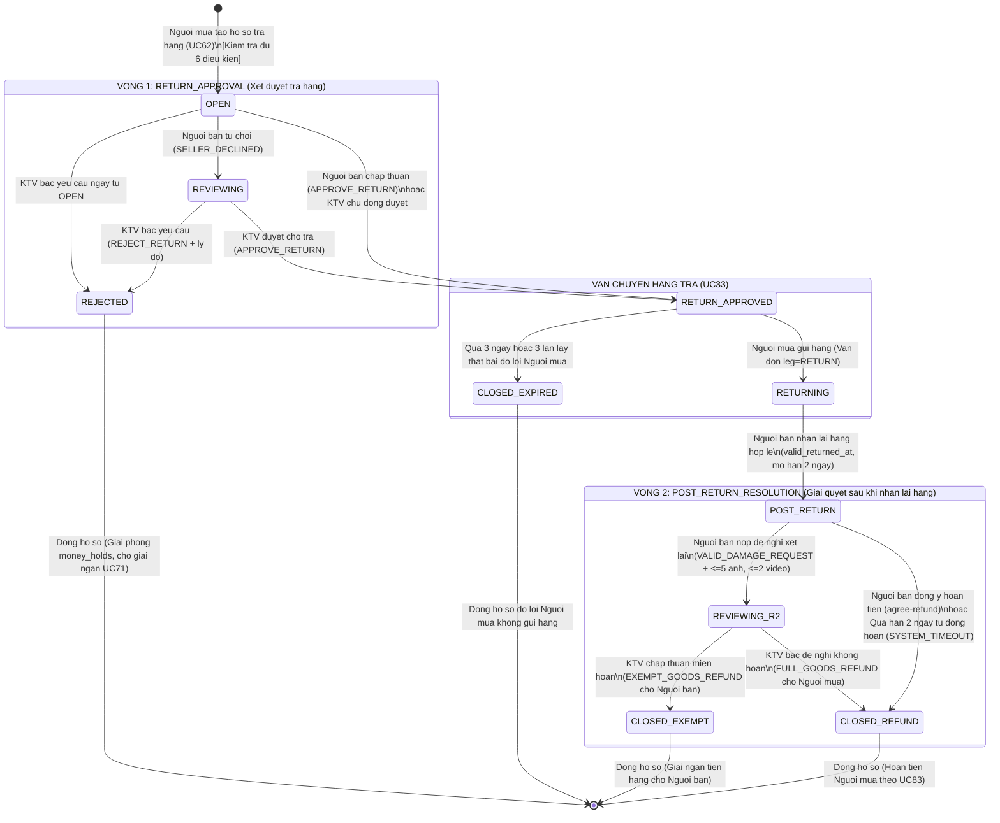
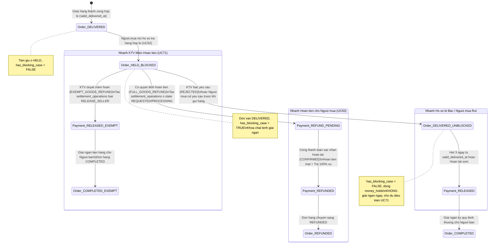

# Kế hoạch Triển khai Tính năng Trả hàng & Xử lý Tranh chấp Nhiều Vòng (Multi-Round Return & Dispute Workflow)

> **Căn cứ tài liệu**: Báo cáo đồ án tốt nghiệp (`Báo_cáo_đồ_án.docx`: UC22, UC26, UC27, UC33, UC40, UC52, UC62, UC63, UC71, UC75, UC83).  
> **Tệp trích xuất văn bản**: `tasks/bao_cao_extracted.txt` (9.426 dòng trích xuất nguyên văn từ `Báo_cáo_đồ_án.docx`).  
> **Kiến trúc dữ liệu hiện có**: PostgreSQL schema `og_compat` & `public` (V18, V19, V22: `cases`, `case_rounds`, `case_decisions`, `case_evidence`, `case_events`, `money_holds`, `settlement_operations`, `shipments`).

---

## 0. Các Quyết định Đã Chốt (Core Decisions)

- **D1**: Trả hàng sau giao CHỈ xảy ra thông qua yêu cầu khiếu nại trả hàng (UC62). Kiểm duyệt viên (KTV) là người phân xử và quyết định cuối cùng.
- **D2**: Người bán KHÔNG chỉ "được biết" thụ động mà có **3 vai trò chủ động**:
  * **(a) Vòng 1**: Có 2 lựa chọn: `[Chấp thuận trả]` hoặc `[Không đồng ý, chuyển KTV]`. KTV thấy hồ sơ ngay khi `OPEN` và có toàn quyền duyệt cho trả dù Người bán không đồng ý (UC62 7b). KTV không phải đợi Người bán từ chối mới thấy hồ sơ.
  * **(b) Theo dõi hàng trả**: Khi Người mua gửi hàng trả, Người bán có một màn hình **"Hàng trả"** hiển thị mã vận đơn và tiến trình giao hàng chiều về (`shipments.leg = 'RETURN'`) giống phía Người mua (UC33).
  * **(c) Vòng 2**: Khi hàng về, Người bán kiểm tra hàng thực tế và có **2 lựa chọn rõ ràng**:
    - `[Hàng đúng, đồng ý hoàn tiền]` -> Kích hoạt lệnh hoàn tiền ngay cho Người mua.
    - `[Hàng có vấn đề, gửi đề nghị xét lại]` kèm bằng chứng (tối đa 5 ảnh, 2 video <= 60 giây) đề nghị KTV miễn hoàn tiền.
    Hạn phản hồi: **2 ngày** kể từ khi nhận lại hàng. Nếu Người bán không chọn gì trong hạn, hệ thống tự động hoàn tiền 100% (UC83).
- **D3**: "Nhận lại hàng" KHÔNG đồng nghĩa với "đồng ý hoàn tiền" (BR-UC33-02). Nhận lại chỉ ghi nhận mốc `valid_returned_at` và mở thời hạn 2 ngày phản hồi. Ghi nhận nhận lại đến từ: Sự kiện vận đơn giao thành công (mô phỏng GHN), hoặc OTP / hai bên xác nhận (nếu trả trực tiếp), tuyệt đối không phụ thuộc vào một nút bấm cảm tính của Người bán.
- **D4**: Phản hồi "khiếu nại" của Người bán ở Vòng 2 là **ĐỀ NGHỊ XÉT LẠI**, không phải quyết định. Người bán **KHÔNG ĐƯỢC TỰ QUYẾT TỪ CHỐI HOÀN TIỀN** (BR-UC63-02, BR-UC33-03); chỉ KTV mới có thẩm quyền ra quyết định miễn hoàn. Khi có đề nghị hợp lệ, hệ thống tiếp tục giữ tiền.
- **D5**: Mở rộng câu chữ báo cáo đồ án: Cụm từ *"hư hỏng nghiêm trọng"* được mở rộng thành:
  > *"hàng trả hư hỏng nghiêm trọng HOẶC không đúng với hàng đã giao (tráo hàng, sai hàng, thiếu hàng)"*.
  Phải sửa đồng bộ toàn bộ các Use Case liên quan trong báo cáo (xem bảng chi tiết tại Mục 7).
- **D6**: Đơn hàng **GIỮ TRẠNG THÁI `DELIVERED`**. Tuyệt đối **KHÔNG dùng `STATUS_DISPUTED` làm trạng thái đơn hàng**; trạng thái có tranh chấp được suy ra từ cờ quan hệ hồ sơ (`has_blocking_case = true` qua hàm DB `og_order_has_blocking_case`).

---

## 1. Phạm vi Triển khai (Scope Boundaries)

### 1.1. Trong Phạm vi (In-Scope - Thực hiện trong giai đoạn này)
1. **UC62 (Yêu cầu trả hàng)**: Người mua gửi yêu cầu trả hàng với đầy đủ 6 điều kiện, 3 lý do chuẩn hóa, upload bằng chứng (tối đa 5 ảnh, 2 video <= 60s), tự động kích hoạt `money_holds`. Rút yêu cầu trước khi gửi hàng trả (7c).
2. **UC27 & UC71 (Tách Hoàn tất sớm khỏi Xác nhận nhận hàng)**:
   - Nút "Đã nhận hàng" chỉ ghi nhận xác nhận nhận hàng của Người mua (`received_at`), không đóng quyền trả hàng và không giải ngân ngay.
   - Nút "Hoàn tất sớm" (`earlyCompleteOrder`): yêu cầu đồng thuận cảnh báo từ bỏ quyền trả hàng (`warningConsent`), gọi `og_early_complete_order`, chặn khi có hồ sơ tranh chấp đang mở.
3. **Vòng 1 (RETURN_APPROVAL - Xét duyệt trả hàng)**:
   - Người bán chọn: `[Chấp thuận trả]` (`APPROVE_RETURN`) hoặc `[Không đồng ý, chuyển KTV]` (`SELLER_DECLINED`).
   - KTV thấy hồ sơ ngay khi `OPEN`, có quyền duyệt `APPROVE_RETURN` hoặc bác `REJECT_RETURN` (kèm lý do).
   - KTV bác yêu cầu -> chuyển `REJECTED`, **không giải ngân ngay** mà chờ đủ điều kiện UC71 (hết 3 ngày từ `valid_delivered_at` hoặc Hoàn tất sớm).
   - Quy tắc đua quyết định Vòng 1: Ghi trước thắng, ghi sau bị từ chối; hạn 48h của Người bán là SLA hành vi, không chặn KTV.
4. **UC33 (Vận chuyển hàng trả)**:
   - Quản lý vận đơn chiều về (`shipments.leg = 'RETURN'`).
   - Hạn gửi hàng trả: 3 ngày hoặc 3 lần lấy hàng thất bại. Lỗi ĐVVC mô phỏng không tự quy kết lỗi Người mua.
   - Ghi nhận `valid_returned_at` từ webhook vận đơn hoặc xác nhận bàn giao trực tiếp hai bên (`og_consume_handover_otp` / `og_confirm_direct_handover`), mở hạn 2 ngày cho Người bán.
5. **Vòng 2 (POST_RETURN_RESOLUTION - Giải quyết sau nhận lại hàng)**:
   - Người bán có 2 lựa chọn: `[Hàng đúng, đồng ý hoàn tiền]` (endpoint `agree-refund`) hoặc `[Hàng có vấn đề, gửi đề nghị xét lại]` (`submitDamageExemptionRequest` hỗ trợ hàng hỏng hoặc tráo hàng/sai hàng).
   - Bộ đếm ngược 2 ngày phản hồi của Người bán (`seller_response_due_at`).
   - KTV phân xử Vòng 2: `FULL_GOODS_REFUND` (hoàn tiền Người mua) hoặc `EXEMPT_GOODS_REFUND` (miễn hoàn tiền, giải ngân Người bán).
6. **Hệ thống Worker Tự động**:
   - Worker 1: Quá hạn 2 ngày Người bán im lặng -> tự động `SYSTEM_TIMEOUT` + `FULL_GOODS_REFUND` (UC83).
   - Worker 2: Quá hạn 3 ngày từ `valid_delivered_at` -> tự động giải ngân cho đơn `DELIVERED` đủ điều kiện (kể cả đơn `return_allowed = false`).
7. **UC83 & UC22 (Hạch toán hoàn tiền)**:
   - Hoàn tiền hàng thực trả sau voucher và xu phân bổ cho hàng.
   - Trả lại 100% xu đã dùng trong đơn (kể cả xu dùng cho ship). Không hoàn phí ship tiền mặt, không hoàn phí đăng tin, không cấp lại voucher.
   - Xử lý đơn 0 đồng (Ví dụ UC83-07): không tạo giao dịch hoàn tiền 0đ.
   - Nhánh `EXEMPT_GOODS_REFUND`: không hoàn tiền hàng, không trả xu theo trường hợp hoàn thông thường; giải ngân Người bán theo BR-UC71-01/05.
   - Phân biệt quyết định hoàn và đã hoàn xong (`REFUND_PENDING` -> `CONFIRMED` qua `settlement_operations`).
8. **KTV Workbench & Admin Monitoring**:
   - Màn hình KTV Workbench: hàng đợi hồ sơ `OPEN` và `REVIEWING`, đối chiếu bằng chứng hai bên, cảnh báo SLA 48h tính từ khi hồ sơ đủ nội dung (`complete_submission_at`).
   - Màn hình/Endpoint Admin theo dõi hồ sơ `ESCALATED` quá hạn 48h KTV.

### 1.2. Hoãn sang Giai đoạn Sau (Out-of-Scope / Deferred Post-MVP)
1. **Thông báo Đẩy Thời gian thực (UC40, UC48, UC52 - Push Notifications / WebSockets)**:
   - *Lý do hoãn*: Việc thiết lập hạ tầng WebSocket / FCM push cần cấu hình máy chủ riêng. Trong phạm vi đồ án, toàn bộ sự kiện thông báo được ghi nhận đầy đủ vào cơ sở dữ liệu (`case_events` và bảng thông báo hệ thống); đồng thời giao diện Frontend hiển thị trạng thái hồ sơ tức thời trong màn hình chi tiết đơn hàng của Người mua và Người bán.
2. **Khiếu nại Lỗi Hệ thống / Thu tiền (UC64, UC76)**:
   - *Lý do hoãn*: UC64 và UC76 xử lý các tranh chấp kỹ thuật ngoài luồng trả hàng (lỗi trừ tiền ví, lỗi hệ thống). Luồng này được tách riêng, không nằm trong quy trình trả hàng của đơn mua.
3. **Tích hợp Bưu tá Thực tế (GHN Real Postman Integration)**:
   - *Lý do hoãn*: Chiều trả hàng sử dụng cơ chế mô phỏng sự kiện vận chuyển GHN (webhook simulation) theo đúng đặc tả UC33 và UC83 của đồ án.

---

## 2. Sơ đồ Chuyển Trạng thái (Hai Sơ đồ Mermaid Độc lập)

### 2.1. Sơ đồ 1: Vòng đời Trạng thái Hồ sơ Trả hàng (`cases.state` & `case_rounds`)



### 2.2. Sơ đồ 2: Trạng thái Tiền & Đơn hàng (`orders.status` & `settlement_operations`)



---

## 3. Quy tắc Tài chính, Hoàn tiền & Giải ngân (UC83, UC71, UC22)

### 3.1. Công thức Hoàn tiền Thực tế cho Người mua (UC83)
Theo quy tắc `BR-UC22-04`, xu tích lũy và voucher giảm giá trừ vào cả tiền hàng và phí vận chuyển:
- **Tiền mặt hoàn trả cho Người mua**:
  ```text
  Tiền mặt hoàn = Tiền hàng thực trả sau voucher và xu (phần phân bổ cho tiền hàng)
  CashRefund = subtotal - voucher_discount_amount_for_goods - points_discount_amount_for_goods
  ```
- **Quy tắc hoàn chi tiết**:
  1. **Tiền mặt**: Hoàn đúng bằng khoản tiền hàng thực trả sau giảm trừ.
  2. **Phí vận chuyển chiều mua**: **KHÔNG HOÀN** phần phí vận chuyển chiều mua đã trả bằng tiền mặt (BR-UC83-05).
  3. **Phí đăng tin**: **KHÔNG HOÀN** phí đăng tin (BR-UC83-05, BR-UC17-09).
  4. **Xu tích lũy**: **TRẢ LẠI 100% SỐ XU ĐÃ DÙNG** trong đơn hàng (kể cả phần xu đã dùng cho phí vận chuyển) theo BR-UC22-03 và BR-UC83-01.
  5. **Voucher khuyến mãi**: **KHÔNG CẤP LẠI VOUCHER** đã dùng (BR-UC22-03, BR-UC83-01).

### 3.2. Nhánh KTV Duyệt Miễn Hoàn tiền (`EXEMPT_GOODS_REFUND` - UC83 4d, BR-UC22-03)
Khi KTV chấp thuận không hoàn vì hàng trả hư hỏng nghiêm trọng hoặc không đúng hàng đã giao đủ căn cứ:
- **Đối với Người mua**: **KHÔNG hoàn tiền hàng**, **KHÔNG trả lại xu** theo trường hợp hoàn thông thường (UC83 4d, BR-UC22-03).
- **Đối với Người bán**: Giải ngân tiền hàng theo quy định `BR-UC71-01/05`:
  ```text
  Số giải ngân Người bán = Tiền hàng thực trả (sau voucher và xu) + Phần Sàn tài trợ voucher/xu cho hàng
  ```
  *(Lưu ý: Bỏ hoàn toàn khoản "Trừ phí sàn bán" vì báo cáo không quy định phí hoa hồng sàn. Không bao gồm phí vận chuyển và không bao gồm phí đăng tin; phí đăng tin Người bán đã thanh toán riêng từ trước).*

### 3.3. Kiểm thử Trường hợp Điển hình UC83-07 (Đơn hàng 0 đồng)
- **Kịch bản**: Đơn hàng có:
  * Tiền hàng (`subtotal`) = 100.000 VNĐ.
  * Phí vận chuyển (`shipping_fee`) = 10.000 VNĐ.
  * Voucher giảm giá = 10.000 VNĐ.
  * Sử dụng xu tích lũy = 100.000 xu (tương đương 100.000 VNĐ).
  * **Tổng tiền mặt Người mua thanh toán = 0 VNĐ**.
- **Kết quả xử lý khi hoàn tiền (UC83 5a)**:
  * Tiền mặt hoàn trả: **0 VNĐ** -> **TUYỆT ĐỐI KHÔNG TẠO GIAO DỊCH HOÀN TIỀN 0 ĐỒNG** sang cổng thanh toán / ngân hàng.
  * Hoàn trả xu: **Cộng trả lại đúng 100.000 xu** vào ví xu của Người mua.
  * Voucher: **Không cấp lại voucher 10.000 VNĐ**.

### 3.4. Phân biệt "Quyết định Hoàn tiền" và "Đã Hoàn xong" (BR-UC83-04)
- **Tách biệt trạng thái**:
  * Khi có quyết định hoàn tiền (Người bán đồng ý hoặc KTV phán quyết): Trạng thái thanh toán chuyển sang **`REFUND_PENDING`**.
  * Chỉ khi dịch vụ thanh toán / ngân hàng xác nhận giao dịch thành công, trạng thái mới chuyển sang **`REFUNDED`**.
- **Xử lý sự cố dịch vụ và hoàn từng phần (UC83 6a, 6b)**:
  * Kết quả hoàn chưa rõ hoặc lỗi dịch vụ: hiển thị "còn chờ", không báo đã hoàn, không chuyển lại ngay (tránh chuyển kép).
  * Tiền hoặc xu chỉ hoàn thành một phần: hiển thị rõ phần đã xong và phần cần tiếp tục.
- **Xác minh Bảng `settlement_operations`**:
  * Đã xác minh: Bảng `settlement_operations` **ĐÃ TỒN TẠI** trong Flyway migration `V18__payment_intents_and_component_settlement.sql` (dòng 242) và view `og_compat.settlement_operations` trong `V22__consolidate_database_to_48_tables.sql` (dòng 2826) với các trường: `operation_id` (UUID), `component_id`, `operation_type` (`REFUND_BUYER`, `RELEASE_SELLER`), `amount`, `cause_type` (`RETURN`, `EXEMPTION`, `COMPLETION`), `case_decision_id`, `state` (`REQUESTED`, `PROCESSING`, `CONFIRMED`, `FAILED`), `command_key`.

### 3.5. Chống Trùng lặp & Thứ tự Khóa Tài nguyên (BR-UC83-03)
- Tuyệt đối không vừa hoàn tiền vừa giải ngân cùng một khoản hai lần (BR-UC83-03).
- Mọi thao tác xử lý tiền và worker phải đảm bảo Idempotent thông qua `command_key` duy nhất.
- **Thứ tự khóa tài nguyên chống Deadlock**:
  ```text
  Khóa OrderEntity (1)  --->  Khóa PaymentEntity (2)  --->  Khóa CaseEntity (3)
  ```

---

## 4. Quy tắc Hạn chờ, Worker & SLA

### 4.1. Đủ 6 Điều kiện Mở Yêu cầu Trả hàng (UC62, BR-UC62-02) & Tầng Kiểm tra

Hệ thống kiểm tra nghiêm ngặt cả **6 điều kiện nghiệp vụ** (kèm các ràng buộc kỹ thuật DB) trước khi cho phép tạo hồ sơ:

| STT | Điều kiện Nghiệp vụ (UC62, BR-UC62-02) | Tầng Kiểm tra | Căn cứ Kỹ thuật & Thân hàm Trigger DB |
| :---: | :--- | :--- | :--- |
| **1** | Đơn hàng `status == 'DELIVERED'` và có mốc `valid_delivered_at IS NOT NULL` | **Cả hai tầng**:<br>- `status == DELIVERED`: Application Service<br>- `valid_delivered_at IS NOT NULL`: DB Trigger | DB Trigger `og_guard_return_case` kiểm tra trực tiếp: `IF o.valid_delivered_at IS NULL THEN RAISE EXCEPTION 'Order has no current right to request return'`. Application Service kiểm tra `status == DELIVERED` trước khi khởi tạo case. |
| **2** | Đơn hàng cho phép trả hàng (`return_allowed == true`) | **DB Trigger & Service** | DB Trigger `og_guard_return_case` kiểm tra: `IF NOT o.return_allowed THEN RAISE EXCEPTION 'Order has no current right to request return'`. Ghi nhận cờ `return_allowed` lúc đặt hàng. |
| **3** | Trong thời hạn 3 ngày kể từ lúc giao hàng (`now() <= valid_delivered_at + 3 ngày`) | **DB Trigger & Service** | DB Trigger `og_guard_return_case` kiểm tra: `IF NEW.created_at > o.valid_delivered_at + INTERVAL '3 days' THEN RAISE EXCEPTION 'Order has no current right to request return'`. Xem/mở form nháp không kéo dài thời hạn 3 ngày. |
| **4** | Người mua chưa bấm Hoàn tất sớm (`early_completed_at IS NULL`) | **DB Trigger & Service** | DB Trigger `og_guard_return_case` kiểm tra: `IF o.early_completed_at IS NOT NULL THEN RAISE EXCEPTION 'Order has no current right to request return'`. |
| **5** | Tiền ký quỹ chưa giải ngân cuối cùng (`PaymentEntity.status != 'RELEASED'`) | **Application Service** | Application Service kiểm tra trạng thái thanh toán trước khi mở case. Cấp DB bảo vệ tài chính thông qua trigger `og_return_case_money_holds` tự động đóng băng các khoản `GOODS_CASH` / `PLATFORM_GOODS_SUBSIDY`. |
| **6** | Không có hồ sơ trả hàng/khiếu nại nào đang hoạt động cho đơn này | **Application Service & DB Unique Index** | Application Service gọi `og_order_has_blocking_case(order_id)`. Cấp DB bảo vệ qua index duy nhất `uq_return_case_active` trên `(order_id) WHERE state NOT IN ('CLOSED', 'REJECTED')`. |
| *Ràng buộc DB* | Đơn hàng phải thuộc mô hình `workflow_model = 'UC83'` | **DB Trigger** | DB Trigger `og_guard_return_case` kiểm tra: `IF o.workflow_model <> 'UC83' THEN RAISE EXCEPTION 'Order has no current right to request return'`. Đơn `LEGACY_V14` bị từ chối. |
| *Ràng buộc DB* | Người tạo hồ sơ phải chính là Người mua (`NEW.created_by = o.buyer_id`) | **DB Trigger & Service** | DB Trigger `og_guard_return_case` kiểm tra: `IF NEW.created_by <> o.buyer_id THEN RAISE EXCEPTION 'Order has no current right to request return'`. |
| *Ràng buộc DB* | Trạng thái khởi tạo của hồ sơ mới phải là `OPEN` | **DB Trigger** | DB Trigger `og_guard_return_case` kiểm tra: `IF NEW.state <> 'OPEN' THEN RAISE EXCEPTION 'New case starts open'`. |

### 4.2. Hạn Gửi Hàng Trả & Thu gom (UC33 3e)
- Khi hồ sơ ở trạng thái `RETURN_APPROVED`:
  * Thời hạn gửi hàng: **3 ngày** kể từ thời điểm chấp thuận HOẶC **3 lần bưu tá lấy hàng thất bại**, mốc nào đến trước thì dừng thu gom (UC33 3e).
  * Mô phỏng bưu tá GHN: Lần lấy đầu tiên dự kiến trong 24 giờ (`pickup_expected_at = approved_at + 24 hours`), nếu thất bại thì hẹn lại trong cửa sổ 3 ngày (`pickup_deadline = approved_at + 3 days`).
  * Xử lý thất bại (3d, 3e): Lỗi ĐVVC mô phỏng không tự quy kết lỗi Người mua. Nếu có phản đối, lỗi vận chuyển hoặc chưa rõ nguyên nhân -> chuyển KTV và tiếp tục giữ tiền; nếu có căn cứ rõ ràng do lỗi Người mua không giao hàng -> đóng hồ sơ (`CLOSED_EXPIRED`).

### 4.3. Cơ chế Ghi nhận "Nhận lại Hàng" Chống kẹt Hồ sơ (D3 & UC33)
- `valid_returned_at` được ghi nhận từ:
  1. *Đơn hàng qua đơn vị vận chuyển*: Webhook / sự kiện giao hàng thành công của vận đơn chiều trả (`shipments.leg = 'RETURN'`).
  2. *Giao dịch bàn giao trực tiếp*: Người mua và Người bán cùng xác nhận qua OTP / mã bàn giao 2 bên (`og_consume_handover_otp` / `og_confirm_direct_handover`).
- **Cơ chế chống kẹt hồ sơ**:
  * Người bán KHÔNG có nút tự bấm "đã nhận lại" tùy tiện.
  * Nếu hai bên im lặng hoặc Người bán cố tình không xác nhận: Tận dụng cơ chế `direct_handover_attention` có sẵn trong V19 (sau 14 ngày hoặc khi có biên bản bất đồng `FAILED`) -> Tự động chuyển hồ sơ sang KTV kiểm tra đối soát, không để hồ sơ bị kẹt vô hạn.

### 4.4. Hệ thống Worker Tự động Định kỳ
1. **Worker 1: Quá hạn 2 ngày phản hồi của Người bán (`reconcileOverdueReturnResponses`)**:
   - Chạy định kỳ quét các hồ sơ `cases.state = 'POST_RETURN'`.
   - Nếu `now() > seller_response_due_at` mà Người bán KHÔNG gửi đề nghị xét lại hợp lệ -> Hệ thống tự động tạo quyết định quá hạn: `actor_type = 'SYSTEM_TIMEOUT'`, `outcome = 'FULL_GOODS_REFUND'` theo UC83.
2. **Worker 2: Tự động Giải ngân sau 3 ngày (`reconcileOverdueDeliveries` - UC71)**:
   - Chạy định kỳ quét các đơn hàng có `status = 'DELIVERED'`, `now() > valid_delivered_at + 3 ngày`.
   - Kiểm tra điều kiện: `has_blocking_case == false` và tiền chưa giải ngân.
   - Nếu thỏa mãn -> Tự động giải ngân cho Người bán.
   - *Lưu ý*: Áp dụng cho cả đơn hàng có cờ `return_allowed = false` (vẫn phải chờ hết 3 ngày hoặc Hoàn tất sớm mới giải ngân).

### 4.5. KTV Bác Yêu cầu Trả (`REJECTED`) KHÔNG Giải ngân Ngay
- Khi KTV bác yêu cầu trả của Người mua (`outcome = 'REJECT_RETURN'`):
  * Hồ sơ chuyển sang `REJECTED`, lệnh giữ tiền `money_holds` được đóng (`closed_at = now()`).
  * **TUYỆT ĐỐI KHÔNG GIẢI NGÂN TIỀN NGAY LẬP TỨC**.
  * Đơn hàng quay về trạng thái `DELIVERED` không có hồ sơ cản trở (`has_blocking_case = false`), và chỉ được giải ngân khi thỏa mãn quy tắc UC71: Đủ 3 ngày kể từ `valid_delivered_at` HOẶC Người mua bấm Hoàn tất sớm.

### 4.6. Mốc SLA 48h của KTV & Admin Escalation
- Thời hạn SLA 48 giờ của KTV được tính thống nhất từ thời điểm **HỒ SƠ ĐỦ NỘI DUNG** (`complete_submission_at + 48 hours` theo `BR-UC62-03`), không tính từ thời điểm Người bán từ chối.
- Khi quá hạn 48 giờ: Hệ thống ghi nhận sự kiện `ESCALATED` vào `case_events` và hiển thị trên màn hình giám sát của Quản trị viên (Admin). **Tuyệt đối KHÔNG tự động duyệt hay tự động hoàn tiền khi KTV quá hạn**.

---

## 5. Tách "Đã nhận hàng" khỏi "Hoàn tất sớm" & Tái sử dụng Database Functions (UC26, UC27, UC71)

### 5.1. Định nghĩa Nút "Đã nhận hàng" vs "Hoàn tất sớm"
- **Nút "Đã nhận hàng" (UC27)**:
  * Chỉ mang tính chất ghi nhận việc Người mua xác nhận đã nhận được kiện hàng từ bưu tá / người bán (`orders.received_at = now()`).
  * **KHÔNG thay đổi tiến độ giải ngân**, **KHÔNG đóng quyền trả hàng**, **KHÔNG gán lại `valid_delivered_at`**.
  * Mốc `valid_delivered_at` chỉ được ghi nhận từ sự kiện giao hàng thành công hợp lệ (sự kiện vận đơn GHN hoặc OTP bàn giao theo UC26).
- **Nút "Hoàn tất sớm" (`earlyCompleteOrder` - UC27, UC71)**:
  * Refactor từ endpoint `completeBuyerOrder` cũ.
  * Bắt buộc Người mua đồng thuận cảnh báo từ bỏ quyền trả hàng: gửi kèm tham số `warningConsent: string`.
  * Hiển thị popup cảnh báo: *"Xác nhận hoàn tất sớm sẽ đóng vĩnh viễn quyền gửi yêu cầu trả hàng mới của bạn và đơn hàng sẽ được chuyển sang tiến trình giải ngân cho Người bán"*.
  * Kiểm tra guard: Không có hồ sơ trả hàng nào đang mở (`og_order_has_blocking_case(orderId) == false`).
  * Gọi trực tiếp hàm stored procedure `og_early_complete_order`. Hàm này **CHỈ ghi nhận mốc `early_completed_at` và tạo sự kiện `EARLY_COMPLETION_ACCEPTED`, KHÔNG trực tiếp đổi trạng thái giải ngân** (UC71 3a).
- **Tiến trình Giải ngân cho Người bán (`disburseSellerFunds` / `reconcileOverdueDeliveries` - UC71 3a, BR-UC71-04)**:
  * Là bước xử lý riêng biệt. Hệ thống chỉ giải phóng tiền ký quỹ (`RELEASED`) cho Người bán và chuyển đơn sang `COMPLETED` khi thỏa mãn đồng thời cả 3 điều kiện:
    1. Đơn hàng đã giao thành công hợp lệ (`valid_delivered_at` có giá trị);
    2. Hết hạn 3 ngày kể từ `valid_delivered_at` HOẶC Người mua đã xác nhận hoàn tất sớm (`early_completed_at` có giá trị);
    3. Không có hồ sơ ngăn chặn (`og_order_has_blocking_case(orderId) == false`) và không còn lệnh giữ tiền (`money_holds`) nào chưa đóng.

### 5.2. Chữ ký Hàm & Trích đoạn Migration Tái sử dụng Database (Đã kiểm tra 100% file thật)

Dưới đây là kết quả kiểm tra đối chiếu trực tiếp từng dòng mã nguồn trong `V19__fulfillment_and_multi_round_cases.sql` và `V22__consolidate_database_to_48_tables.sql`:

1. **`og_early_complete_order`**:
   - *Chữ ký hàm*: `public.og_early_complete_order(p_order bigint, p_buyer bigint, p_warning text, p_command text) RETURNS boolean`
   - *Vị trí*:
     * `V19__fulfillment_and_multi_round_cases.sql`: Dòng 504 – 520.
     * `V22__consolidate_database_to_48_tables.sql`: Dòng 3604 – 3625 (và lệnh DROP tại dòng 287).
   - *Trạng thái*: **ĐÃ XÁC MINH 100%**.
   - *Trích đoạn V22*:
     ```sql
     CREATE OR REPLACE FUNCTION public.og_early_complete_order(p_order bigint, p_buyer bigint, p_warning text, p_command text)
      RETURNS boolean LANGUAGE plpgsql SET search_path TO 'public', '$user', 'public' AS $function$
     DECLARE o og_compat.orders;
     BEGIN
         SELECT * INTO STRICT o FROM og_compat.orders WHERE order_id=p_order FOR UPDATE;
         IF EXISTS(SELECT 1 FROM og_compat.order_events WHERE command_key=p_command AND order_id=p_order AND actor_id=p_buyer
             AND event_type='EARLY_COMPLETION_ACCEPTED') THEN RETURN TRUE; END IF;
         IF o.workflow_model<>'UC83' OR o.buyer_id<>p_buyer OR o.valid_delivered_at IS NULL
             OR NULLIF(btrim(p_warning),'') IS NULL OR o.status<>'DELIVERED' OR og_order_has_blocking_case(p_order)
             OR EXISTS(SELECT 1 FROM og_compat.money_holds h JOIN og_compat.order_fund_components c USING(component_id)
                 WHERE c.order_id=p_order AND h.closed_at IS NULL) THEN
             RAISE EXCEPTION 'Early completion needs Buyer warning consent and no blockers' USING ERRCODE='23514'; END IF;
         UPDATE og_compat.orders SET early_completed_at=clock_timestamp(),early_completion_warning_version=p_warning WHERE order_id=p_order;
         INSERT INTO og_compat.order_events(event_id,order_id,actor_id,event_type,metadata,command_key)
             VALUES(gen_random_uuid(),p_order,p_buyer,'EARLY_COMPLETION_ACCEPTED',jsonb_build_object('warning_version',p_warning),p_command);
         RETURN TRUE;
     END;
     $function$;
     ```

2. **`og_order_has_blocking_case`**:
   - *Chữ ký hàm*: `public.og_order_has_blocking_case(p_order bigint) RETURNS boolean`
   - *Vị trí*:
     * `V19__fulfillment_and_multi_round_cases.sql`: Dòng 246 – 249.
     * `V22__consolidate_database_to_48_tables.sql`: Dòng 4206 – 4214 (và lệnh DROP tại dòng 343; sử dụng tại dòng 3615, 4544, 7079).
   - *Trạng thái*: **ĐÃ XÁC MINH 100%**.
   - *Trích đoạn V22*:
     ```sql
     CREATE OR REPLACE FUNCTION public.og_order_has_blocking_case(p_order bigint)
      RETURNS boolean LANGUAGE sql STABLE SET search_path TO 'public', '$user', 'public' AS $function$
         SELECT EXISTS(SELECT 1 FROM og_compat.cases WHERE order_id=p_order AND state NOT IN ('CLOSED','REJECTED'))
     $function$;
     ```

3. **`og_case_settlement_allowed`**:
   - *Chữ ký hàm*: `public.og_case_settlement_allowed(p_decision bigint, p_order bigint, p_cause text) RETURNS boolean`
   - *Vị trí*:
     * `V19__fulfillment_and_multi_round_cases.sql`: Dòng 238 – 245.
     * `V22__consolidate_database_to_48_tables.sql`: Dòng 4099 – 4111 (và lệnh DROP tại dòng 333; sử dụng tại dòng 4552, 4561, 4570).
   - *Trạng thái*: **ĐÃ XÁC MINH 100%**.
   - *Trích đoạn V22*:
     ```sql
     CREATE OR REPLACE FUNCTION public.og_case_settlement_allowed(p_decision bigint, p_order bigint, p_cause text)
      RETURNS boolean LANGUAGE sql STABLE SET search_path TO 'public', '$user', 'public' AS $function$
         SELECT EXISTS(SELECT 1 FROM og_compat.case_decisions d JOIN og_compat.case_rounds r USING(round_id) JOIN og_compat.cases c USING(case_id)
             WHERE d.decision_id=p_decision AND c.order_id=p_order AND c.case_type='RETURN'
               AND c.valid_returned_at IS NOT NULL AND d.is_final
               AND ((p_cause='RETURN' AND d.outcome='FULL_GOODS_REFUND')
                 OR (p_cause='EXEMPTION' AND d.outcome='EXEMPT_GOODS_REFUND')))
     $function$;
     ```

4. **`og_guard_return_case`**:
   - *Chữ ký hàm*: `public.og_guard_return_case() RETURNS trigger`
   - *Vị trí*:
     * `V19__fulfillment_and_multi_round_cases.sql`: Dòng 32 – 49 (kèm trigger `trg_return_case_guard` tại dòng 49).
     * `V22__consolidate_database_to_48_tables.sql`: Dòng 3232 – 3252 (lệnh DROP tại dòng 259; trong kiến trúc trigger gộp của V22, được bọc trong `og70_row_cases_og_guard_return_case` tại dòng 4894 và kích hoạt tại dòng 7703).
   - *Trạng thái*: **ĐÃ XÁC MINH 100%**.
   - *Trích đoạn V22*:
     ```sql
     CREATE OR REPLACE FUNCTION public.og_guard_return_case()
      RETURNS trigger LANGUAGE plpgsql SET search_path TO 'public', '$user', 'public' AS $function$
     DECLARE o og_compat.orders;
     BEGIN
         IF NEW.state<>'OPEN' THEN RAISE EXCEPTION 'New case starts open' USING ERRCODE='23514'; END IF;
         IF NEW.case_type='RETURN' AND TG_OP='INSERT' THEN
             SELECT * INTO STRICT o FROM og_compat.orders WHERE order_id=NEW.order_id FOR UPDATE;
             NEW.created_at:=clock_timestamp();
             IF o.workflow_model<>'UC83' OR NEW.created_by<>o.buyer_id OR NOT o.return_allowed
                 OR o.valid_delivered_at IS NULL OR o.early_completed_at IS NOT NULL
                 OR NEW.created_at>o.valid_delivered_at+INTERVAL '3 days' THEN
                 RAISE EXCEPTION 'Order has no current right to request return' USING ERRCODE='23514';
             END IF;
         END IF;
         RETURN NEW;
     END;
     $function$;
     ```

5. **`og_return_case_money_holds`**:
   - *Chữ ký hàm*: `public.og_return_case_money_holds() RETURNS trigger`
   - *Vị trí*:
     * `V19__fulfillment_and_multi_round_cases.sql`: Dòng 251 – 265 (kèm trigger `trg_return_case_holds` tại dòng 264).
     * `V22__consolidate_database_to_48_tables.sql`: Dòng 4226 – 4238 (lệnh DROP tại dòng 347; trong trigger gộp V22 bọc trong `og70_row_cases_og_return_case_money_holds` dòng 4919, kích hoạt tại dòng 7708).
   - *Trạng thái*: **ĐÃ XÁC MINH 100%**.
   - *Trích đoạn V22*:
     ```sql
     CREATE OR REPLACE FUNCTION public.og_return_case_money_holds()
      RETURNS trigger LANGUAGE plpgsql SET search_path TO 'public', '$user', 'public' AS $function$
     BEGIN
         IF NEW.case_type='RETURN' THEN
             INSERT INTO og_compat.money_holds(hold_id,component_id,source_key,reason,case_id)
                 SELECT gen_random_uuid(),f.component_id,'RETURN_CASE:'||NEW.case_id,'Return case pending',NEW.case_id
                 FROM og_compat.order_fund_components f WHERE f.order_id=NEW.order_id
                     AND f.component_type IN ('GOODS_CASH','PLATFORM_GOODS_SUBSIDY')
                     AND NOT EXISTS(SELECT 1 FROM og_compat.money_holds h WHERE h.component_id=f.component_id AND h.source_key='RETURN_CASE:'||NEW.case_id);
         END IF;
         RETURN NEW;
     END;
     $function$;
     ```

6. **`og_close_case_holds`**:
   - *Chữ ký hàm*: `public.og_close_case_holds() RETURNS trigger`
   - *Vị trí*:
     * `V19__fulfillment_and_multi_round_cases.sql`: Dòng 437 – 447 (kèm trigger `trg_case_close_holds` tại dòng 446).
     * `V22__consolidate_database_to_48_tables.sql`: Dòng 3135 – 3147 (lệnh DROP tại dòng 249; trong trigger gộp V22 bọc trong `og70_row_case_decisions_og_close_case_holds` dòng 5702, kích hoạt tại dòng 7903).
   - *Trạng thái*: **ĐÃ XÁC MINH 100%**.
   - *Trích đoạn V22*:
     ```sql
     CREATE OR REPLACE FUNCTION public.og_close_case_holds()
      RETURNS trigger LANGUAGE plpgsql SET search_path TO 'public', '$user', 'public' AS $function$
     BEGIN
         UPDATE og_compat.money_holds SET closed_at=clock_timestamp() WHERE case_id=(SELECT r.case_id FROM og_compat.case_rounds r
             WHERE r.round_id=NEW.round_id) AND closed_at IS NULL AND EXISTS(SELECT 1 FROM og_compat.cases c
             WHERE c.case_id=og_compat.money_holds.case_id AND c.state IN ('CLOSED','REJECTED'));
         RETURN NEW;
     END;
     $function$;
     ```

7. **`settlement_operations`**:
   - *Vị trí*:
     * `V18__payment_intents_and_component_settlement.sql`: Dòng 242 – 258 (tạo bảng gốc `CREATE TABLE settlement_operations`).
     * `V19__fulfillment_and_multi_round_cases.sql`: Dòng 236 (thêm FK `fk_settlement_case_decision`).
     * `V22__consolidate_database_to_48_tables.sql`: Dòng 1525 – 1541 (tạo bảng gộp `public.settlement_operations`), Dòng 2826 (tạo view `og_compat.settlement_operations`).
   - *Trạng thái*: **ĐÃ XÁC MINH 100%**.

8. **`direct_handover_attention`**:
   - *Vị trí*:
     * `V19__fulfillment_and_multi_round_cases.sql`: Dòng 522 – 529.
     * `V22__consolidate_database_to_48_tables.sql`: Dòng 2846 (tạo view `og_compat.direct_handover_attention`), Dòng 14666 – 14681 (view `public.direct_handover_attention`).
   - *Trạng thái*: **ĐÃ XÁC MINH 100%**.

---

## 6. Danh mục Lý do Trả hàng & Quản lý Bằng chứng (BR-UC62-05, BR-UC62-07)

### 6.1. Danh mục 3 Lý do Chuẩn hóa & Lưu trữ Cơ sở Dữ liệu
- **3 Lý do Chuẩn theo Báo cáo Đồ án (BR-UC62-05)**:
  1. `CHANGE_MIND`: Đổi ý khi chưa mở và còn nguyên (chỉ áp dụng khi đơn có `return_allowed = true`).
  2. `NOT_AS_DESCRIBED`: Hàng sai mô tả (sai mẫu mã, thiếu phụ kiện, nghi vấn hàng giả).
  3. `DAMAGED_OR_DEFECTIVE`: Hàng hỏng, không dùng được.
- *Bỏ `DELIVERY_ISSUE`*: Thuộc giao hàng thất bại (UC26/UC82), không thuộc quy trình trả hàng.
- *Kết quả kiểm tra DB V19/V22*: Bảng `cases` không có cột enum `case_reason` riêng mà dùng cột `description TEXT NOT NULL`.
- *Đề xuất lưu trữ sạch*: Lưu mã chuẩn hóa có tiền tố vào trường `description`:
  Ví dụ: `[CHANGE_MIND] Người mua đổi ý, bao bì còn nguyên seal`, `[NOT_AS_DESCRIBED] Sản phẩm giao sai màu sắc`, `[DAMAGED_OR_DEFECTIVE] Màn hình bị nứt vỡ`. Khi đọc dữ liệu, hệ thống dễ dàng bóc tách cả `reason_code` lẫn văn bản mô tả của người dùng mà không cần sửa migration database.

### 6.2. Giới hạn Bằng chứng & Tính Riêng tư (BR-UC62-07)
- **Giới hạn**: Tối đa **5 ảnh** (<= 5MB/ảnh), tối đa **2 video** (<= 50MB/video, thời lượng mỗi video <= **60 giây**). Validate chặt chẽ ở cả Frontend Modal và Backend Service.
- **Bảo mật & Lưu trữ**:
  * Bằng chứng lưu trữ riêng tư, chỉ Người mua, Người bán trong đơn và KTV/Admin được phân quyền truy cập.
  * Bằng chứng lưu theo cơ chế **Append-only**: Lưu `submission_no` tăng dần và `submitted_at`. Bổ sung bằng chứng ở vòng sau tuyệt đối không ghi đè hoặc xóa bằng chứng đã gửi trước đó.

### 6.3. Các Thao tác Nghiệp vụ Bổ trợ
- **Người mua bổ sung bằng chứng (UC62 7a, UC75 4a)**: Khi KTV yêu cầu bổ sung thông tin (`POST .../request-evidence`), Người mua được mở lại quyền nộp thêm ảnh/video với `submission_no` tăng dần.
- **Người mua rút yêu cầu trả hàng (UC62 7c)**:
  * Người mua **CHỈ ĐƯỢC RÚT TRƯỚC KHI GỬI HÀNG TRẢ** (`state IN ('OPEN', 'REVIEWING', 'RETURN_APPROVED')` và chưa tạo vận đơn / chưa lấy hàng).
  * Nếu hàng đang trả hoặc đã trả về Người bán thì không được rút; hồ sơ tiếp tục xử lý theo UC33 và UC75.
  * Khi rút yêu cầu: Hồ sơ chuyển sang `CLOSED`, **đóng lệnh giữ tiền (`money_holds.closed_at = now()`); việc giải ngân vẫn phải tuân theo điều kiện của UC71** (chờ hết 3 ngày từ `valid_delivered_at` hoặc Người mua bấm Hoàn tất sớm).
- **Quy định bên chịu phí vận chuyển từng chiều (BR-UC62-04)**:
  * Chiều mua: Người mua đã thanh toán khi đặt đơn (không hoàn lại).
  * Chiều trả hàng: Nếu trả do lỗi Người bán (hư hỏng, sai mô tả) -> Người bán/Sàn chịu phí chiều trả; nếu trả do Đổi ý -> Người mua tự chi trả phí chiều trả.

### 6.4. Bảng Ánh xạ Sự kiện Nghiệp vụ -> `event_type` DB (Ràng buộc `case_events_event_type_check`)
- Ràng buộc CHECK trong DB (`V22` dòng 8696-8697 / `V19` dòng 202-203) chỉ cho phép **chính xác 8 giá trị** cho cột `event_type`:
  `SUBMITTED`, `SUPPLEMENTED`, `VALID_DAMAGE_REQUEST`, `ESCALATED`, `ASSIGNED`, `COMPENSATION`, `DEADLINE_EXTENSION`, `CLEANUP`.
- Mọi thông tin nghiệp vụ chi tiết hơn được lưu trong trường `reason` (TEXT NOT NULL, btrim <> '') và `metadata` (JSONB NOT NULL, jsonb_typeof='object').

| Sự kiện nghiệp vụ thực tế | `event_type` trong DB | Ghi chú trong `reason` | Nội dung `metadata` (JSON Object) |
| :--- | :--- | :--- | :--- |
| Nộp yêu cầu trả hàng / khiếu nại ban đầu | `SUBMITTED` | Mô tả lý do nộp hồ sơ (tiền tố `[CODE]`) | `{"action": "RETURN_REQUESTED", "subtotal": 300000, "client_ip": "..."}` |
| Bổ sung bằng chứng / thông tin phản hồi | `SUPPLEMENTED` | Diễn giải bằng chứng bổ sung | `{"submission_no": 2, "evidence_count": 3, "role": "BUYER"}` |
| Người bán đề nghị miễn trừ hư hỏng | `VALID_DAMAGE_REQUEST` | Lý do yêu cầu miễn trừ thiệt hại hàng trả | `{"damage_claim": true, "round_id": 2, "claim_type": "DAMAGED"}` |
| Chuyển hồ sơ lên Admin (KTV -> Admin) | `ESCALATED` | Lý do chuyển tiếp cấp thẩm quyền | `{"escalated_by": 1002, "target": "ADMIN", "priority": "HIGH"}` |
| Phân công chuyên viên KTV thụ lý | `ASSIGNED` | Quyết định điều phối phân công hồ sơ | `{"assignee_id": 1002, "assigned_by": 1001, "queue": "DEFAULT"}` |
| Bồi thường sự cố / hỗ trợ thiện chí | `COMPENSATION` | Lý do chi trả bồi hoàn cho đương sự | `{"compensation_amount": 50000, "source": "PLATFORM", "target_user_id": 2001}` |
| Gia hạn thời hạn phản hồi/xử lý | `DEADLINE_EXTENSION` | Căn cứ và lý do gia hạn thời hạn | `{"extended_hours": 24, "target_user_id": 3001, "new_due_at": "..."}` |
| Dọn dẹp dữ liệu media hết hạn | `CLEANUP` | Báo cáo tác vụ bảo trì / dọn dẹp hệ thống | `{"cleaned_keys_count": 5, "batch_id": "BATCH_01"}` |

---

## 7. Đề xuất Sửa Báo cáo Đồ án (Theo Quyết định D5) - Bảng Đối chiếu Nguyên văn

> **Nguyên tắc**: Cột "Câu cũ" được chép **NGUYÊN VĂN 100%** từ file `Báo_cáo_đồ_án.docx` (đối chiếu trực tiếp với `tasks/bao_cao_extracted.txt`), không diễn đạt lại. Cột "Câu mới" mở rộng cụm từ *"hư hỏng nghiêm trọng"* thành *"hàng trả hư hỏng nghiêm trọng hoặc không đúng với hàng đã giao (tráo hàng, sai hàng, thiếu hàng)"* với số lượng chữ thay đổi ít nhất có thể.

| Vị trí trong Báo cáo | Dòng trích xuất | Câu cũ (nguyên văn trong docx) | Câu mới đề xuất thay thế |
| :--- | :---: | :--- | :--- |
| **Bảng 1.6 YCKN Thương mại - Mục 17 (Giữ và giải phóng tiền)** | 412 | `Giữ tiền theo từng đơn và hồ sơ đang xét; trả đủ điều kiện hoàn 100% tiền hàng thực trả, miễn hoàn chỉ khi KTV duyệt vì hư hỏng đủ mức. Không phân chia tỷ lệ trung gian, không xử lý trùng; phí đăng tin Người bán trả riêng.` | `Giữ tiền theo từng đơn và hồ sơ đang xét; trả đủ điều kiện hoàn 100% tiền hàng thực trả, miễn hoàn chỉ khi KTV duyệt vì hàng trả hư hỏng nghiêm trọng hoặc không đúng với hàng đã giao (tráo hàng, sai hàng, thiếu hàng) đủ căn cứ. Không phân chia tỷ lệ trung gian, không xử lý trùng; phí đăng tin Người bán trả riêng.` |
| **Bảng 1.8 YCKN Quản trị an ninh - Mục 1 (Tạo khiếu nại)** | 470 | `Phân biệt yêu cầu trả UC62 của đơn cho trả, đề nghị miễn hoàn vì hư hỏng UC63 sau nhận lại và lỗi hệ thống/tiền UC64; hai vòng trả thuộc cùng hồ sơ.` | `Phân biệt yêu cầu trả UC62 của đơn cho trả, đề nghị miễn hoàn vì hư hỏng nghiêm trọng hoặc không đúng với hàng đã giao UC63 sau nhận lại và lỗi hệ thống/tiền UC64; hai vòng trả thuộc cùng hồ sơ.` |
| **Bảng 1.8 YCKN Quản trị an ninh - Mục 5 (Xử lý giao dịch theo quyết định tranh chấp)** | 482 | `Người bán hoặc KTV chấp thuận trả; chỉ KTV duyệt miễn hoàn sau Người bán nhận hàng trả. Hoàn 100% tiền hàng thực trả khi đủ điều kiện; hỏng không đủ mức vẫn hoàn 100%. Tiền thực hiện qua sandbox.` | `Người bán hoặc KTV chấp thuận trả; chỉ KTV duyệt miễn hoàn sau Người bán nhận hàng trả. Hoàn 100% tiền hàng thực trả khi đủ điều kiện; không đủ căn cứ hư hỏng nghiêm trọng hoặc sai khác hàng vẫn hoàn 100%. Tiền thực hiện qua sandbox.` |
| **Bảng 1.8 YCKN Quản trị an ninh - Mục 10 (Phản đối hoàn tiền sau nhận lại)** | 497 | `Người bán gửi bằng chứng hư hỏng trong hạn phản hồi sau nhận trả để xin miễn hoàn. KTV duyệt; mức hỏng/bằng chứng không đủ thì hoàn 100% tiền hàng, không áp tỷ lệ trung gian.` | `Người bán gửi bằng chứng hàng trả hư hỏng nghiêm trọng hoặc không đúng với hàng đã giao trong hạn phản hồi sau nhận trả để xin miễn hoàn. KTV duyệt; không đủ căn cứ thì hoàn 100% tiền hàng, không áp tỷ lệ trung gian.` |
| **Bảng 1.8 YCKN Quản trị an ninh - Mục 11 (Hoàn tiền)** | 500 | `Hủy hoặc trả hợp lệ hoàn tiền thực trả được phép và trả toàn bộ xu đã dùng của đơn; voucher không cấp lại. Khi trả, phí giao chiều mua đã trả bằng tiền không được hoàn, xu dùng cho phí giao vẫn trả lại. Chỉ KTV được cho không hoàn vì hư hỏng nghiêm trọng theo UC75 và UC83.` | `Hủy hoặc trả hợp lệ hoàn tiền thực trả được phép và trả toàn bộ xu đã dùng của đơn; voucher không cấp lại. Khi trả, phí giao chiều mua đã trả bằng tiền không được hoàn, xu dùng cho phí giao vẫn trả lại. Chỉ KTV được cho không hoàn vì hàng trả hư hỏng nghiêm trọng hoặc không đúng với hàng đã giao (tráo hàng, sai hàng, thiếu hàng) theo UC75 và UC83.` |
| **Mục 1.4.5: Phạm vi mô phỏng của quy trình giao dịch** | 891 | `Người bán hoặc KTV chấp thuận trả; hàng về Người bán. Chỉ KTV duyệt miễn hoàn do hư hỏng nghiêm trọng đủ căn cứ; mức hỏng không đủ thì hoàn 100% tiền hàng.` | `Người bán hoặc KTV chấp thuận trả; hàng về Người bán. Chỉ KTV duyệt miễn hoàn do hàng trả hư hỏng nghiêm trọng hoặc không đúng với hàng đã giao (tráo hàng, sai hàng, thiếu hàng) đủ căn cứ; không đủ căn cứ thì hoàn 100% tiền hàng.` |
| **Bảng 2.1 Bảng danh sách Use Case - UC33** | 1108 | `Hai bên theo dõi hàng trả sau chấp thuận của Người bán hoặc KTV. Hàng về Người bán; nhận lại mở hạn phản hồi 2 ngày, đồng ý/hết hạn chuyển hoàn hoặc bằng chứng hư hỏng chuyển KTV xét miễn hoàn.` | `Hai bên theo dõi hàng trả sau chấp thuận của Người bán hoặc KTV. Hàng về Người bán; nhận lại mở hạn phản hồi 2 ngày, đồng ý/hết hạn chuyển hoàn hoặc bằng chứng hàng trả hư hỏng nghiêm trọng hoặc không đúng với hàng đã giao chuyển KTV xét miễn hoàn.` |
| **Bảng 2.1 Bảng danh sách Use Case - UC63** | 1260 | `Người bán nhận hàng trả, gửi bằng chứng hư hỏng để đề nghị KTV cho phép không hoàn tiền hàng. Người bán không tự miễn hoàn; mức hỏng hoặc bằng chứng không đủ thì vẫn hoàn 100% tiền hàng thực trả.` | `Người bán nhận hàng trả, gửi bằng chứng hàng trả hư hỏng nghiêm trọng hoặc không đúng với hàng đã giao (tráo hàng, sai hàng, thiếu hàng) để đề nghị KTV cho phép không hoàn tiền hàng. Người bán không tự miễn hoàn; không đủ căn cứ thì vẫn hoàn 100% tiền hàng thực trả.` |
| **Bảng 2.1 Bảng danh sách Use Case - UC75** | 1321 | `KTV xét yêu cầu trả trước gửi và đề nghị miễn hoàn vì hư hỏng sau Người bán nhận lại, dựa trên bằng chứng hai bên trong cùng hồ sơ. Trả đủ điều kiện hoàn 100% tiền hàng; chỉ miễn hoàn khi KTV duyệt.` | `KTV xét yêu cầu trả trước gửi và đề nghị miễn hoàn vì hàng trả hư hỏng nghiêm trọng hoặc không đúng với hàng đã giao sau Người bán nhận lại, dựa trên bằng chứng hai bên trong cùng hồ sơ. Trả đủ điều kiện hoàn 100% tiền hàng; chỉ miễn hoàn khi KTV duyệt.` |
| **Bảng đặc tả UC17 (Quản lý tin đăng)** | - | `KHÔNG TÌM THẤY (UC17 không có câu nào quy định về miễn hoàn/hư hỏng hàng trả. BR-UC17-09 tại dòng 2053 chỉ nêu: "giảm giá hoặc hủy, trả đơn không hoàn phí đăng" - tức phí đăng tin không hoàn lại khi đơn bị trả).` | `Giữ nguyên docx (không sửa).` |
| **Bảng 3.32 Đặc tả UC22 - BR-UC22-03** | 2240 | `BR-UC22-03: Hủy đơn hoặc hoàn tiền hợp lệ được trả lại toàn bộ xu đã dùng của đơn, voucher đã dùng không được cấp lại. Nếu KTV chấp thuận không hoàn vì hàng trả bị hư hỏng nghiêm trọng, không trả xu theo trường hợp hoàn thông thường.` | `BR-UC22-03: Hủy đơn hoặc hoàn tiền hợp lệ được trả lại toàn bộ xu đã dùng của đơn, voucher đã dùng không được cấp lại. Nếu KTV chấp thuận không hoàn vì hàng trả bị hư hỏng nghiêm trọng hoặc không đúng với hàng đã giao (tráo hàng, sai hàng, thiếu hàng), không trả xu theo trường hợp hoàn thông thường.` |
| **Bảng 3.44 Đặc tả UC33 - Mô tả** | 2645 | `Hai bên theo dõi hàng trả sau chấp thuận của Người bán hoặc KTV. Hàng về Người bán; nhận lại mở hạn phản hồi 2 ngày, đồng ý/hết hạn chuyển hoàn hoặc bằng chứng hư hỏng chuyển KTV xét miễn hoàn.` | `Hai bên theo dõi hàng trả sau chấp thuận của Người bán hoặc KTV. Hàng về Người bán; nhận lại mở hạn phản hồi 2 ngày, đồng ý/hết hạn chuyển hoàn hoặc bằng chứng hàng trả hư hỏng nghiêm trọng hoặc không đúng với hàng đã giao chuyển KTV xét miễn hoàn.` |
| **Bảng 3.70 Đặc tả UC62 - BR-UC62-06** | 3677 | `BR-UC62-06: Chấp thuận trả chưa phải hoàn xong. Sau nhận trả và hết bước phản hồi hoặc xét lại, hoàn theo UC83; chỉ KTV có thể cho không hoàn do hư hỏng nghiêm trọng đủ căn cứ.` | `BR-UC62-06: Chấp thuận trả chưa phải hoàn xong. Sau nhận trả và hết bước phản hồi hoặc xét lại, hoàn theo UC83; chỉ KTV có thể cho không hoàn do hàng trả hư hỏng nghiêm trọng hoặc không đúng với hàng đã giao (tráo hàng, sai hàng, thiếu hàng) đủ căn cứ.` |
| **Bảng 3.71 Đặc tả UC63 - Mô tả** | 3690 | `Người bán nhận hàng trả, gửi bằng chứng hư hỏng để đề nghị KTV cho phép không hoàn tiền hàng. Người bán không tự miễn hoàn; mức hỏng hoặc bằng chứng không đủ thì vẫn hoàn 100% tiền hàng thực trả.` | `Người bán nhận hàng trả, gửi bằng chứng hàng trả hư hỏng nghiêm trọng hoặc không đúng với hàng đã giao (tráo hàng, sai hàng, thiếu hàng) để đề nghị KTV cho phép không hoàn tiền hàng. Người bán không tự miễn hoàn; không đủ căn cứ thì vẫn hoàn 100% tiền hàng thực trả.` |
| **Bảng 3.71 Đặc tả UC63 - Post-conditions** | 3696 | `Đề nghị được gửi cho KTV cùng hồ sơ trả; chưa tự quyết không hoàn tiền.` | `Đề nghị được gửi cho KTV cùng hồ sơ trả; chưa tự quyết không hoàn tiền.` |
| **Bảng 3.71 Đặc tả UC63 - Main flow bước 4** | 3701 | `Người bán mô tả hư hỏng nghiêm trọng, gửi ảnh hoặc video đối chiếu và đề nghị không hoàn tiền hàng.` | `Người bán mô tả hàng trả hư hỏng nghiêm trọng hoặc không đúng với hàng đã giao (tráo hàng, sai hàng, thiếu hàng), gửi ảnh hoặc video đối chiếu và đề nghị không hoàn tiền hàng.` |
| **Bảng 3.71 Đặc tả UC63 - BR-UC63-02** | 3714 | `BR-UC63-02: Người bán chỉ đề nghị; KTV quyết định có cho không hoàn hay không. Không đủ căn cứ thì hoàn toàn bộ khoản được phép theo UC83, không chia tỷ lệ theo mức hỏng.` | `BR-UC63-02: Người bán chỉ đề nghị; KTV quyết định có cho không hoàn hay không. Không đủ căn cứ thì hoàn toàn bộ khoản được phép theo UC83, không chia tỷ lệ theo mức độ hư hại hoặc sai lệch.` |
| **Bảng 3.71 Đặc tả UC63 - BR-UC63-05** | 3717 | `BR-UC63-05: KTV so sánh tình trạng trước giao, lý do đã cho trả và hàng nhận lại. Chỉ hư hỏng nghiêm trọng đủ căn cứ mới được xem xét không hoàn.` | `BR-UC63-05: KTV so sánh tình trạng trước giao, lý do đã cho trả và hàng nhận lại. Chỉ hàng trả hư hỏng nghiêm trọng hoặc không đúng với hàng đã giao (tráo hàng, sai hàng, thiếu hàng) đủ căn cứ mới được xem xét không hoàn.` |
| **Bảng 3.75 Đặc tả UC71 - Alternative flow 3b** | 4011 | `3b. KTV chấp thuận không hoàn do hư hỏng nghiêm trọng: xét phần Người bán theo quyết định cuối.` | `3b. KTV chấp thuận không hoàn do hàng trả hư hỏng nghiêm trọng hoặc không đúng với hàng đã giao: xét phần Người bán theo quyết định cuối.` |
| **Bảng 3.78 Đặc tả UC75 - Mô tả** | 4154 | `KTV xét yêu cầu trả trước gửi và đề nghị miễn hoàn vì hư hỏng sau Người bán nhận lại, dựa trên bằng chứng hai bên trong cùng hồ sơ. Trả đủ điều kiện hoàn 100% tiền hàng; chỉ miễn hoàn khi KTV duyệt.` | `KTV xét yêu cầu trả trước gửi và đề nghị miễn hoàn vì hàng trả hư hỏng nghiêm trọng hoặc không đúng với hàng đã giao sau Người bán nhận lại, dựa trên bằng chứng hai bên trong cùng hồ sơ. Trả đủ điều kiện hoàn 100% tiền hàng; chỉ miễn hoàn khi KTV duyệt.` |
| **Bảng 3.78 Đặc tả UC75 - Main flow bước 2** | 4166 | `KTV chọn cho trả hoặc bác yêu cầu ở giai đoạn đầu; sau nhận hàng trả, chọn chấp thuận hoặc bác đề nghị không hoàn của Người bán.` | `KTV chọn cho trả hoặc bác yêu cầu ở giai đoạn đầu; sau nhận hàng trả, chọn chấp thuận hoặc bác đề nghị không hoàn (do hư hỏng nghiêm trọng hoặc sai khác hàng) của Người bán.` |
| **Bảng 3.78 Đặc tả UC75 - Alternative flow 5b** | 4172 | `5b. Xét lại xác nhận vấn đề Người mua nêu hoặc không đủ căn cứ hư hỏng nghiêm trọng: hoàn theo UC83.` | `5b. Xét lại xác nhận vấn đề Người mua nêu hoặc không đủ căn cứ hư hỏng nghiêm trọng hay không đúng hàng đã giao: hoàn theo UC83.` |
| **Bảng 3.78 Đặc tả UC75 - Alternative flow 5c** | 4173 | `5c. KTV chấp thuận không hoàn vì hư hỏng nghiêm trọng đủ căn cứ: nêu lý do và xét khoản Người bán theo UC71.` | `5c. KTV chấp thuận không hoàn vì hàng trả hư hỏng nghiêm trọng hoặc không đúng với hàng đã giao đủ căn cứ: nêu lý do và xét khoản Người bán theo UC71.` |
| **Bảng 3.78 Đặc tả UC75 - BR-UC75-01** | 4181 | `BR-UC75-01: Người bán hoặc KTV chấp thuận trước trả; chỉ KTV quyết không hoàn sau nhận trả. Lượt đầu xử lý trong 48 giờ từ hồ sơ đủ nội dung; quá hạn báo Admin theo dõi, không tự đổi kết quả.` | `BR-UC75-01: Người bán hoặc KTV chấp thuận trước trả; chỉ KTV quyết không hoàn sau nhận trả (khi hàng trả hư hỏng nghiêm trọng hoặc không đúng hàng đã giao). Lượt đầu xử lý trong 48 giờ từ hồ sơ đủ nội dung; quá hạn báo Admin theo dõi, không tự đổi kết quả.` |
| **Bảng 3.78 Đặc tả UC75 - BR-UC75-03** | 4183 | `BR-UC75-03: Trả hợp lệ hoàn toàn bộ tiền hàng thực trả và trả xu theo UC83; chỉ KTV có thể chấp thuận không hoàn vì hư hỏng nghiêm trọng. Không chia tỷ lệ tiền theo mức hỏng.` | `BR-UC75-03: Trả hợp lệ hoàn toàn bộ tiền hàng thực trả và trả xu theo UC83; chỉ KTV có thể chấp thuận không hoàn vì hàng trả hư hỏng nghiêm trọng hoặc không đúng với hàng đã giao (tráo hàng, sai hàng, thiếu hàng). Không chia tỷ lệ tiền theo mức hỏng.` |
| **Bảng 3.78 Đặc tả UC75 - BR-UC75-05** | 4185 | `BR-UC75-05: KTV phải đối chiếu bằng chứng hai bên và nêu lý do; không đủ căn cứ nghiêm trọng thì không chấp thuận đề nghị không hoàn.` | `BR-UC75-05: KTV phải đối chiếu bằng chứng hai bên và nêu lý do; không đủ căn cứ hư hỏng nghiêm trọng hoặc không đúng hàng đã giao thì không chấp thuận đề nghị không hoàn.` |
| **Bảng 3.86 Đặc tả UC83 - Alternative flow 4d** | 4496 | `4d. KTV chấp thuận không hoàn vì hư hỏng nghiêm trọng đủ căn cứ: không hoàn tiền hàng hoặc trả xu theo trường hợp hoàn thông thường; phần Người bán xét theo UC71.` | `4d. KTV chấp thuận không hoàn vì hàng trả hư hỏng nghiêm trọng hoặc không đúng với hàng đã giao đủ căn cứ: không hoàn tiền hàng hoặc trả xu theo trường hợp hoàn thông thường; phần Người bán xét theo UC71.` |
| **Bảng 3.86 Đặc tả UC83 - BR-UC83-02** | 4505 | `BR-UC83-02: Trả sau nhận cần quyền trả lúc đặt, được Người bán hoặc KTV chấp thuận, hàng về Người bán và hoàn tất phản hồi hoặc xét lại. Chỉ KTV có thể quyết không hoàn vì hư hỏng nghiêm trọng đủ căn cứ; không chia tỷ lệ hoàn theo mức hỏng.` | `BR-UC83-02: Trả sau nhận cần quyền trả lúc đặt, được Người bán hoặc KTV chấp thuận, hàng về Người bán và hoàn tất phản hồi hoặc xét lại. Chỉ KTV có thể quyết không hoàn vì hàng trả hư hỏng nghiêm trọng hoặc không đúng với hàng đã giao (tráo hàng, sai hàng, thiếu hàng) đủ căn cứ; không chia tỷ lệ hoàn theo mức hỏng.` |
| **Từ điển dữ liệu (Chương 4) - Bảng case_rounds** | 8512 | `Thời điểm nhận đề nghị hư hỏng hợp lệ.` *(Mô tả cột `valid_damage_request_at`)* | `Thời điểm nhận đề nghị xem xét lại (hư hỏng nghiêm trọng / không đúng hàng đã giao) hợp lệ.` |

---

## 8. Các Giả định Ngoài Báo cáo (Assumptions Matrix)

Các quy tắc sau đây là thiết kế chi tiết kỹ thuật bổ trợ cho những điểm báo cáo chưa nêu cụ thể số liệu, đảm bảo hệ thống vận hành nhất quán và không có lỗ hổng kẹt quy trình:

| STT | Giả định Đề xuất | Giá trị / Quy tắc Kỹ thuật | Lý do và Căn cứ Kỹ thuật |
| :---: | :--- | :--- | :--- |
| **1** | **Thời hạn Người bán phản hồi ở Vòng 1 & Quy tắc Đua lệnh** | **48 giờ (2 ngày)** kể từ khi hồ sơ mở đủ nội dung.<br>**Nguyên tắc Đua lệnh**: `first-write-wins` **CHỈ** áp dụng cho các quyết định cuối cùng (`APPROVE_RETURN`, `REJECT_RETURN`). Thao tác `SELLER_DECLINED` của Người bán **KHÔNG** khóa KTV (UC62 7b). | Báo cáo quy định hạn 2 ngày ở Vòng 2 và SLA 48h cho KTV, nhưng chưa nêu số ngày Người bán phải chọn ở Vòng 1. Thiết lập 48h để Người bán có đủ thời gian phản hồi. KTV thấy hồ sơ ngay khi `OPEN` và có thể duyệt/bác bất kỳ lúc nào. Nếu Người bán bấm `[Không đồng ý, chuyển KTV]`, hồ sơ chuyển sang `REVIEWING` để KTV ưu tiên phân xử, hoàn toàn không cản trở quyền quyết định của KTV. Khi có hai quyết định cuối cùng xảy ra đồng thời (ví dụ Người bán bấm chấp thuận trong khi KTV bấm bác), quyết định nào ghi vào DB trước sẽ thắng (`command_key` idempotent), quyết định sau bị từ chối. |
| **2** | **SLA của KTV ở Vòng 2** | **48 giờ** kể từ khi nhận đủ đề nghị của Người bán (`valid_damage_request_at`). | Quy tắc `BR-UC75-01` ghi *"lượt đầu trong 48 giờ"*. Lượt phân xử Vòng 2 cũng liên quan trực tiếp đến số tiền đang bị đóng băng của hai bên, nên áp dụng chuẩn cam kết 48 giờ đồng bộ. Quá hạn 48 giờ tự động phát sinh sự kiện `ESCALATED` lên Admin theo dõi (có endpoint và màn hình Admin chuyên biệt). |
| **3** | **Quy tắc Phân bổ Voucher và Xu giữa Tiền hàng và Phí vận chuyển (BR-UC22-04)** | **Voucher giảm trừ theo loại trước, Xu giảm trừ sau; Xu trừ vào Tiền hàng trước rồi mới đến Phí vận chuyển**.<br><br>*(a) Quyết định phạm vi*: Giữ nguyên phạm vi, **KHÔNG triển khai checkout dùng xu lúc này**. Ghi nhận UC22 *"Dùng xu ở checkout"* là phụ thuộc chưa triển khai (đơn hàng tạo mới giữ `points_discount_amount = 0`).<br>*(b) Ràng buộc bắt buộc*: Khi triển khai checkout dùng xu, bắt buộc phải trừ xu theo đúng quy tắc: `points_on_goods = min(points_discount_amount, max(0, subtotal - voucher_discount_amount))`, phần dư mới trừ vào phí giao hàng (`points_on_shipping = points_discount_amount - points_on_goods`).<br>*(c) Phạm vi kiểm thử*: Các test case hoàn tiền có xu (như TC-24, hoàn 100% xu đã dùng) sử dụng **đơn hàng giả lập (mock/fixture order)** có sẵn `points_discount_amount > 0` và `order_fund_components` để kiểm chứng. | Báo cáo `BR-UC22-04` quy định: *"voucher trước, xu sau, trừ vào tiền hàng và phí vận chuyển"*. Việc trừ thẳng vào Tiền hàng trước bảo đảm xác định chính xác và minh bạch khoản hoàn tiền mặt tối đa cho Người mua theo đúng giá trị hàng hóa thực trả (`subtotal - voucher_discount_amount - points_on_goods`). Xu hoàn 100% về ví xu (`points_discount_amount`), phí ship tiền mặt không hoàn, voucher không cấp lại. Phạm vi đã được người dùng chốt chính thức. |
| **4** | **Thời hạn 14 ngày của cơ chế `direct_handover_attention`** | **14 ngày** kể từ thời điểm khởi tạo bàn giao trực tiếp (`initiated_at + 14 days`). | Đây là cơ chế có sẵn trong view database `direct_handover_attention` (V19 line 528). Khi hai bên giao nhận trực tiếp nhưng im lặng quá 14 ngày không xác nhận thành công, hệ thống tự động gắn cờ `SILENT_14_DAYS` để chuyển KTV kiểm tra xử lý, tránh kẹt đơn vĩnh viễn. |
| **5** | **Điều kiện áp dụng lý do `CHANGE_MIND` (Đổi ý)** | Đơn hàng phải có `return_allowed = true` và hàng chưa mở seal/còn nguyên vẹn. | Bỏ cờ phát sinh `allow_change_mind` ở cấp sản phẩm để bám sát báo cáo; quyền đổi ý được bảo vệ mặc định cho mọi đơn hàng có cam kết `return_allowed = true` tại thời điểm đặt hàng. |

---

## 9. Danh mục Kiểm thử Mở rộng (Test Matrix Chi tiết - 27 Kịch bản)

| Mã Test | Kịch bản & Điều kiện Kiểm thử | Kết quả Mong đợi |
| :--- | :--- | :--- |
| **TC-01** | Người ngoài hoặc Người bán cố tình gọi API tạo yêu cầu trả hàng thay Người mua | Ném lỗi `403 Forbidden`, từ chối tạo case. |
| **TC-02** | Người mua gửi yêu cầu trả khi đơn chưa `DELIVERED` (ví dụ `SHIPPED`, `CONFIRMED`) | Ném lỗi `400 Bad Request`, từ chối tạo case. |
| **TC-03** | Người mua gửi yêu cầu trả cho đơn hàng có `return_allowed = false` | Ném lỗi từ chối ngay lập tức do đơn không cho phép trả hàng. |
| **TC-04** | Người mua gửi yêu cầu trả sau 3 ngày kể từ `valid_delivered_at` | Ném lỗi quá hạn 3 ngày quyền yêu cầu trả hàng. |
| **TC-05** | Người mua đã bấm "Hoàn tất sớm" trước đó, sau đó gửi yêu cầu trả | Ném lỗi quyền trả hàng đã bị đóng bởi Hoàn tất sớm. |
| **TC-06** | Mở yêu cầu trả khi đã có một hồ sơ khác đang `OPEN` hoặc `REVIEWING` trên cùng đơn | Chặn tạo case trùng lặp (`uq_return_case_active`). |
| **TC-07** | Upload video dài > 60 giây hoặc gửi > 5 ảnh bằng chứng | Chặn ngay tại validation DTO / service. |
| **TC-08** | Mở yêu cầu trả thành công -> kiểm tra tiền ký quỹ | Tiền tiếp tục giữ ở `HELD`, có bản ghi `money_holds` gắn với `case_id`, `has_blocking_case = true`. |
| **TC-09** | Đơn đang có hồ sơ mở -> Người mua gọi API `earlyCompleteOrder` | Ném lỗi bị chặn do có hồ sơ tranh chấp đang mở. |
| **TC-10** | Đơn có `return_allowed = false` -> kiểm tra giải ngân trước 3 ngày | Bị chặn, vẫn phải chờ hết 3 ngày từ `valid_delivered_at` hoặc người mua hoàn tất sớm mới giải ngân. |
| **TC-11** | Người bán chọn `APPROVE_RETURN` ở Vòng 1 | Hồ sơ chuyển sang `RETURN_APPROVED`, **chưa hoàn tiền**, chờ Người mua gửi hàng trả. |
| **TC-12** | Người bán chọn `SELLER_DECLINED` ở Vòng 1 | Hồ sơ chuyển sang `REVIEWING`, gắn hạn KTV 48h tính từ khi đủ nội dung. |
| **TC-13** | KTV bác yêu cầu ở Vòng 1 (`REJECT_RETURN`) | Bắt buộc có lý do, hồ sơ chuyển `REJECTED`, giải phóng `money_holds`, **không giải ngân ngay** mà chờ đủ điều kiện UC71. |
| **TC-14** | KTV quá hạn 48h không phân xử | Ghi nhận event `ESCALATED`, **tuyệt đối không tự động duyệt hay tự động hoàn tiền**. |
| **TC-15** | Đua quyết định Vòng 1: Người bán chấp thuận đồng thời KTV bác yêu cầu | Quyết định nào ghi trước thắng (`command_key` idempotent), quyết định sau bị từ chối với lỗi xung đột trạng thái. |
| **TC-16** | Đua quyết định Vòng 1: Người bán chấp thuận sau khi KTV đã ra quyết định | Thao tác của Người bán bị từ chối vì case đã ở trạng thái quyết định (`DECIDED`). |
| **TC-17** | Người mua gửi hàng trả quá hạn 3 ngày hoặc 3 lần lấy thất bại do lỗi người mua | Dừng thu gom, chuyển hồ sơ xem xét đóng (`CLOSED_EXPIRED`). |
| **TC-18** | Người bán nhận lại hàng qua vận đơn bưu tá hoặc OTP trực tiếp | `valid_returned_at` được ghi nhận, `seller_response_due_at = valid_returned_at + 2 days`, mở Round 2. |
| **TC-19** | Người bán chọn [Hàng đúng, đồng ý hoàn tiền] ở Vòng 2 (`agree-refund`) | Kích hoạt hoàn tiền, trạng thái thanh toán chuyển `REFUND_PENDING` -> `REFUNDED`. |
| **TC-20** | Người bán nộp đề nghị miễn hoàn sau hạn 2 ngày | Bị chặn do quá hạn phản hồi. |
| **TC-21** | Quá hạn 2 ngày mà Người bán không nộp đề nghị hợp lệ | Worker tự động kích hoạt `SYSTEM_TIMEOUT` + `FULL_GOODS_REFUND` hoàn 100% tiền hàng. |
| **TC-22** | Người bán nộp đề nghị "Hàng trả không đúng hàng đã giao / tráo hàng / hư hỏng" kèm bằng chứng | Đề nghị được tiếp nhận hợp lệ (`VALID_DAMAGE_REQUEST`), tiếp tục giữ tiền, chuyển KTV thụ lý Vòng 2. |
| **TC-23** | KTV duyệt miễn hoàn tiền (`EXEMPT_GOODS_REFUND`) | Tiền hàng giải ngân cho Người bán theo BR-UC71-01/05, Người mua không được hoàn tiền và không được trả xu. |
| **TC-24** | Kiểm thử hoàn tiền đơn 0 đồng (Ví dụ UC83-07: hàng 100k, ship 10k, voucher 10k, dùng 100k xu) | Tiền mặt hoàn = 0đ (không gọi VNPAY hoàn 0đ), trả lại đúng 100k xu vào ví, không cấp lại voucher. |
| **TC-25** | Hoàn tiền đơn có phí ship tiền mặt (voucher gắn vào hàng): Hàng 200k, ship 30k tiền mặt, voucher hàng 20k | Tiền mặt hoàn = 180k (tiền hàng thực trả), không hoàn 30k phí ship tiền mặt. |
| **TC-26** | Hoàn tiền đơn có voucher gắn vào phí ship: Hàng 200k, ship 30k, voucher ship 20k, tiền mặt trả 210k | Tiền mặt hoàn = 200k (tiền hàng thực trả nguyên giá), 10k ship tiền mặt còn lại không hoàn. |
| **TC-27** | Bổ sung bằng chứng ở Vòng 2 và Worker Idempotent | Evidence mới lưu `submission_no = 2` không xóa evidence cũ. Worker chạy lặp lại 2 lần không tạo 2 quyết định/giao dịch. |

---

## 10. Danh mục Công việc Chi tiết (Tasks Roadmap)

### Giai đoạn 1: Backend Domain Models & Persistence Layer
- [x] **Task 1.1**: Tạo các JPA Entity và Enum mã lý do (`CaseEntity`, `CaseRoundEntity`, `CaseDecisionEntity`, `CaseEvidenceEntity`, `CaseEventEntity`, `ReturnReasonCode`) kèm Smoke test JPQL trên H2 (`CaseEntitiesSmokeTest`).
- [ ] **Task 1.1b**: Kiểm thử tích hợp PostgreSQL thật (`CaseEntitiesPostgresTest`): kết nối an toàn qua `PostgresTestSafetyGuard`, đọc 5 view `og_compat`, tạo fixture đơn hàng thỏa 6 điều kiện `og_guard_return_case` kèm `order_fund_components`, kiểm tra trigger tạo `money_holds`, rollback sạch sẽ.
- [ ] **Task 1.2**: Bổ sung các trường `return_allowed`, `valid_delivered_at`, `return_due_at`, `early_completed_at`, `early_completion_warning_version` vào `OrderEntity`.
- [ ] **Task 1.3**: Tạo Repositories tương ứng cho `Case`, `CaseRound`, `CaseDecision`, `CaseEvidence`.

### Giai đoạn 2: Tách Hoàn tất sớm (UC27) & Nghiệp vụ Vòng 1 (UC62 & UC75)
- [ ] **Task 2.1**: Refactor `earlyCompleteOrder` thay thế `completeBuyerOrder`, yêu cầu `warningConsent`, gọi `og_early_complete_order`, chặn khi có hồ sơ mở. Nút "Đã nhận hàng" chỉ ghi nhận `received_at`, không giải ngân và không đóng quyền trả hàng.
- [ ] **Task 2.2**: Triển khai `createReturnRequest` kiểm tra đủ 6 điều kiện, validate 3 lý do chuẩn, giới hạn 5 ảnh / 2 video <= 60s, kích hoạt `money_holds`.
- [ ] **Task 2.3**: Triển khai Người bán phản hồi Vòng 1 (`APPROVE_RETURN` hoặc `SELLER_DECLINED`) và KTV phân xử Vòng 1 (thấy hồ sơ ngay khi `OPEN`, SLA 48h từ lúc đủ nội dung, bác yêu cầu có lý do, không giải ngân ngay). Xử lý đua quyết định Vòng 1 (first-write wins).
- [ ] **Task 2.4**: Triển khai Người mua rút yêu cầu trả hàng (`withdrawReturnRequest` - UC62 7c): chỉ cho rút trước khi gửi hàng trả, giải phóng `money_holds`, chờ giải ngân theo UC71.

### Giai đoạn 3: Vận chuyển Trả hàng (UC33) & Nghiệp vụ Vòng 2 (UC63 & UC75)
- [ ] **Task 3.1**: Xử lý vận chuyển chiều về (`shipments.leg = 'RETURN'`), ghi nhận `valid_returned_at` từ webhook vận đơn hoặc xác nhận bàn giao trực tiếp hai bên (`confirm-direct-handover`), mở hạn 2 ngày phản hồi của Người bán.
- [ ] **Task 3.2**: Triển khai 2 lựa chọn Vòng 2 của Người bán:
  * Lựa chọn 1: `[Hàng đúng, đồng ý hoàn tiền]` qua endpoint `agree-refund`.
  * Lựa chọn 2: `[Hàng có vấn đề, gửi đề nghị xét lại]` qua endpoint `damage-exemption` (hỗ trợ lý do hàng hỏng hoặc tráo hàng/sai hàng).
- [ ] **Task 3.3**: Xây dựng Worker tự động hoàn tiền sau 2 ngày nếu Người bán không phản hồi (`reconcileOverdueReturnResponses` - `SYSTEM_TIMEOUT` + `FULL_GOODS_REFUND`).
- [ ] **Task 3.4**: Xây dựng Worker tự động giải ngân sau 3 ngày cho đơn `DELIVERED` đủ điều kiện UC71 (`reconcileOverdueDeliveries`).
- [ ] **Task 3.5**: Triển khai KTV phân xử Vòng 2 (`EXEMPT_GOODS_REFUND` hoặc `FULL_GOODS_REFUND`).

### Giai đoạn 4: Hạch toán Hoàn tiền Chuẩn xác (UC83 & UC71)
- [ ] **Task 4.1**: Xây dựng `RefundSettlementService`:
  * Tính tiền hàng thực trả sau voucher/xu phân bổ cho hàng.
  * Hoàn 100% xu đã dùng cho Người mua.
  * Không hoàn phí ship chiều mua tiền mặt, không hoàn phí đăng tin, không cấp lại voucher.
  * Xử lý đơn 0 đồng (không tạo lệnh chuyển tiền 0đ).
  * Quản lý trạng thái `REFUND_PENDING` -> `CONFIRMED` qua `settlement_operations`.
  * Nhánh `EXEMPT_GOODS_REFUND`: không hoàn tiền/xu cho Người mua, giải ngân Người bán theo BR-UC71-01/05 (bỏ trừ phí sàn).

### Giai đoạn 5: REST API Controllers & DTOs
- [ ] **Task 5.1**: Controller cho Người mua & Người bán (`ReturnCaseController`):
  * `POST /api/v1/commerce/orders/{orderId}/early-complete` (Hoàn tất sớm có popup cảnh báo)
  * `POST /api/v1/commerce/orders/{orderId}/confirm-received` (Chỉ xác nhận nhận hàng, không giải ngân)
  * `POST /api/v1/commerce/orders/{orderId}/return-request` (Mở yêu cầu trả hàng)
  * `GET /api/v1/commerce/orders/{orderId}/return-case` (Xem chi tiết hồ sơ trả hàng)
  * `POST /api/v1/commerce/orders/{orderId}/return-case/withdraw` (Rút yêu cầu trả trước khi gửi hàng)
  * `POST /api/v1/commerce/orders/{orderId}/return-case/seller-response` (Người bán phản hồi Vòng 1)
  * `POST /api/v1/commerce/orders/{orderId}/return-shipment/confirm-direct-handover` (Bàn giao trực tiếp hai bên)
  * `POST /api/v1/commerce/orders/{orderId}/return-case/agree-refund` (Người bán đồng ý hoàn tiền Vòng 2)
  * `POST /api/v1/commerce/orders/{orderId}/return-case/damage-exemption` (Người bán đề nghị xét lại Vòng 2)
- [ ] **Task 5.2**: Controller cho KTV (`KtvCaseController`):
  * `GET /api/v1/ktv/cases` (Queue hồ sơ KTV `OPEN` & `REVIEWING`, hiển thị cảnh báo SLA 48h)
  * `POST /api/v1/ktv/cases/{caseId}/decide-round1` (KTV phán quyết Vòng 1)
  * `POST /api/v1/ktv/cases/{caseId}/decide-round2` (KTV phán quyết Vòng 2)
  * `POST /api/v1/ktv/cases/{caseId}/request-evidence` (KTV yêu cầu Người mua nộp thêm bằng chứng)
- [ ] **Task 5.3**: Controller cho Admin (`AdminDisputeController`):
  * `GET /api/v1/admin/cases/escalated` (Danh sách các hồ sơ bị trễ hạn SLA 48h của KTV)

### Giai đoạn 6: Giao diện Người dùng (Frontend)
- [ ] **Task 6.1**: Giao diện Người mua (`BuyerOrderDetailView.tsx` & Modals):
  * Nút "Đã nhận hàng" tách biệt hoàn toàn (chỉ xác nhận nhận kiện hàng, không đổi trạng thái giải ngân).
  * Nút "Hoàn tất sớm" mở `EarlyCompleteModal` với cảnh báo từ bỏ quyền trả hàng.
  * Nút "Yêu cầu trả hàng" kiểm tra 6 điều kiện, mở `CreateReturnRequestModal` (3 lý do, upload ảnh/video).
  * Timeline theo dõi hồ sơ nhiều vòng.
- [ ] **Task 6.2**: Giao diện Người bán (`SellerOrderDetailView.tsx` & `SellerReturnsView.tsx`):
  * Khối hồ sơ Vòng 1 với 2 nút: `[Chấp thuận trả]` và `[Không đồng ý, chuyển KTV]`.
  * Màn hình "Hàng trả" (`SellerReturnsView.tsx`) theo dõi mã vận đơn và tiến trình hàng trả chiều về (UC33).
  * Vòng 2 sau khi nhận hàng: Bộ đếm ngược 48h, nút `[Hàng đúng, đồng ý hoàn tiền]` và nút `[Hàng có vấn đề, gửi đề nghị xét lại]` kèm form upload bằng chứng.
- [ ] **Task 6.3**: Giao diện KTV Workbench (`KtvCasesPage.tsx`):
  * Queue hồ sơ `OPEN` và `REVIEWING`, cảnh báo SLA 48h màu đỏ.
  * Giao diện đối chiếu song song: Bằng chứng lúc nhận của Người mua vs Bằng chứng lúc nhận lại của Người bán.
  * Form ra phán quyết kèm lý do giải trình bắt buộc.
- [ ] **Task 6.4**: Màn hình Admin Giám sát Tranh chấp (`AdminDisputesView.tsx`):
  * Theo dõi danh sách các case bị `ESCALATED` do KTV quá hạn 48h.

### Giai đoạn 7: Kiểm thử Tự động Toàn diện
- [ ] **Task 7.1**: Viết bộ test `ReturnCaseServiceTest` và `RefundSettlementTest` phủ đủ 27 test cases trong Test Matrix.

---

## 11. Các Điểm Đã Được Người Dùng Chốt (Finalized Decisions)

Cả 3 điểm giả định kỹ thuật đã được người dùng chính thức phê duyệt và chốt chặt chẽ:

1. **Quyết định phạm vi Phân bổ Voucher và Xu (UC22 phụ thuộc)**:
   - Giữ nguyên quyết định: **KHÔNG triển khai checkout dùng xu lúc này**.
   - Ghi nhận UC22 "Dùng xu ở checkout" là phụ thuộc chưa triển khai. Đơn hàng tạo mới giữ `points_discount_amount = 0`.
   - **Ràng buộc bắt buộc trong kế hoạch**: Khi làm checkout dùng xu trong tương lai, BẮT BUỘC phải trừ xu theo quy tắc:
     `points_on_goods = min(points_discount_amount, max(0, subtotal - voucher_discount_amount))`
     Phần dư mới cho phí giao hàng: `points_on_shipping = points_discount_amount - points_on_goods`.
   - Các bài test hoàn xu (TC-24, hoàn 100% xu cho người mua) sẽ sử dụng đơn hàng giả lập (mock/fixture order) có sẵn `points_discount_amount > 0` và `order_fund_components`.
   - Bổ sung các ca kiểm thử cho cả voucher hàng (TC-25) và voucher ship (TC-26).
2. **Quy tắc Đua lệnh Vòng 1**:
   - `first-write-wins` **CHỈ** áp dụng cho các quyết định cuối cùng (`APPROVE_RETURN`, `REJECT_RETURN`).
   - Thao tác "Người bán không đồng ý" (`SELLER_DECLINED`) **KHÔNG** khóa KTV; KTV vẫn toàn quyền quyết định theo UC62 7b.
3. **Màn hình và Endpoint Admin cho hồ sơ ESCALATED**:
   - Đồng ý triển khai endpoint `GET /api/v1/admin/cases/escalated` (Task 5.3) và màn hình Admin `AdminDisputesView.tsx` (Task 6.4) để giám sát các hồ sơ KTV trễ hạn SLA 48h.

